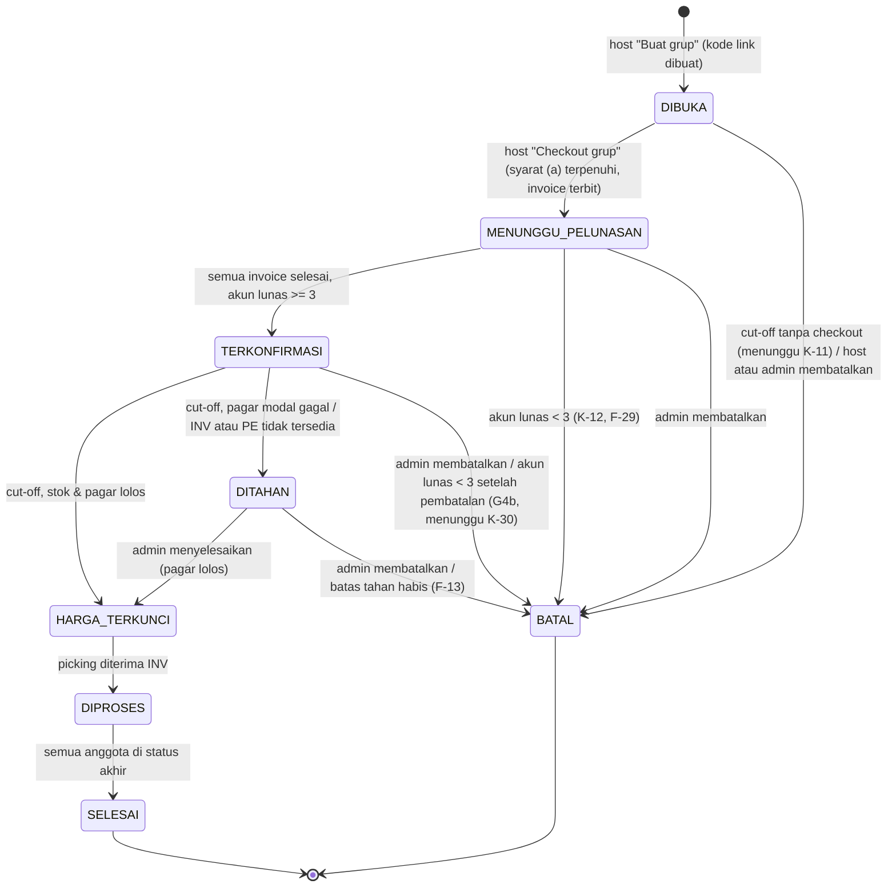
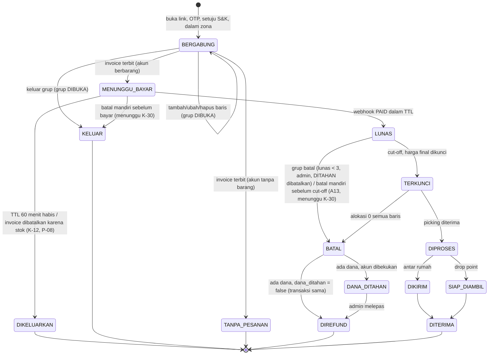

# Peta Flow Group Order — NEKAT Fase 1

| Atribut | Nilai |
|---|---|
| Task | T-002 (flow), disinkronkan T-047 (`task/T-047-sinkron-keputusan`) |
| Versi | 0.6 — Draf. **v0.6 (15 Nov 2026, T-047): ditulis ulang mengikuti `keputusan.md` §11–§13**: grup per keranjang campur produk (G-01), syarat 3 akun yang menambah barang (K-17) + total grup Rp100.000 (F-30), harga grup = harga Mitra Grosir (K-14), invoice TTL 60 menit sejak terbit (K-07), akun tak lunas dikeluarkan & grup batal bila lunas < 3 (K-12), host bayar = invoice disatukan (G-07, K-17), satu ledger saldo = loyalty point (K-13, G-06), snapshot saat invoice (K-15), ongkir di invoice setelah final (K-10). Model v0.5 (grup per produk × zona × slot, bayar harga satuan di muka, tier MOQ, `LANJUT_SATUAN`) **tidak berlaku lagi**; riwayat ada di git |
| Tanggal | 10 Nov 2026 (rev. 15 Nov 2026) |
| Penyusun | Workflow Architect (squad Produk & flow, pemilik: Randy) |
| Status | Draf, menunggu review + Reality Checker setelah T-022/T-023 dibangun |
| Sumber wajib | `project-specs/keputusan.md` (#2–#5, #8, #9, §11, §12, §13), `project-specs/keputusan-terbuka.md`, `docs/legal/syarat-ketentuan.md` §2, §4, §5, §7 |
| Diselaraskan dengan | `docs/adr/0001-tech-stack.md` (job, peta kunci §3.2, Xendit, UTC, TOTP admin H9), `docs/spec/engine-harga.md` v0.6 (harga, pagar, rumus kredit), `docs/spec/T-009-kontrak-inventory-source.md` v0.3 |
| Dipakai oleh | T-004, T-005, T-010, T-011, T-021, T-022, T-023, T-024, T-030, T-031, T-033, T-035, T-039, T-040, T-043 |

Dokumen ini menetapkan **perilaku wajib**, bukan cara implementasi. Tidak ada angka harga, margin, tarif ongkir, atau nilai biaya admin. Angka yang muncul hanya angka keputusan (3 akun, Rp100.000, 60 menit, Rp500.000 COD, 15 menit) dan semuanya dibaca dari konfigurasi. Hal yang belum diputuskan ditulis "**menunggu X**" dengan **DEFAULT SEMENTARA** (asumsi kerja, bukan keputusan); rangkuman di §12.

---

## 1. Definisi & istilah

| Istilah | Definisi |
|---|---|
| **Grup** | Satu **keranjang bersama** yang bisa berisi banyak produk (G-01). Dibuat oleh satu akun (**host**) untuk satu **zona** dan satu **slot kirim**. Boleh ada banyak grup untuk zona × slot yang sama. |
| **Host** | Akun pembuat grup. Hanya memilih cara bayar saat invoice (K-17) dan menekan "Checkout grup". Host dihitung ke syarat 3 akun **hanya bila** ia sendiri menambah barang. |
| **Anggota** | Satu akun dalam satu grup (unik per akun per grup). Punya 0..n **baris keranjang** dan satu cara kirim (antar rumah / ambil di drop point; keduanya boleh dalam satu grup, F-12). |
| **Baris keranjang** | Produk × satuan jual (1 pcs, 3 pcs, lusin, dus, koli — yang tersedia untuk produk itu, P-03) × qty. **Tidak memotong stok** (P-08). |
| **Akun berbarang** | Anggota dengan ≥ 1 baris keranjang qty > 0. Akun unik per nomor HP terverifikasi OTP (keputusan #3). |
| **Syarat grup** | (a) **≥ 3 akun berbarang** (keputusan #3, K-17) **dan** (b) **total grup ≥ Rp100.000** (F-30, nilai di konfigurasi `grup.min_total`). Dasar hitung total: **menunggu K-23** (DEFAULT SEMENTARA: Σ harga grup × qty semua baris, harga tampil termasuk PPN, sebelum diskon, tanpa biaya admin & ongkir). |
| **Harga grup** | Untuk setiap baris: **harga level Mitra Grosir** satuan jual itu, tanpa MOQ grosir, meskipun hanya 1 pcs (K-09, K-14, K-08). Satuan jual tanpa sel Mitra Grosir: **menunggu K-27** (DEFAULT SEMENTARA: baris itu memakai harga satuan dan diberi label "tidak dapat harga grup"). |
| **Harga satuan** | Harga level individu satuan jual itu (engine-harga §5). Dipakai bila syarat grup (a) terpenuhi tetapi (b) tidak (K-18), kecuali baris memenuhi MOQ grosir produk (P-05). |
| **Invoice barang** | Tagihan barang + biaya admin satu akun (mode `SENDIRI`) atau gabungan semua akun berbarang (mode `HOST`, K-17). Terbit saat checkout grup (§5 B-04). Batas bayar **60 menit sejak terbit** (F-26, K-07, `invoice.ttl_menit`). Metode: VA / QRIS (F-01) + saldo (G-03). |
| **Invoice ongkir** | Tagihan kedua yang memuat ongkir, terbit **setelah harga final dikunci** (K-10). Hanya untuk akun antar rumah; drop point = ongkir 0 (keputusan #4). |
| **Pembayar** | Akun yang melunasi invoice: anggota itu sendiri (`SENDIRI`) atau host (`HOST`). Semua kredit (selisih, refund, bayar terlambat) masuk ke **akun pembayar** (G-06b). |
| **Snapshot invoice** | Saat invoice barang terbit, tiap baris menyimpan harga per unit, jenis harga, modal, rincian PPN, dan `id_versi_harga` (K-15, P-08). Nilai ini tidak pernah berubah = **harga dibayar (D)**. |
| **Cut-off** | Waktu penutupan slot kirim. Harga final dikunci saat cut-off (CLAUDE.md). Semua grup di slot yang sama berbagi satu cut-off (A-01). |
| **Harga final (F)** | Harga per unit yang dikunci saat cut-off: `min(D, harga berlaku saat cut-off untuk jenis harga yang sama)` (engine-harga §5.4). Tidak pernah > D (PG-7, **DEFAULT SEMENTARA P-19**) dan selalu di atas modal (margin 0 ditolak, P-16); gagal pagar → grup **DITAHAN** (P-09, P-26). |
| **Kredit cut-off** | Selisih harga (`D − F` untuk unit teralokasi) + refund stok (unit tidak teralokasi), sebagai nilai bersih engine-harga §5.5, **dibatasi** agar nilai bersih ≥ modal (P-23); bagian yang ditahan tampil sebagai "biaya admin (penyesuaian pagar modal)". Satu entri ledger `selisih:{grup_id}:{anggota_id}` ke akun pembayar. |
| **Saldo (= loyalty point)** | **Satu ledger** per akun (K-13, G-06a): 1 poin = Rp1, tanpa pembulatan, **tanpa masa berlaku** (G-06c), tidak pernah negatif. Bisa dipakai sebagai metode bayar dan digabung dengan VA/QRIS (G-03). Bisa dicairkan (G-06d) — alur pencairan adalah workflow terpisah (§11 R-10), tinjauan hukum H5 disarankan sebelum dibuka. Istilah UI: "Poin NEKAT (1 poin = Rp1)". |
| **Biaya admin** | Flat Rupiah **per akun per grup** (G-05, K-06), dari konfigurasi `biaya_admin.per_akun_per_grup`; nilai **kosong** sampai diisi admin. DEFAULT SEMENTARA: kosong = tidak ada baris biaya admin (asumsi A-09). |
| **PPN** | Tarif & DPP dari konfigurasi, flag "bebas PPN" per produk, harga tampil sudah termasuk PPN, rincian PPN di checkout & nota (G-04). Rumus di engine-harga §3.5. |
| **Kunci idempotensi** | Ledger (`kunci_idempotensi UNIQUE`, ADR §5.2): `debit:{invoice_id}`, `saldo-balik:{invoice_id}`, `refund:{anggota_id}`, `selisih:{grup_id}:{anggota_id}`, `bayar_terlambat:{pembayaran_id}`, `refund_ongkir:{invoice_ongkir_id}`. Outbox: `picking:{grup_id}`, `wa:{template}:{ref_jenis}:{ref_id}:{akun_id}[:{periode_WIB}]`. Job: `cutoff:{slot_id}`, `ttl:{invoice_id}`. |
| **Outbox** | Hanya efek eksternal (WhatsApp, picking ke Gudang). **Ledger tidak pernah lewat outbox**: ditulis langsung di transaksi bisnisnya (ADR §3.3). |

### Asumsi dasar (bukan keputusan bisnis)

| # | Asumsi | Dasar | Risiko bila salah |
|---|---|---|---|
| A-01 | Cut-off per slot kirim (konfigurasi Operations) | fase-1-mvp fitur 5, T-006 | Job cut-off per grup |
| A-02 | Zona grup = zona host (alamat/drop point); anggota wajib di zona yang sama | keputusan #5 | Ongkir & harga lintas zona |
| A-03 | (Dipindah ke §12.1 sebagai **K-31**: COD di pesanan grup adalah keputusan bisnis, bukan asumsi) | — | — |
| A-04 | Invoice barang hanya bisa terbit bila `sekarang + TTL ≤ cut-off`, sehingga tidak ada invoice yang hidup melewati cut-off (pengganti A-05 v0.5) | K-07, S&K §5.3 | Pelunasan bertabrakan dengan kunci harga |
| A-06 | Waktu disimpan UTC (`timestamptz`), jadwal & tampilan WIB | ADR-0001 | Cut-off meleset 7 jam |
| A-07 | Reservasi stok milik NEKAT, dibuat **saat invoice terbit** (bukan saat masuk keranjang, P-08) di atas snapshot lokal `InventorySource` | ADR-0001, P-08 | Dobel-jual |
| A-08 | Semua transaksi grup/uang mengikuti peta kunci ADR §3.2: `grup` FOR UPDATE → stok SKU → anggota → invoice → `akun_saldo`; tidak ada HTTP keluar di dalam transaksi | ADR §3.2–3.3 | Deadlock, hitungan ganda |
| A-09 | Biaya admin kosong = 0 (tidak ditampilkan) | G-05 "nilai dikosongkan" | Tagihan kurang dari maksud pemilik |

---

## 2. Aktor & komponen

| Kode | Aktor / komponen | Peran |
|---|---|---|
| HOST | Akun pembuat grup | Buat grup, bagikan link, checkout grup, pilih cara bayar |
| USR | Anggota (termasuk host bila berbarang) | Gabung, isi keranjang, bayar, terima barang |
| FE | PWA | Halaman grup, keranjang, checkout; tidak menghitung harga |
| GE | Engine group order (T-022/T-023) | Status grup & anggota, syarat grup, penerbitan invoice, cut-off |
| PE | Engine harga (T-020, spek T-003) | Harga per satuan jual & level, PPN, pagar, kredit |
| PAY | Pembayaran + Xendit (T-029/T-030) | Invoice barang & ongkir, webhook, kedaluwarsa |
| SAL | Ledger saldo / loyalty point (T-021) | Debit pemakaian, kredit selisih/refund ke pembayar |
| INV | `InventorySource` (T-018/T-019) | Snapshot stok & modal, konfirmasi stok cut-off, picking |
| RSV | Modul reservasi NEKAT | Reservasi saat invoice terbit, lepas saat batal/kedaluwarsa |
| ONG | Adapter ongkir eksternal (T-031, K-05, P-12) | Ongkir jadi per pengiriman; engine harga hanya menerima angka |
| WA | Notifikasi WhatsApp (T-016, T-010) | Pesan ke pengguna |
| JOB | Penjadwal (T-010/T-040) | Cron tiap menit: TTL invoice, cut-off, rekonsiliasi |
| ADM | Admin (panel T-039, login OTP + **TOTP wajib**, H9) | Menyelesaikan grup DITAHAN, membatalkan grup, membekukan akun |

Prasyarat produk bisa masuk keranjang grup: tayang di zona (engine-harga §4 PG-5), bukan kategori terlarang (keputusan #7, P-24), stok snapshot > 0 untuk satuan itu. Tampilan produk stok habis: **menunggu K-20** (DEFAULT SEMENTARA = rekomendasi: tetap tampil dengan label "Stok habis, segera distok", tombol beli nonaktif, tidak bisa masuk keranjang/grup).

---

## 3. Mesin status grup

Atribut (bukan status): `host_akun_id`, `zona_id`, `slot_id`, `kode`, `cara_bayar` (`SENDIRI` / `HOST`, diisi saat checkout), `akun_berbarang`, `total_grup`, `syarat_grup_terpenuhi` (bool, dihitung ulang di dalam kunci), `jenis_harga_grup` (`GRUP` / `SATUAN`, diisi saat invoice terbit), `invoice_terbit_pada`, `alasan_batal` (`KURANG_AKUN_LUNAS` / `TIDAK_CHECKOUT_SAMPAI_CUTOFF` / `DIBATALKAN_HOST` / `DIBATALKAN_ADMIN` / `DITAHAN_KEDALUWARSA` / `STOK_HABIS`), `himpunan_lunas` (dicatat saat TERKONFIRMASI, diverifikasi saat kunci harga).

`BATAL` adalah status akhir yang tampil di riwayat sebagai **"batal"** (F-29). Dana yang sudah masuk selalu dikembalikan ke saldo pembayar di transaksi yang sama.

### 3.1 Tabel transisi grup

| # | Asal | Pemicu | Syarat (guard) | Aksi | Tujuan | Oleh |
|---|---|---|---|---|---|---|
| G1 | — | `BuatGrup` | Host login OTP + S&K versi terkini, dalam zona, slot punya cut-off > sekarang + TTL, akun tidak dibekukan | Buat grup + kode 6 karakter (unik), host jadi anggota pertama (belum berbarang) | DIBUKA | HOST |
| G2 | DIBUKA | `CheckoutGrup` | Hanya host; `akun_berbarang ≥ 3` (K-17); `sekarang + TTL ≤ cut-off` (A-04); cek stok cabang sukses (F-20, H14); data modal ≤ 15 menit (P-10) | Satu transaksi (§5 B-04): kunci keranjang, tentukan `jenis_harga_grup` (GRUP bila total ≥ Rp100.000, selain itu SATUAN, K-18), snapshot baris (K-15), reservasi stok (A-07), buat invoice barang (`SENDIRI`: per akun berbarang; `HOST`: satu gabungan, K-17), debit saldo sementara bila dipakai; setelah commit panggil Xendit, QR ke host (`HOST`) atau ke tiap akun (`SENDIRI`); outbox WA-04 | MENUNGGU_PELUNASAN | HOST |
| G3 | MENUNGGU_PELUNASAN | Invoice terakhir berstatus akhir (lunas / kedaluwarsa / dibatalkan) | Akun lunas ≥ 3 | Catat `himpunan_lunas`; anggota tak lunas sudah DIKELUARKAN (A3). Total lunas < Rp100.000 padahal `jenis_harga_grup = GRUP`: **menunggu K-24** (DEFAULT SEMENTARA: harga grup tetap, tidak ada tagihan tambahan) | TERKONFIRMASI | GE |
| G4 | MENUNGGU_PELUNASAN | sama dengan G3 | Akun lunas < 3 | Satu transaksi: semua anggota LUNAS → BATAL → DIREFUND (`refund:{anggota_id}` ke pembayar); lepas semua reservasi; `alasan_batal = KURANG_AKUN_LUNAS`; outbox WA-08 (K-12, F-29) | BATAL | GE |
| G4b | TERKONFIRMASI | Anggota lunas membatalkan (A13) / akun dibekukan | Akun lunas < 3 (dihitung ulang di dalam kunci) | Seperti G4 (`alasan_batal = KURANG_AKUN_LUNAS`) | BATAL | GE |
| G5 | TERKONFIRMASI | `CutOffTiba` → §6 | Stok terkonfirmasi, harga cut-off tersedia, pagar lolos untuk semua baris teralokasi > 0, `himpunan_lunas` tidak berubah | Satu transaksi: alokasi, harga final, kredit cut-off ke pembayar, outbox `picking:{grup_id}` + WA-07; lalu GE meminta ONG ongkir dan menerbitkan invoice ongkir (§5 B-08) | HARGA_TERKUNCI | JOB |
| G6 | TERKONFIRMASI | §6 gagal | Pagar modal gagal untuk baris mana pun dengan alokasi > 0 (P-09, P-26), atau INV/PE tidak tersedia setelah retry, atau data modal > 15 menit (P-10) | Tidak ada kredit/refund/picking; `GrupDitahan` + alert admin; WA-09 | DITAHAN | JOB |
| G7 | DITAHAN | Admin "Lanjutkan" | Guard G5 dijalankan ulang atas input terkoreksi; engine tidak punya override di bawah modal | Seperti G5 | HARGA_TERKUNCI | ADM |
| G8 | DITAHAN | Admin "Batalkan" / batas tahan habis (**menunggu F-13**, DEFAULT SEMENTARA: batas = sebelum picking slot) | Alasan wajib | Semua anggota BATAL → DIREFUND ke pembayar (kecuali `dana_ditahan`); lepas reservasi; WA-10 | BATAL | ADM / JOB |
| G9 | DIBUKA | `CutOffTiba` tanpa checkout | — | **Menunggu K-11.** DEFAULT SEMENTARA (= rekomendasi K-11: dibatalkan, dana ke saldo): grup BATAL `TIDAK_CHECKOUT_SAMPAI_CUTOFF`; tidak ada dana yang perlu dikembalikan karena belum ada invoice; WA-08b ke anggota berbarang | BATAL | JOB |
| G10 | DIBUKA | Host / admin "Batalkan grup" | Alasan wajib untuk admin | Tidak ada dana; WA-10 ke anggota berbarang | BATAL | HOST / ADM |
| G11 | MENUNGGU_PELUNASAN / TERKONFIRMASI | Admin "Batalkan grup" | Alasan wajib | Invoice terbuka dibatalkan (setelah commit, di luar transaksi), `saldo-balik:{invoice_id}`; anggota LUNAS → DIREFUND ke pembayar; lepas reservasi; PAID sesudahnya → A9; WA-10 | BATAL | ADM |
| G12 | HARGA_TERKUNCI | `PickingDiterima` | Total alokasi > 0 (bila 0, tanpa picking, langsung G13 setelah semua anggota akhir) | Anggota TERKUNCI → DIPROSES | DIPROSES | INV |
| G13 | DIPROSES | Anggota terakhir di status akhir | Semua ∈ {DITERIMA, DIREFUND, DIKELUARKAN, KELUAR, DANA_DITAHAN, BATAL tanpa dana} | Tutup grup; laporan harian | SELESAI | GE |

Aturan umum: status hanya maju lewat **update bersyarat** (`WHERE status = <asal>`) di dalam transaksi yang mengunci baris sesuai ADR §3.2. Syarat grup dihitung ulang dari data anggota di dalam kunci (bukan counter).

---

## 4. Mesin status anggota

Atribut anggota: `cara_kirim` (ANTAR / DROP_POINT), `id_alamat` / `id_drop_point`, `invoice_id`, `pembayar_akun_id`, `waktu_bayar` (= `paid_at` Xendit, F-11), `dana_ditahan`, `alasan_batal`. Atribut baris: `satuan_jual`, `qty_pesan`, `qty_teralokasi`, `harga_dibayar` (D, snapshot), `modal_snapshot`, `jenis_harga` (GRUP / SATUAN / GROSIR_MOQ), `ppn_snapshot`, `harga_final`, `potongan_baris`. Mode `HOST`: status bayar semua anggota berbarang mengikuti satu invoice host.

### 4.1 Tabel transisi anggota

| # | Asal | Pemicu | Guard | Aksi | Tujuan | Oleh |
|---|---|---|---|---|---|---|
| A1 | — | `Gabung` (link / buat grup) | `akun_id` dari sesi (§8.1); OTP; S&K terkini; zona = zona grup; grup DIBUKA; belum anggota; akun tidak dibekukan | Buat anggota | BERGABUNG | USR |
| A2 | BERGABUNG | Ubah keranjang / keluar | Grup DIBUKA (dicek di dalam kunci grup) | Simpan baris (tanpa reservasi stok, P-08; stok snapshot hanya informasi) / KELUAR. Host tidak bisa KELUAR; host membatalkan grup (G10) | BERGABUNG / KELUAR | USR |
| A3 | MENUNGGU_BAYAR | Job TTL `ttl:{invoice_id}` (sejak terbit + 60 menit) atau `PembayaranKedaluwarsa` | Belum LUNAS di dalam kunci | Satu transaksi: anggota (semua anggota invoice itu bila `HOST`) → DIKELUARKAN; lepas reservasi; `saldo-balik:{invoice_id}`; evaluasi G3/G4 bila ini invoice terakhir; outbox WA-03 (K-12) | DIKELUARKAN | JOB / PAY |
| A4 | MENUNGGU_BAYAR | Webhook PAID (dikonfirmasi GET Xendit) | Satu transaksi insert `webhook_event` + proses; di dalam kunci grup: anggota MENUNGGU_BAYAR, invoice tidak `dibatalkan`, debit saldo sementara masih aktif, nominal cocok, `waktu_bayar` ≤ terbit + TTL (F-11) | LUNAS; evaluasi G3/G4 bila invoice terakhir; outbox WA-02 | LUNAS | PAY |
| A5 | MENUNGGU_BAYAR | Stok habis sebelum lunas (INV menurunkan stok di bawah reservasi) | — | Invoice akun itu dibatalkan (P-08), sama seperti A3 dengan `alasan_batal = STOK_HABIS`; WA-03b menyebut barangnya. Batal seluruh invoice atau hanya baris: **menunggu K-29** (DEFAULT SEMENTARA: seluruh invoice akun itu, sesuai teks P-08) | DIKELUARKAN | GE |
| A6 | LUNAS | Grup → BATAL (G4/G8/G11) | — | Ledger `refund:{anggota_id}` ke pembayar langsung di transaksi yang sama, kecuali `dana_ditahan` → DANA_DITAHAN | BATAL → DIREFUND | GE / ADM |
| A7 | LUNAS | Cut-off G5/G7 | Dijamin guard G5 | Tulis `harga_final`, `qty_teralokasi` per baris; kredit cut-off ke pembayar | TERKUNCI | JOB |
| A8 | TERKUNCI | Semua baris alokasi 0 | — | Kredit cut-off = seluruh nilai bersih (refund stok); WA-11 | BATAL → DIREFUND | JOB |
| A9 | DIKELUARKAN / BATAL / grup ≥ TERKONFIRMASI | Webhook PAID terlambat | A4 tidak lolos | Ledger `bayar_terlambat:{pembayaran_id}` sebesar **seluruh** nominal ke pembayar (akun dibekukan → DANA_DITAHAN); tidak menghidupkan anggota, tidak menghitung ulang grup; WA-15 | (tetap) | PAY |
| A10 | BATAL / DIKELUARKAN | Akun dibekukan (B-13) dengan dana masuk | — | Tanpa kredit, `dana_ditahan = true`, tugas review admin | DANA_DITAHAN | ADM |
| A11 | DANA_DITAHAN | Admin melepas | Alasan tercatat di log admin (admin login TOTP, H9) | Ledger `refund:{anggota_id}` / `bayar_terlambat:{pembayaran_id}`; keputusan lain menunggu F-10 | DIREFUND | ADM |
| A13 | LUNAS | Anggota (atau host, mode `HOST`) "Batalkan" | Sebelum cut-off, grup ∈ {MENUNGGU_PELUNASAN, TERKONFIRMASI} (dicek di dalam kunci) — **DEFAULT SEMENTARA, menunggu K-30** | Satu transaksi (grup → stok SKU → anggota → invoice → akun_saldo): `refund:{anggota_id}` ke pembayar; lepas reservasi; hitung ulang akun lunas → G4/G4b bila < 3; WA-10. Dana refund masuk saldo dengan **masa tahan pencairan** (`dapat_dicairkan_sejak`, menunggu K-34) sehingga batal-setelah-bayar tidak menjadi jalur memindahkan dana QRIS/e-wallet curian ke rekening; saldo tetap bisa dipakai belanja | BATAL → DIREFUND | USR |
| A12 | DIPROSES → … → DITERIMA | Kurir / drop point | sesuai `cara_kirim` | WA-12/13/14 | DIKIRIM / SIAP_DIAMBIL / DITERIMA | ADM / kurir |

Pembatalan mandiri oleh anggota (**menunggu K-30**; DEFAULT SEMENTARA = default v0.5, selaras S&K §7.1): boleh **sebelum cut-off**.
- MENUNGGU_BAYAR → invoice dibatalkan (di luar transaksi, setelah commit), anggota KELUAR, lepas reservasi, `saldo-balik:{invoice_id}`; PAID sesudahnya → A9. Mode `HOST`: hanya host yang bisa membatalkan invoice gabungan (semua anggota invoice itu ikut keluar).
- LUNAS → **A13**: dana penuh ke saldo **pembayar** (`refund:{anggota_id}`, dengan `dapat_dicairkan_sejak` sesuai masa tahan K-34), lepas reservasi, syarat grup dihitung ulang; akun lunas < 3 → grup BATAL (G4 / G4b). Mode `HOST`: anggota non-host boleh membatalkan bagiannya; refund ke host.
- Setelah cut-off: tidak ada tombol batal; hanya CS untuk kesalahan NEKAT (S&K §7.2).
- Catatan risiko untuk K-30: satu akun lunas yang membatalkan bisa menjatuhkan grup di bawah 3 akun lunas dan membatalkan grup orang lain (pola griefing yang dimitigasi K-12).

---

## 5. Flow per cabang

Format: langkah bernomor; `⟂` = cabang gagal.

### B-01 Buat grup & bagikan link
1. HOST memilih zona (izin lokasi / manual) → "Belanja Bareng" → slot kirim berikutnya yang `cut_off > sekarang + TTL` (A-04) → cara kirim host → nama grup.
2. Belum login → B-03. ⟂ Di luar zona → B-12.
3. G1 → DIBUKA. Lembar bagikan: pesan siap kirim + link `{BASE_URL}/g/{kode}` (keputusan #3); urutan tombol WhatsApp, Salin link, lainnya.
4. Halaman grup menampilkan: syarat dalam satu kalimat "Minimal 3 akun menambah barang dan total belanja grup Rp100.000", progres akun berbarang (x/3), progres total (Rp… dari Rp100.000), jam cut-off & slot (tidak bisa diubah host).

### B-02 Gabung lewat link `/g/XXXXXX`
1. Aplikasi native terpasang → halaman grup; belum → halaman install lalu kembali ke grup yang sama (deferred deep link, Fase 5/H11); PWA → halaman grup di browser + ajakan "Tambah ke layar utama".
2. `resolveKode` dengan **rate limit per IP dan per akun** (anti enumerasi kode). ⟂ Kode tidak ada → "Link grup tidak ditemukan" tanpa info lain.
   Pengunjung **belum login** hanya melihat nama grup, jam tutup, dan jumlah akun; **tidak** melihat detail zona, drop point, atau daftar anggota. Detail tampil setelah login dan lokasi cocok.
3. Grup ≠ DIBUKA → "Grup ini sudah ditutup / sedang dibayar" + tombol "Buat grup baru". Anggota grup itu melihat status pesanannya.
4. Zona pengguna ≠ zona grup → B-12. Belum login → B-03.
5. A1 → BERGABUNG. Nama anggota lain tampil disamarkan ("Bu S***", Kebijakan Privasi §3); tanpa nomor HP/alamat. Parameter `ref` opsional harus opaque (F-22).

### B-03 Login OTP & persetujuan S&K
1. Niat (kode grup / buat grup) disimpan di sesi lokal → nomor HP → OTP WhatsApp (ADR §4.3: sekali pakai, kedaluwarsa, **batas percobaan salah per kode dan per nomor per hari yang tidak di-reset oleh kirim ulang** (CWE-307), rate limit kirim per nomor & per IP, anggaran biaya kirim global; respons tidak membedakan nomor terdaftar/belum). ⟂ WA mati → §7 M-05.
2. Akun dibekukan → "Akun tidak dapat ikut grup, hubungi CS".
3. S&K + Kebijakan Privasi versi terkini wajib dicentang; promo opsional. Versi berubah: **menunggu F-23** (DEFAULT SEMENTARA: persetujuan ulang wajib sebelum gabung berikutnya). ⟂ Tidak setuju → tidak bisa gabung; katalog tetap bisa dilihat.
4. Kembali ke niat; guard dicek ulang.

### B-04 Mengisi keranjang grup (grup DIBUKA)
1. Anggota menambah produk × satuan jual × qty. Tidak ada reservasi stok (P-08); qty > stok snapshot → peringatan "Stok tersisa N" (informasi, belum mengikat).
2. Tidak ada batas qty per akun (F-06).
3. Setiap baris menampilkan **perbandingan "Harga grup vs sendiri"** (K-18; tampilan harga Mitra Grosir sebagai "Harga Belanja Bareng" di kartu/detail **menunggu K-38**, P-28 vs K-14): harga grup (Mitra Grosir) dan harga satuan per satuan jual, dari `tampilanHarga` engine harga (harga kartu = detail = halaman grup, PG-6; promo tampil terpisah). Info harga Mitra drop point tidak tampil di kartu/detail (P-28); di halaman grup hanya sebagai harga grup yang berlaku untuk semua cara kirim.
4. Kalimat ajakan: "Kurang {n} akun lagi" (akun berbarang < 3); "Kurang Rp{x} lagi agar harga grup berlaku" (total < Rp100.000); keduanya terpenuhi → "Harga grup berlaku · checkout sebelum {jam}".
5. Anggota boleh mengubah/menghapus baris dan keluar grup selama DIBUKA (A2).
6. Pengingat ke host & anggota berbarang menjelang batas checkout (`cut_off − TTL`): WA-05, batas frekuensi **menunggu F-17**.

### B-05 Checkout grup & penerbitan invoice (G2)
Pemicu: **menunggu K-22** (DEFAULT SEMENTARA: host menekan "Checkout grup"; tombol aktif bila akun berbarang ≥ 3 dan `sekarang + TTL ≤ cut-off`; tidak ada penerbitan otomatis).
1. Host memilih **cara bayar** (G-07, K-17): "Masing-masing bayar" (`SENDIRI`, bawaan) atau "Saya bayar semua" (`HOST`). Syarat 3 akun tetap dihitung dari akun berbarang, bukan dari pembayar (K-17).
2. FE menampilkan ringkasan per akun: baris, harga per baris, jenis harga, potongan, rincian PPN, biaya admin per akun (K-06), catatan "Ongkir ditagih terpisah setelah harga final" (K-10).
3. Di luar transaksi: GE meminta INV cek stok cabang penerima (F-20) untuk semua baris. ⟂ Gudang tak terjangkau → **tahan checkout** (H14, T-009 §6): "Stok sedang dicek, coba lagi sebentar", tidak ada invoice. ⟂ Data modal > 15 menit (P-10) → sama.
4. ⟂ Stok kurang untuk baris tertentu → checkout ditolak dengan daftar baris kurang; anggota terkait diberi tahu (WA-03b) dan host bisa mencoba lagi setelah keranjang disesuaikan (P-08: barang di keranjang tidak memotong stok).
5. Satu transaksi (kunci grup → stok SKU → anggota → invoice → akun_saldo), guard G2 dicek ulang di dalam kunci:
   1. Kunci keranjang (grup → MENUNGGU_PELUNASAN). Anggota tanpa barang → TANPA_PESANAN.
   2. `jenis_harga_grup` = GRUP bila total grup ≥ Rp100.000 (dasar hitung K-23), selain itu SATUAN (K-18). Baris yang memenuhi MOQ grosir produk tetap mendapat harga Mitra Grosir walau SATUAN (P-05).
   3. PE `hargaInvoice` per baris → snapshot D, modal, PPN, `id_versi_harga` (K-15). Pagar PG-1/PG-2 dan batas bawah promo (engine-harga §4) dicek; satu diskon per invoice, tidak menumpuk (P-15; arti "keseluruhan" **menunggu K-21**).
   4. Reservasi stok per baris (A-07).
   5. Invoice barang: `SENDIRI` → satu per akun berbarang; `HOST` → satu gabungan atas nama host berisi semua akun (K-17); rincian per anggota di invoice/QR/nota host hanya memakai **nama samaran**, tanpa alamat atau nomor HP anggota (CWE-359). Biaya admin = biaya per akun × jumlah akun yang ditagih. Pemakaian saldo pembayar: debit sementara `debit:{invoice_id}` (G-03).
   6. Anggota berbarang → MENUNGGU_BAYAR; `invoice_terbit_pada` = sekarang; job `ttl:{invoice_id}` dijadwalkan terbit + 60 menit (K-07).
6. Setelah commit: PAY membuat invoice Xendit (`external_id` = `pembayaran_id`, kedaluwarsa = terbit + 60 menit). `HOST`: QR/VA dikirim ke host (K-17); `SENDIRI`: ke tiap akun. Timeout Xendit → cek ulang dengan `external_id` sama (M-06). Saldo menutup seluruh tagihan → langsung LUNAS tanpa Xendit.
7. WA-04 ke semua anggota berbarang: "Grup {nama} checkout · bayar sebelum {jam}" (`HOST`: anggota non-host diberi tahu bahwa host yang membayar).

### B-06 Pelunasan 60 menit (K-07, K-12, F-29)
1. FE menampilkan hitung mundur per invoice dan status bayar anggota lain (lunas / belum, nama disamarkan). WA-03a pengingat sebelum habis (F-17).
2. PAID dalam TTL → A4 LUNAS.
3. TTL habis → A3: akun **dikeluarkan otomatis**, reservasinya dilepas, debit saldo sementara dikembalikan. Mode `HOST`: invoice host tidak lunas → semua akun dikeluarkan → G4.
4. Semua invoice berstatus akhir → G3 (lunas ≥ 3 → TERKONFIRMASI) atau G4 (lunas < 3 → **BATAL**, tercatat "batal", dana yang sudah masuk → saldo pembayar).
5. Status anggota lain tidak menunggu yang belum bayar lebih dari TTL, sehingga satu akun yang sengaja tidak membayar hanya mengeluarkan dirinya; grup hanya batal bila sisa lunas < 3 (mitigasi griefing K-12).

### B-07 Cut-off & kunci harga (G5/G6) → §6
1. Per grup TERKONFIRMASI: konfirmasi stok, alokasi, harga final, pagar, kredit — §6.
2. Harga final per baris `F = min(D, harga berlaku saat cut-off untuk jenis harga yang sama)`; harga tidak pernah naik (PG-7). Bila harga cut-off > D tetapi ≥ modal: anggota tidak ditagih tambahan — **menunggu P-19** (DEFAULT SEMENTARA: NEKAT menanggung, tanpa tagihan).
3. Modal saat cut-off > D, atau nilai bersih setelah promo < modal → **DITAHAN** untuk admin (P-09, P-26). Tidak pernah dikirim di bawah modal.
4. Kredit cut-off > 0 → satu entri `selisih:{grup_id}:{anggota_id}` ke **akun pembayar** (host bila `HOST`, G-06b), dibatasi pagar modal (P-23). WA-07: "Harga final dikunci · {n} poin masuk ke Poin NEKAT {pembayar}".

### B-08 Invoice ongkir setelah final (K-10, K-05, P-12, P-27)
1. Setelah HARGA_TERKUNCI, GE meminta ONG ongkir jadi per pengiriman (akun antar rumah). Drop point → ongkir 0, tidak ada invoice ongkir.
2. PE mengevaluasi gratis ongkir: minimal belanja dihitung **sesudah diskon** (P-13); subsidi dialokasikan ke baris (**menunggu P-20**, DEFAULT SEMENTARA: proporsional nilai bersih); pagar batas bawah promo per baris (K-16).
3. ⟂ Gratis ongkir gagal pagar → pesanan **tidak dibatalkan** (P-27): tampilkan "Gratis ongkir tidak memenuhi syarat", alasannya, dan jalan keluar yang bisa dipilih (mis. ambil di drop point = ongkir 0, atau bayar ongkir normal).
4. Invoice ongkir terbit sebagai **tagihan kedua** (mode bayar sama dengan invoice barang; `HOST` → ke host, rincian per anggota hanya nama samaran tanpa alamat/HP, CWE-359), TTL 60 menit (F-26), bisa dipotong saldo.
5. ⟂ Invoice ongkir tidak lunas dalam TTL: **menunggu K-25** (DEFAULT SEMENTARA: pengiriman akun itu dialihkan ke ambil di drop point zona, ongkir 0, WA-13b; barang tetap disiapkan). Tidak memengaruhi status grup atau harga anggota lain.
6. Picking (`picking:{grup_id}`) tidak menunggu invoice ongkir; hanya cara kirim per akun yang bisa berubah.

### B-09 Stok kurang saat cut-off (alokasi parsial, F-09)
1. §6 langkah 2: INV mengonfirmasi stok untuk total qty baris lunas.
2. Stok kurang → alokasi per `waktu_bayar` paling awal, unit utuh (F-09, mengikuti default v0.5 yang disetujui). Harga tidak dinaikkan karena alokasi; grup tetap terkunci walau penerima < 3.
3. Unit tak teralokasi = refund stok, masuk kredit cut-off pembayar; WA-11 "Maaf, {n} dari {qty} {satuan} tidak tersedia · {poin} poin masuk".
4. Semua baris akun alokasi 0 → A8.

### B-10 Refund & kredit (semua jalur)
1. Sumber: grup BATAL (G4/G8/G11), alokasi 0/parsial (kredit cut-off), PAID terlambat (A9), ongkir (`refund_ongkir:{invoice_ongkir_id}` bila pengiriman batal setelah ongkir dibayar), keluhan barang (**menunggu F-24**).
2. Tujuan: **selalu saldo** (= loyalty point) **akun pembayar** (K-13, G-03, G-06b). Tidak ada refund ke metode asal; pencairan saldo adalah workflow terpisah (G-06d, H5).
3. Nominal = nilai bersih yang benar-benar dibayar untuk baris itu (engine-harga §5.5). Biaya admin akun ikut dikembalikan bila grup batal sebelum kunci harga (**menunggu K-26**, DEFAULT SEMENTARA: ya).
4. Ledger ditulis **langsung** di transaksi yang mengubah status; entri ganda ditolak constraint unik dan dianggap sukses. Gagal tulis ledger = rollback seluruh transaksi.
5. Akun pembayar dibekukan → tidak ada kredit; DANA_DITAHAN sampai admin memutuskan (F-10).

### B-11 Webhook ganda / tidak berurutan
1. Verifikasi callback token dengan **perbandingan constant-time**. ⟂ Token salah → 401, tidak ada efek, log keamanan.
2. PAID dikonfirmasi lewat GET status ke Xendit **sebelum** transaksi dibuka (ADR §4.2). ⟂ GET gagal → 5xx agar Xendit mengulang.
3. Satu transaksi: insert `webhook_event` (`UNIQUE(gateway, external_id, status)`) + proses. Duplikat → 200 tanpa efek. Error lain → rollback + 5xx (tidak ada event "tercatat tapi tidak diproses").
4. PAID untuk yang sudah LUNAS → no-op. EXPIRED setelah PAID → diabaikan. PAID tak dikenal → "yatim" + alert. Nominal ≠ invoice → tetap MENUNGGU_BAYAR + alert.

### B-12 Pengguna di luar zona
1. Di luar semua zona → "Maaf, NEKAT belum melayani lokasimu" (daftar tunggu **menunggu F-18**); katalog boleh dilihat.
2. Zona berbeda dari grup di link → tidak bisa gabung; tawarkan "Buat grup di zonamu" (**menunggu F-19**).
3. Zona ditentukan alamat kirim / drop point milik akun sesi; ganti alamat setelah invoice: **menunggu F-25** (DEFAULT SEMENTARA: tidak bisa; dalam zona sama sebelum checkout boleh).

### B-13 Akun ganda / curang
1. ADM (login TOTP, H9) membekukan akun dengan alasan tercatat.
2. Grup DIBUKA → anggota dikeluarkan dari hitungan. MENUNGGU_PELUNASAN / TERKONFIRMASI sebelum kunci harga → anggota BATAL → DANA_DITAHAN, syarat grup dihitung ulang (bisa memicu G4). Saat kunci harga, `himpunan_lunas` berubah → transaksi diulang dari evaluasi.
3. Setelah HARGA_TERKUNCI → hanya flag `dana_ditahan` yang menahan kredit; status pengiriman tidak berubah (**menunggu F-10**, DEFAULT SEMENTARA: barang tetap dikirim).
4. Deteksi bantuan admin (bukan pembekuan otomatis): ≥ 2 akun berbarang berbagi alamat persis, drop point + nama penerima, sidik perangkat, atau sumber dana yang sama → tugas review.

### B-14 Perubahan modal saat grup berjalan
1. Grup DIBUKA: harga tampil mengikuti tabel harga terkini (live); tidak ada yang mengikat sebelum invoice (K-15).
2. Setelah invoice terbit: D dan modal snapshot per baris tidak berubah (K-15).
3. Saat cut-off: pagar memakai **modal terkini** (data ≤ 15 menit, P-10); modal terkini > D → DITAHAN (P-09). Timpaan modal admin (P-25, K-03) ikut sebagai modal terkini.
4. Penurunan modal dari Gudang hanya dicatat di log admin (K-02).

### B-15 Pembayaran memakai saldo (loyalty point)
1. Saldo pembayar ≥ tagihan → LUNAS tanpa Xendit (`debit:{invoice_id}`).
2. Saldo < tagihan → debit sementara + invoice Xendit untuk sisa (G-03). Kedaluwarsa/batal → `saldo-balik:{invoice_id}`.
3. Mode `HOST`: hanya saldo host yang bisa dipakai.

---

## 6. Prosedur job cut-off (per slot)

Pemicu: cron tiap menit untuk slot dengan `cut_off ≤ sekarang` yang `job_run(cutoff, slot_id)` belum SELESAI (lease + heartbeat, ADR §3.3). Panggilan INV/PE/ONG di luar transaksi. Ledger langsung di transaksi; outbox hanya WA & picking.

| Langkah | Aksi | Gagal → |
|---|---|---|
| 1 | Grup DIBUKA di slot ini → G9 (DEFAULT SEMENTARA K-11). Grup MENUNGGU_PELUNASAN seharusnya tidak ada (A-04); bila ada (anomali) → tunggu invoice berstatus akhir lalu lanjut G3/G4 + alert | DB gagal → retry |
| 2 | Per grup TERKONFIRMASI: INV `konfirmasiStok` untuk total qty baris lunas per SKU di cabang penerima | Retry backoff; habis → G6 DITAHAN |
| 3 | Alokasi FIFO `waktu_bayar` (B-09) | — |
| 4 | PE: harga berlaku saat cut-off per baris (jenis harga sama dengan snapshot) dengan modal terkini; data modal > 15 menit → tidak tersedia | Retry; habis → G6 |
| 5 | PE `hitungHargaFinal` per baris alokasi > 0: F, nilai bersih, syarat lolos (engine-harga §5.4) | Ada baris gagal → G6 DITAHAN |
| 6 | **Satu transaksi**: kunci grup `WHERE status = 'TERKONFIRMASI'` → stok SKU → anggota → invoice → akun_saldo; verifikasi `himpunan_lunas` sama (beda → rollback, ulang langkah 2). Tulis F, `qty_teralokasi`, anggota TERKUNCI / A8, ledger kredit cut-off ke pembayar, status HARGA_TERKUNCI, outbox WA-07/WA-11 + `picking:{grup_id}` (bila total alokasi > 0) | Rollback; ulang |
| 7 | Setelah commit: B-08 (ongkir & invoice ongkir) | Adapter ONG gagal → retry; habis → alert admin, picking tetap jalan |
| 8 | Laporan job: jumlah grup per hasil (HARGA_TERKUNCI / DITAHAN / BATAL) | — |

---

## 7. Mode gagal & pemulihan

| # | Mode gagal | Deteksi | Pemulihan | Idempotensi |
|---|---|---|---|---|
| M-01 | Job cut-off/TTL tidak jalan | Cron menemukan `job_run` belum SELESAI / `ttl` lewat | API checkout & ubah keranjang **sendiri** menolak setelah batas waktu; cron berikutnya menjalankan; alert DevOps | `cutoff:{slot_id}`, `ttl:{invoice_id}` + update bersyarat |
| M-02 | Job mati di tengah | Lease habis | Run berikutnya mengambil alih; grup dengan status > TERKONFIRMASI dilewati | Status sebagai checkpoint + kunci ledger unik |
| M-03 | INV/Gudang tidak tersedia | Timeout/5xx; umur snapshot | Checkout grup **ditahan** (H14); cut-off → DITAHAN; picking di-outbox & diulang | `picking:{grup_id}` |
| M-04 | Adapter ongkir tidak tersedia | Timeout/5xx | Invoice ongkir diulang; harga & picking tidak terpengaruh; alert admin setelah retry habis | `ongkir:{grup_id}:{anggota_id}` |
| M-05 | WhatsApp tidak tersedia | Error adapter | OTP: coba lagi; notifikasi antre di outbox; status aplikasi = sumber kebenaran | `wa:…` |
| M-06 | Xendit timeout saat invoice | Timeout/5xx | Cek ulang dengan `external_id` sama; akun dikeluarkan hanya bila invoice terbukti tidak ada **dan** TTL habis | `external_id` = `pembayaran_id` |
| M-07 | Webhook tidak datang | Invoice mendekati TTL | Rekonsiliasi menanyakan status ke Xendit sebelum A3 | Sama dengan B-11 |
| M-08 | PE gagal | Error | Produk tidak tayang; checkout ditolak; cut-off → DITAHAN | — |
| M-09 | Balapan PAID vs TTL vs pembekuan akun | — | Semua jalur mengunci grup FOR UPDATE dulu; syarat grup dihitung ulang dari data anggota di dalam kunci; A4 hanya lolos bila `waktu_bayar` ≤ terbit + TTL | Update bersyarat |
| M-10 | Tabrakan kode link | Constraint unik | Bangkitkan ulang | Constraint unik |

---

## 8. Kontrak handoff antar komponen

Semua event membawa `id_event`, `waktu` (ISO-8601 dengan offset), `versi_skema`, `kunci_idempotensi`. Penamaan id: `grup_id`, `anggota_id`, `baris_id`, `slot_id`, `invoice_id`, `pembayaran_id`, `akun_id`.

| Arah | Panggilan | Data minimal | Sukses | Gagal |
|---|---|---|---|---|
| FE → GE | `POST grup` | slot_id, cara_kirim, id_alamat? / id_drop_point?, nama — **tanpa** id_akun/id_zona | grup_id, kode, link | 403 `LUAR_ZONA`, 403 `BELUM_SETUJU_SK`, 403 `AKUN_DIBEKUKAN`, 409 `SLOT_TERLALU_DEKAT_CUTOFF` |
| FE → GE | `GET grup/{kode}` | kode | status, slot, cut_off, akun_berbarang, total_grup, syarat_grup_terpenuhi, anggota (nama samaran + status bayar), keranjang milik akun sesi | 404 `GRUP_TIDAK_DITEMUKAN` |
| FE → GE | `POST grup/{kode}/gabung` | cara_kirim, id_alamat? / id_drop_point?, ref? | anggota_id | 409 `SUDAH_ANGGOTA`, 409 `GRUP_TUTUP`, 403 `LUAR_ZONA` |
| FE → GE | `PUT grup/{kode}/keranjang` | daftar (id_satuan_jual, qty) | ringkasan + perbandingan grup vs sendiri | 409 `GRUP_TUTUP`, 422 `PRODUK_TIDAK_TAYANG` |
| FE → GE | `POST grup/{kode}/checkout` (host saja) | cara_bayar (`SENDIRI`/`HOST`), pakai_saldo | daftar invoice (id, nominal, kedaluwarsa) | 403 `BUKAN_HOST`, 409 `KURANG_AKUN` (+ kurang n), 409 `MELEWATI_BATAS_CHECKOUT`, 422 `STOK_KURANG` (+ baris), 503 `STOK_SEDANG_DICEK` (H14) |
| GE → PE | `hargaInvoice` / `hitungRingkasanInvoice` | baris (satuan jual, qty), jenis_harga_grup, konfigurasi PPN & biaya admin | D, modal, PPN, potongan, total per akun | `HARGA_TIDAK_TERSEDIA`, `DI_BAWAH_MODAL` |
| GE → RSV | `reservasi` / `lepas` | invoice_id, baris, qty | id_reservasi | `STOK_KURANG`, `SNAPSHOT_KEDALUWARSA` |
| GE → INV | `konfirmasiStok` (cut-off) | grup_id, sku, lokasi, qty | qty_tersedia | retryable |
| GE → INV | `kirimPermintaanPicking` | grup_id, slot, baris (anggota_id, sku, qty_teralokasi, cara_kirim, drop_point) — tanpa data pribadi | id_picking | retryable, `picking:{grup_id}` |
| GE → ONG | `hitungOngkir` | grup_id, anggota_id, berat, alamat → jarak (zona) | ongkir (Rupiah jadi) | retryable (M-04) |
| GE → PAY | `buatInvoice` | pembayaran_id (= `external_id`), invoice_id, nominal, metode (VA/QRIS), kedaluwarsa = terbit + TTL, penerima QR (host / akun) | id_invoice, instruksi | timeout → cek ulang (M-06) |
| PAY → GE | `PembayaranLunas` / `PembayaranKedaluwarsa` | pembayaran_id, invoice_id, nominal, waktu_bayar | — | — |
| GE → SAL (dalam transaksi) | `kredit` | akun pembayar, nominal, jenis (SELISIH_HARGA / REFUND / BAYAR_TERLAMBAT / REFUND_ONGKIR), rincian, referensi, kunci | id_entri, saldo_baru | `DUPLIKAT` = sukses; error → rollback |
| GE → SAL (dalam transaksi) | `debit` / `batalkanDebit` | akun pembayar, nominal, `debit:{invoice_id}` / `saldo-balik:{invoice_id}` | id_entri | `SALDO_KURANG` → rollback |

### 8.1 Aturan kepercayaan input (wajib)
- `akun_id` **selalu** dari sesi; `id_akun` di body diabaikan/400 (CWE-639). Saldo yang didebit selalu saldo akun sesi (host pada mode `HOST`).
- Zona diturunkan server: `id_alamat` **harus milik akun sesi**; `id_drop_point` harus ada, **aktif**, dan berada di **zona grup** → selain itu 403 `LUAR_ZONA` / 422.
- Dokumen untuk host (invoice gabungan, invoice ongkir, nota) hanya memuat nama samaran anggota, tanpa alamat/nomor HP (CWE-359).
- Harga, diskon, PPN, biaya admin, ongkir, nominal tidak pernah dari klien.
- Hanya host yang bisa checkout & memilih cara bayar; anggota hanya bisa mengubah baris miliknya. Akses lintas akun/grup → 404. Tes API (T-044) **wajib** mencoba akses lintas akun dan lintas grup dan memastikan ditolak (CWE-639).

---

## 9. Status terlihat pengguna & notifikasi WhatsApp

### 9.1 Teks UI per status

| Status | Teks UI singkat |
|---|---|
| Grup DIBUKA, syarat belum | "{x} dari 3 akun · total Rp{t} dari Rp100.000 · checkout sebelum {jam}" |
| Grup DIBUKA, ≥ 3 akun, total < Rp100.000 | "Kurang Rp{x} lagi agar harga grup berlaku · kini harga satuan" + perbandingan grup vs sendiri (K-18) |
| Grup DIBUKA, syarat terpenuhi | "Harga grup berlaku · tunggu host checkout" |
| MENUNGGU_PELUNASAN | "Bayar sebelum {jam} · {n} dari {m} akun sudah lunas" (`HOST`: "Dibayar oleh host") |
| TERKONFIRMASI | "Grup lunas · harga final dikunci {jam cut-off}" |
| DITAHAN | "Pesanan sedang kami periksa, kabar paling lambat {waktu}" |
| HARGA_TERKUNCI | "Harga final dikunci · {poin} poin masuk" (+ "{a} dari {q} tersedia" bila parsial) |
| BATAL | "Batal · {alasan singkat}" (+ "Rp{n} masuk Poin NEKAT" bila ada dana) |
| Anggota DIKELUARKAN | "Kamu dikeluarkan karena belum bayar dalam 60 menit" |
| Anggota DANA_DITAHAN | "Dana sedang ditinjau, hubungi CS" |
| Invoice ongkir | "Ongkir Rp{o} · bayar sebelum {jam}" / "Gratis ongkir tidak memenuhi syarat: {alasan} · {jalan keluar}" (P-27) |
| DIKIRIM / SIAP_DIAMBIL / DITERIMA | "Sedang diantar" / "Siap diambil di {drop point}" / "Pesanan diterima" |

### 9.2 Notifikasi WhatsApp

Template final & batas frekuensi di T-010 (**menunggu F-17**).

| Kode | Transisi | Penerima | Isi ringkas |
|---|---|---|---|
| WA-01 | OTP | pemohon | Kode OTP |
| WA-02 | A4 | pembayar (+ anggota bila `HOST`) | "Pembayaran grup {nama} diterima" |
| WA-03a / WA-03 / WA-03b | pengingat TTL / A3 / A5 | akun invoice | "Bayar sebelum {jam}" / "Kamu dikeluarkan dari grup karena belum bayar" / "Stok {barang} habis, invoice dibatalkan" |
| WA-04 | G2 | anggota berbarang | "Grup {nama} checkout · bayar sebelum {jam}" |
| WA-05 | menjelang batas checkout | host + anggota berbarang | "Kurang {n} akun / Rp{x} · checkout sebelum {jam}" |
| WA-07 | G5/G7 | pembayar | "Harga final dikunci · {poin} poin masuk" |
| WA-08 / WA-08b | G4 / G9 | anggota | "Grup batal karena kurang dari 3 akun lunas · Rp{n} masuk Poin NEKAT" / "Grup batal karena tidak checkout sebelum {jam}" |
| WA-09 | G6 | anggota | "Pesanan sedang kami periksa" |
| WA-10 | G8/G10/G11 | anggota | "Grup dibatalkan · Rp{n} masuk Poin NEKAT" |
| WA-11 | B-09 / A8 | pembayar + anggota | "{n} dari {q} tidak tersedia · {poin} poin masuk" |
| WA-12/13/13b/14 | pengiriman | anggota | Diantar / siap diambil / dialihkan ke drop point (K-25) / diterima |
| WA-15 | A9 | pembayar | "Pembayaran masuk setelah batas waktu · Rp{n} masuk Poin NEKAT" |

Pesan promo hanya untuk akun yang mencentang persetujuan promo.

---

## 10. Kasus uji

Data uji tanpa harga asli: pakai nilai simbolik (`Hg` = harga grup/Mitra Grosir, `Hs` = harga satuan, `M` = modal, `Ba` = biaya admin) dari fixture T-011. `t0` = cut-off, `tI` = waktu invoice terbit.

| ID | Langkah | Hasil yang diharapkan |
|---|---|---|
| TC-GO-01 | Host membuat grup | DIBUKA, kode 6 karakter unik, host anggota tanpa barang |
| TC-GO-02 | Host + 2 akun menambah barang (3 akun berbarang), total ≥ Rp100.000, host checkout `SENDIRI` | MENUNGGU_PELUNASAN; 3 invoice; tiap baris D = `Hg`; tiap invoice memuat satu `Ba` |
| TC-GO-03 | Sama, host hanya membayar (tidak menambah barang), 2 akun berbarang | Checkout ditolak `KURANG_AKUN` (K-17) |
| TC-GO-04 | 3 akun berbarang, total < Rp100.000, checkout | `jenis_harga_grup = SATUAN`; D = `Hs`; halaman menampilkan perbandingan `Hg` vs `Hs` (K-18) |
| TC-GO-05 | TC-GO-04 dengan satu baris memenuhi MOQ grosir produk | Baris itu D = `Hg` (P-05); baris lain `Hs` |
| TC-GO-06 | Satu nomor HP mencoba gabung dua kali | Kedua ditolak `SUDAH_ANGGOTA`; dihitung 1 akun |
| TC-GO-07 | Host checkout `HOST` untuk 4 akun berbarang | Satu invoice gabungan atas nama host, berisi 4 × `Ba`; QR/VA hanya ke host (K-17) |
| TC-GO-08 | Invoice terbit `tI`; akun A lunas `tI + 59 menit`; akun B belum bayar | A LUNAS; B DIKELUARKAN pada `tI + 60 menit` (K-07, K-12) |
| TC-GO-09 | 4 akun, 1 tidak lunas | Akun itu DIKELUARKAN; 3 lunas → TERKONFIRMASI |
| TC-GO-10 | 3 akun, 1 tidak lunas | Grup BATAL `KURANG_AKUN_LUNAS`; 2 akun lunas DIREFUND penuh ke saldo masing-masing; riwayat "batal" (F-29) |
| TC-GO-11 | Mode `HOST`, host tidak bayar 60 menit | Semua akun DIKELUARKAN; grup BATAL; tidak ada kredit; bila host memakai saldo, debit sementara dikembalikan tepat sekali (`saldo-balik:{invoice_id}`) |
| TC-GO-12 | Mode `HOST`, lunas, cut-off, harga turun | Kredit cut-off semua akun masuk ke **saldo host** (G-06b) |
| TC-GO-13 | Tiap akun bayar sebagian dengan saldo + QRIS | `debit:{invoice_id}` + invoice sisa; kedaluwarsa → `saldo-balik:{invoice_id}` |
| TC-GO-14 | Saldo menutup seluruh tagihan | LUNAS tanpa Xendit |
| TC-GO-15 | PAID dengan `waktu_bayar` > `tI + 60` | A9: seluruh nominal ke saldo pembayar, `bayar_terlambat:{pembayaran_id}`; anggota tetap DIKELUARKAN |
| TC-GO-16 | 4 akun lunas sisa 3 akun dengan total lunas < Rp100.000 | DEFAULT SEMENTARA K-24: TERKONFIRMASI, harga grup tetap, tidak ada tagihan tambahan |
| TC-GO-17 | Barang hanya di keranjang, stok snapshot turun ke 0 | Tidak ada efek ke grup sebelum checkout (P-08); peringatan stok di keranjang |
| TC-GO-18 | Checkout, stok kurang untuk satu baris | 422 `STOK_KURANG` + daftar baris; tidak ada invoice |
| TC-GO-19 | Setelah invoice terbit, stok Gudang turun di bawah reservasi akun A sebelum A bayar | Invoice A dibatalkan (P-08), A DIKELUARKAN `STOK_HABIS`, WA-03b; grup dievaluasi |
| TC-GO-20 | Gudang tak terjangkau saat checkout | 503 `STOK_SEDANG_DICEK`; tidak ada invoice (H14) |
| TC-GO-21 | Data modal berumur > 15 menit saat checkout | Checkout ditahan (P-10) |
| TC-GO-22 | Snapshot invoice: modal & margin diubah admin setelah invoice terbit | D dan modal snapshot baris tidak berubah (K-15) |
| TC-GO-23 | Cut-off, harga berlaku turun di bawah D (masih ≥ modal) | F = harga cut-off; kredit = (D − F) × a ke pembayar |
| TC-GO-24 | Cut-off, modal terkini > D | Grup DITAHAN; tidak ada kredit/picking; WA-09 (P-09) |
| TC-GO-25 | Cut-off, D ≥ modal tetapi nilai bersih setelah diskon < modal | DITAHAN (P-26) |
| TC-GO-26 | Cut-off, harga turun dan baris memakai diskon | Kredit dibatasi agar bersih ≥ modal; selisih yang ditahan tampil "biaya admin (penyesuaian pagar modal)" (P-23) |
| TC-GO-27 | Admin menyelesaikan grup DITAHAN setelah modal dikoreksi | HARGA_TERKUNCI; pagar dijalankan ulang; tidak ada override di bawah modal |
| TC-GO-28 | Grup DITAHAN melewati batas tahan | BATAL; semua lunas DIREFUND ke pembayar (DEFAULT SEMENTARA F-13) |
| TC-GO-29 | Stok cut-off kurang: A lunas lebih dulu | Alokasi FIFO `waktu_bayar`; sisa → refund stok di kredit cut-off; WA-11 |
| TC-GO-30 | Semua baris akun alokasi 0 | Akun BATAL → DIREFUND nilai bersih; grup tetap HARGA_TERKUNCI |
| TC-GO-31 | Job cut-off dijalankan dua kali | Tidak ada ledger/WA/picking ganda |
| TC-GO-32 | Grup DIBUKA tanpa checkout sampai cut-off | BATAL `TIDAK_CHECKOUT_SAMPAI_CUTOFF` (DEFAULT SEMENTARA K-11); tidak ada ledger |
| TC-GO-33 | Checkout pada `cut_off − TTL + 1 menit` | 409 `MELEWATI_BATAS_CHECKOUT` (A-04) |
| TC-GO-34 | Setelah HARGA_TERKUNCI, akun antar rumah | Invoice ongkir terbit terpisah, TTL 60 menit (K-10); akun drop point tanpa invoice ongkir |
| TC-GO-35 | Gratis ongkir: minimal belanja dibanding nilai sesudah diskon | Berlaku/tidak sesuai nilai sesudah diskon (P-13) |
| TC-GO-36 | Gratis ongkir gagal batas bawah modal × faktor (K-16) | Pesanan lanjut; teks "tidak memenuhi syarat" + alasan + jalan keluar; ongkir normal ditagih (P-27) |
| TC-GO-37 | Invoice ongkir tidak lunas 60 menit | DEFAULT SEMENTARA K-25: dialihkan ke drop point, WA-13b; harga & anggota lain tidak berubah |
| TC-GO-38 | Dua diskon berlaku untuk satu invoice | Hanya satu diskon dipakai (P-15) |
| TC-GO-39 | Biaya admin konfigurasi kosong | Tidak ada baris biaya admin (A-09) |
| TC-GO-40 | Produk bebas PPN dan kena PPN dalam satu invoice | Rincian PPN hanya untuk baris kena PPN; harga tampil sudah termasuk PPN (G-04) |
| TC-GO-41 | Webhook PAID sama 3 kali / token salah / nominal beda | Satu transisi / 401 / tetap MENUNGGU_BAYAR + alert |
| TC-GO-42 | PAID & job TTL bersamaan untuk invoice yang sama | Diserialkan kunci grup; tepat satu hasil (LUNAS bila `waktu_bayar` ≤ `tI + 60`) |
| TC-GO-43 | Anggota mengubah keranjang setelah checkout | 409 `GRUP_TUTUP` |
| TC-GO-44 | Bukan host memanggil checkout | 403 `BUKAN_HOST` |
| TC-GO-45 | `POST checkout` dengan `id_akun` akun lain / nominal di body | Diabaikan/400; harga dihitung server |
| TC-GO-46 | Akun A membuka keranjang milik akun B | 404 |
| TC-GO-47 | Harga kartu vs detail vs halaman grup | Identik; promo terpisah (PG-6); harga Mitra Grosir sebagai "Harga Belanja Bareng" di kartu: **menunggu K-38** (P-28 vs K-14) |
| TC-GO-48 | Akun pembayar dibekukan sebelum kunci harga | Anggota DANA_DITAHAN tanpa ledger; syarat grup dihitung ulang |
| TC-GO-49 | Akun dibekukan setelah HARGA_TERKUNCI | Flag `dana_ditahan`; tidak ada entri `selisih`; status kirim tidak berubah |
| TC-GO-50 | Penulisan ledger gagal di transaksi kunci harga | Rollback penuh; run ulang mengkredit tepat sekali |
| TC-GO-51 | Produk rokok/bir ditambahkan ke keranjang | Ditolak `PRODUK_TIDAK_TAYANG` |
| TC-GO-52 | Saldo hasil kredit tidak berkurang setelah waktu lama | Tidak ada kedaluwarsa poin (G-06c) |
| TC-GO-53 | Event & kolom waktu | UTC tersimpan, ISO-8601 dengan offset, tampilan WIB |
| TC-GO-54 | 4 akun lunas, satu membatalkan sebelum cut-off (DEFAULT SEMENTARA K-30) | `refund:{anggota_id}` penuh ke saldo pembayar; grup tetap TERKONFIRMASI |
| TC-GO-55 | 3 akun lunas, satu membatalkan sebelum cut-off | G4b: grup BATAL; dua akun lain DIREFUND; WA-10 |
| TC-GO-56 | Batal setelah cut-off | Ditolak; hanya kanal CS |
| TC-GO-57 | `POST gabung` dengan `id_alamat` akun lain / `id_drop_point` nonaktif atau di zona lain | 403 `LUAR_ZONA` / 422; tidak ada anggota |
| TC-GO-58 | Invoice gabungan & invoice ongkir mode `HOST` | Hanya nama samaran anggota; tidak ada alamat/HP |
| TC-GO-59 | Webhook token salah / GET Xendit gagal | 401 tanpa efek / 5xx tanpa efek, Xendit mengulang |
| TC-GO-60 | `/g/{kode}` acak berulang dari satu IP; pengunjung belum login | Rate limit; tanpa login tidak ada detail zona, drop point, atau anggota |
| TC-GO-61 | OTP salah berkali-kali lalu kirim ulang | Hitungan percobaan per nomor per hari tidak di-reset (CWE-307) |

---

## 11. Temuan ketidaksesuaian dokumen sumber

| # | Temuan | Dokumen | Tindakan |
|---|---|---|---|
| R-01 | Keputusan #3 "terbuka" pada ≥ 3 akun; S&K memakai "aktif". Model v0.6 memakai "syarat grup terpenuhi"; istilah UI **menunggu F-15** | keputusan, S&K | Status internal tidak memakai kata "terbuka/aktif" |
| R-02 | S&K §7.1 "[pilih]" saldo/metode asal; kini diputuskan semua ke saldo = loyalty point (K-13, G-06) dan saldo bisa dicairkan (G-06d) | S&K | S&K disesuaikan manusia (#5, H5) |
| R-03 | S&K §4.5 belum menyebut grup DITAHAN, akun dikeluarkan 60 menit, grup batal bila lunas < 3, invoice ongkir terpisah | S&K | Disesuaikan setelah review (#5) |
| R-04 | CLAUDE.md "selisih kembali sebagai saldo" = loyalty point (K-13); tidak ada konflik | CLAUDE.md | — |
| R-05 | F-02 ("harga satuan, pesanan terkunci") bertumpuk dengan K-18 (< Rp100.000 → harga satuan) dan K-11 (terbuka) | keputusan | Dokumen ini: < 3 akun → tidak bisa checkout, batal saat cut-off (K-11 default); ≥ 3 akun & < Rp100.000 → harga satuan (K-18) |
| R-06 | F-29 "seluruh grup batal" diperhalus K-12 (hanya akun tak lunas dikeluarkan; batal bila lunas < 3) | keputusan | K-12 dipakai |
| R-07 | F-08 "snapshot saat grup dibuka" diganti K-15 "saat invoice" | keputusan | K-15 dipakai |
| R-08 | Backlog T-022–T-024, T-027/T-028 masih berbunyi "grup per produk × zona × slot" dan "tier 6+/12+" | backlog | Judul/isi task diselaraskan PM (bukan di T-047) |
| R-09 | ADR-0001 §4.1/§9 H14 masih menulis default "jual snapshot", §5.1 menulis pembulatan ke atas (H6), §9 H5 "saldo tidak bisa dicairkan" | ADR-0001 | Di luar cakupan T-047 (hanya H9); usul task lanjutan |
| R-10 | Workflow **pencairan saldo** (G-06d) belum punya spesifikasi | — | Status registry: **Missing**; spesifikasi terpisah setelah tinjauan hukum H5 |
| R-11 | Workflow invoice ongkir tak lunas, keluhan barang (F-24), barang drop point tak diambil (F-28) belum punya status akhir lengkap | — | K-25, F-24, F-28 |

---

## 12. Keputusan terbuka untuk manusia

DEFAULT SEMENTARA = asumsi kerja agar developer & QA bisa jalan, dibangun sebagai konfigurasi/cabang yang bisa diganti. **Bukan keputusan.**

### 12.1 Butir lama yang masih terbuka (ID di `keputusan-terbuka.md`)

| ID | Topik | DEFAULT SEMENTARA di dokumen ini |
|---|---|---|
| K-11 | Grup gagal (< 3 akun): harga satuan atau dibatalkan; default bila diam | **Dibatalkan**, dana (bila ada) ke saldo = rekomendasi K-11. Dalam model v0.6: tombol checkout nonaktif bila < 3 akun berbarang; grup DIBUKA saat cut-off → BATAL (G9) |
| K-20 | Produk stok habis: tampil berlabel atau disembunyikan | Tampil "Stok habis, segera distok", tombol beli nonaktif, tidak bisa masuk keranjang/grup |
| K-21 | Arti "diskon dihitung secara keseluruhan" | Satu diskon atas total invoice, dibagi proporsional nilai ke baris untuk pagar modal (engine-harga §6) |
| P-19 | Siapa menanggung bila harga cut-off > D tetapi ≥ modal | Tidak ada tagihan tambahan (`F ≤ D`). Bila P-19 diputuskan lain, PG-7, constraint `harga_final <= harga_dibayar`, dan TC-HE-27/TC-HE-47 di engine-harga ikut berubah |
| P-20 | Alokasi subsidi gratis ongkir ke baris | Proporsional nilai bersih, metode sisa terbesar |
| P-21 | Tier grup opsional per produk | Tidak ada tier grup terpisah (K-14: harga grup = Mitra Grosir); lihat engine-harga §11 |
| K-31 (dari F-05) | COD di pesanan grup | **DEFAULT SEMENTARA, berubah dari v0.5, menunggu K-31**: COD tidak dipakai di pesanan grup (tafsiran F-01 "dilunasi di awal via VA/QRIS" & F-20 "dibayar di muka"); v0.5 mengizinkan peserta COD. Bila K-31 mengizinkan COD, status COD & hitungan akun lunas perlu dirancang |
| K-30 (dari F-07) | Pembatalan mandiri setelah invoice/lunas | Default v0.5: boleh sebelum cut-off, dana penuh ke saldo pembayar, hitung ulang ≥ 3 akun (bisa memicu G4/G4b), selaras S&K §7.1; risiko griefing dicatat di §4.1 |
| F-10 | Dana akun curang; kirim barang setelah dibekukan? | Dana ditahan; barang tetap dikirim |
| F-13 | Batas waktu grup DITAHAN | Sebelum picking slot → BATAL + refund saldo |
| F-15, F-17, F-18, F-19, F-22, F-23, F-24, F-25, F-28 | Istilah, frekuensi WA, daftar tunggu, zona lain, atribusi, versi S&K, keluhan, ganti alamat, barang tak diambil | Seperti v0.5 (disesuaikan ke model keranjang); lihat teks cabang terkait |
| F-21 | Slot dibatalkan operasional setelah kunci harga | Admin memindahkan slot; harga tetap; anggota boleh minta batal → saldo pembayar |

F-14 (satu grup per produk × zona × slot), F-16 (produk sama di slot berbeda), dan F-27 (jalur beli biasa) **tidak relevan lagi** sebagai pertanyaan flow grup setelah G-01; F-27 tetap terbuka untuk pembelian di luar grup (di luar dokumen ini).

### 12.2 Butir baru (ID resmi di `keputusan-terbuka.md`)

| ID | Pertanyaan | Rekomendasi agen | DEFAULT SEMENTARA | Pemilik |
|---|---|---|---|---|
| K-22 | Kapan invoice barang terbit: host menekan "Checkout grup", otomatis menjelang cut-off, atau keduanya? Boleh tambah barang setelah invoice terbit? Risiko default: host tidak aktif → grup tidak pernah checkout dan batal saat cut-off (G9) walau syarat terpenuhi | Host checkout bila ≥ 3 akun berbarang; otomatis checkout pada `cut_off − TTL` bila syarat (a) terpenuhi dan host belum checkout; keranjang terkunci setelah invoice | Host checkout saja; keranjang terkunci; tanpa checkout otomatis | Randy |
| K-23 | Dasar hitung Rp100.000 (F-30): harga grup atau harga satuan; termasuk PPN; sebelum/sesudah diskon; biaya admin & ongkir? | Σ harga grup × qty, harga tampil (termasuk PPN), sebelum diskon, tanpa biaya admin & ongkir | Sama dengan rekomendasi | Efan |
| K-24 | Setelah akun tak lunas dikeluarkan, sisa lunas ≥ 3 tetapi total lunas < Rp100.000: harga grup tetap, tagih selisih, atau batal? | Harga grup tetap (masih ≥ modal, tanpa tagihan tambahan) | Harga grup tetap | Efan + Randy |
| K-25 | Ongkir sebagai tagihan kedua (K-10): invoice ongkir tidak dilunasi dalam 60 menit | Alihkan ke ambil di drop point (ongkir 0) + WA; bukan batal | Sama dengan rekomendasi | Randy + Efan |
| K-29 | Stok habis setelah invoice terbit sebelum lunas (P-08): batalkan seluruh invoice akun atau hanya baris yang habis? | Hanya baris yang habis, nominal invoice dikurangi (lebih ramah, butuh invoice ulang) | Seluruh invoice akun (teks P-08) | Efan |
| K-26 | Biaya admin dikembalikan saat grup batal? | Ya, ikut refund (grup tidak jadi) | Ya | Efan |

K-27 (sel Mitra Grosir per satuan jual) dan K-28 (PPN & pecahan rupiah) ada di `docs/spec/engine-harga.md` §11.2.
