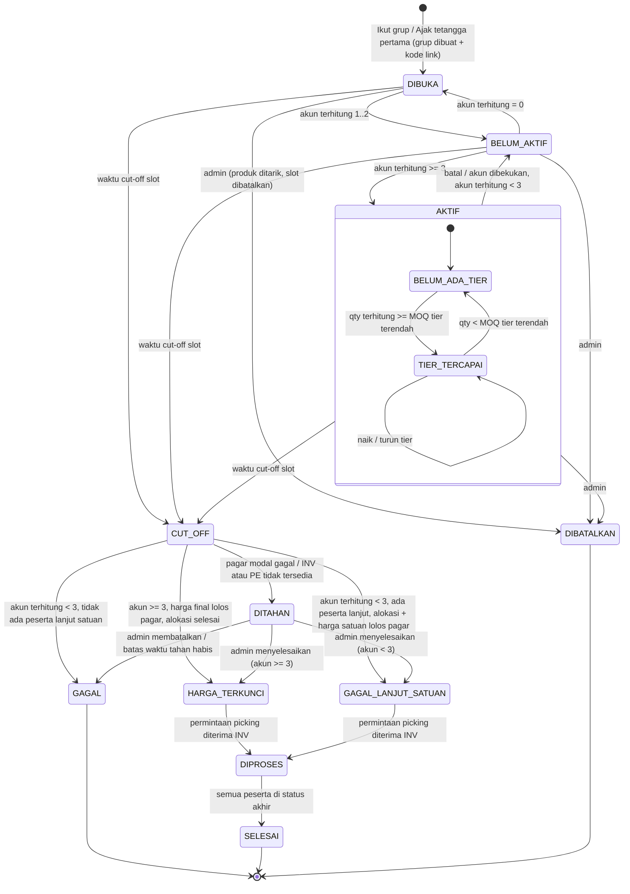
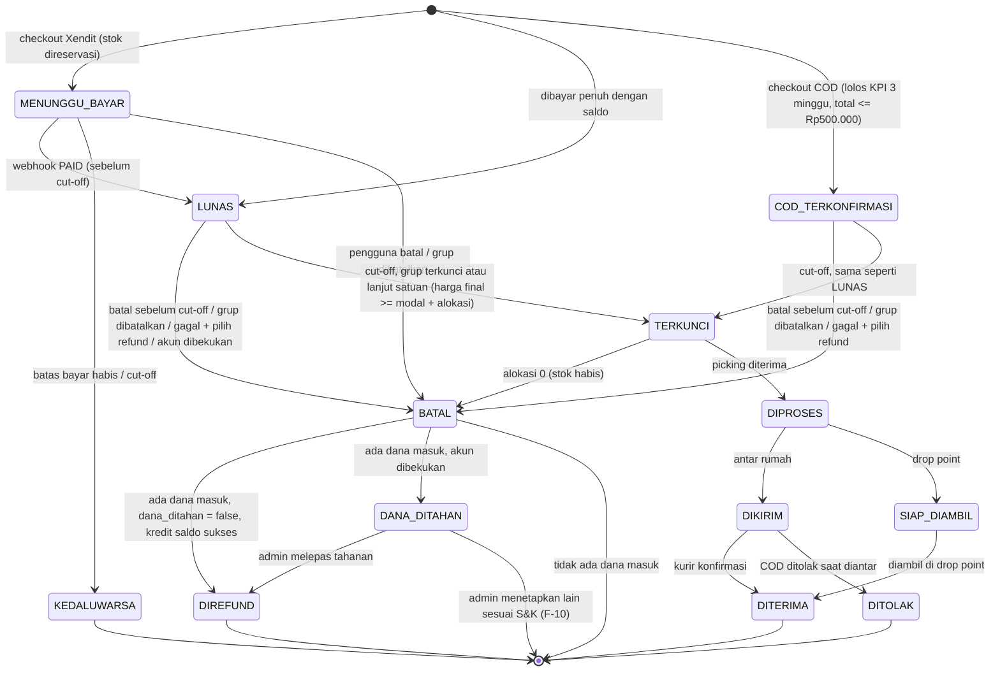

# Peta Flow Group Order — NEKAT Fase 1

| Atribut | Nilai |
|---|---|
| Task | T-002 (`task/T-002-flow-group-order`) |
| Versi | 0.2 — Draf (putaran perbaikan 1: pagar modal & picking untuk grup gagal lanjut satuan, selaras ADR-0001 & engine-harga) |
| Tanggal | 10 Nov 2026 |
| Penyusun | Workflow Architect (squad Produk & flow, pemilik: Randy) |
| Status | Draf, menunggu Reality Checker setelah T-022/T-023 dibangun |
| Sumber wajib | `project-specs/keputusan.md` (#2, #3, #4, #8, #9), `project-specs/fase-1-mvp.md` (fitur 5–7, 9), `docs/legal/syarat-ketentuan.md` §2, §4, §5, §7 |
| Diselaraskan dengan | `docs/adr/0001-tech-stack.md` (T-001: job, reservasi stok, Xendit, waktu UTC), `docs/spec/engine-harga.md` (T-003: §5.3 harga final, §5.4 rumus nilai bersih) |
| Dipakai oleh | T-003, T-004, T-005, T-010, T-011, T-022, T-023, T-024, T-030, T-035, T-039, T-040, T-043 |

Dokumen ini menetapkan **perilaku yang wajib**, bukan cara implementasi. Tidak ada angka harga, margin, atau tarif di sini. Setiap hal bisnis yang belum diputuskan ditulis di §12 dengan **DEFAULT SEMENTARA**. Default ini asumsi kerja agar developer & QA bisa jalan, **bukan keputusan**. Penanda `[F-xx]` di badan teks menunjuk asumsi tersebut.

---

## 1. Definisi & istilah

| Istilah | Definisi |
|---|---|
| **Grup** | Satu wadah pembelian bersama dengan kunci unik **produk × zona × slot kirim**. Satu kunci = satu grup [F-14]. |
| **Produk** | SKU yang tayang (punya harga di semua tier yang dipakai, punya stok). Produk tanpa harga tidak tayang dan tidak bisa punya grup. |
| **Zona** | Area radius 2–3 km dari drop point (skala kelurahan), dari `config/lokasi.json` (keputusan #5). |
| **Slot kirim** | Jendela waktu pengiriman harian yang diatur Operations. Semua grup di satu slot berbagi **satu waktu cut-off** (asumsi A-01). |
| **Link grup** | URL unik `{BASE_URL}/g/XXXXXX` (6 karakter alfanumerik, base URL dari konfigurasi, keputusan-terbuka #6). Kode tidak berubah selama grup ada. |
| **Akun** | Satu orang = satu nomor HP terverifikasi OTP WhatsApp. Akun dihitung unik per nomor HP (keputusan #3). |
| **Peserta** | Satu baris keikutsertaan sebuah akun dalam satu grup (produk, kuantitas, cara kirim). Satu akun maksimal **satu** peserta aktif per grup. |
| **Pesanan** | Satu checkout untuk satu slot kirim: berisi 1..n peserta (satu per produk/grup), satu ongkir, satu pembayaran (asumsi A-02). |
| **Akun terhitung** | Akun unik yang peserta-nya berstatus `LUNAS` atau `COD_TERKONFIRMASI` [F-05]. Yang `MENUNGGU_BAYAR` tidak dihitung. |
| **Grup aktif** | Grup dengan akun terhitung ≥ 3. Di bawah 3, harga grup tidak berlaku (keputusan #3). Istilah UI: "aktif" [F-15]. |
| **Tier MOQ** | Ambang kuantitas yang diatur admin per produk (mis. "6+", "12+"); setiap tier punya harga sendiri dari engine harga. Satuan ambang [F-04]. |
| **Tier tercapai** | Tier tertinggi yang ambangnya terpenuhi oleh kuantitas terhitung **dan** grup aktif. |
| **Harga satuan** | Harga individu non-grup per pcs dari engine harga (dasar pembayaran di muka [F-01]). |
| **Harga dibayar** | Harga per unit yang sudah dibayar peserta saat checkout (disimpan per peserta, tidak pernah berubah). |
| **Cut-off** | Waktu grup ditutup: tidak ada peserta baru, tidak ada pembatalan oleh pengguna (S&K §7.2). |
| **Harga final** | Harga per unit yang **dikunci saat cut-off**: minimum dari harga dibayar dan harga yang berlaku saat cut-off (tier grup bila grup aktif; harga satuan bila grup gagal & peserta lanjut; harga Mitra bila syarat terpenuhi), rinci di engine-harga §5.3. **Tidak pernah di bawah modal** saat cut-off; bila harga dibayar < modal saat cut-off → grup DITAHAN [P-09]. Berlaku sama untuk peserta grup aktif **dan** peserta lanjut harga satuan. |
| **Selisih harga** | Bagian kredit karena harga final lebih murah dari harga dibayar, untuk unit yang **teralokasi**: tanpa promo `(harga dibayar − harga final) × qty teralokasi`. |
| **Refund stok** | Bagian kredit untuk unit yang **tidak teralokasi** karena stok kurang saat cut-off: tanpa promo `harga dibayar × (qty pesan − qty teralokasi)`. |
| **Kredit cut-off** | Selisih harga + refund stok satu peserta, dihitung sebagai nilai bersih dengan rumus engine-harga §5.4 (memperhitungkan diskon & subsidi ongkir). Ditulis sebagai **satu** entri ledger dengan kunci `selisih:{grup_id}:{peserta_id}`; rincian dua komponen ditampilkan terpisah di riwayat saldo & WA. Selalu ke **saldo** (keputusan #9) [F-03]. |
| **Refund** | Pengembalian dana di luar kredit cut-off (batal, grup gagal + pilih refund, grup dibatalkan, pembayaran terlambat). Nilai bersih juga mengikuti engine-harga §5.4 bila ada promo. Kunci `refund:{peserta_id}:{alasan}`. Tidak dijalankan bila `dana_ditahan = true`. |
| **Dana ditahan** | Flag peserta `dana_ditahan = true` (akun dibekukan karena dugaan curang). Dana tidak dikreditkan ke saldo sampai admin memutuskan [F-10]. |
| **Saldo** | Ledger kredit/debit per akun (T-021). Tidak pernah negatif. Dipakai hanya untuk belanja di NEKAT [F-03 / H5]. |
| **Alokasi** | Pembagian stok riil ke peserta saat cut-off bila stok kurang dari total pesanan. |
| **Drop point** | Titik ambil di zona. Pesanan ambil di drop point: ongkir ke rumah 0 dan dihitung **tingkat Mitra** (keputusan #4) [F-12, P-05]. |
| **Kunci idempotensi** | Kunci unik per operasi efek samping (kredit saldo, notifikasi, permintaan picking) sehingga eksekusi ulang tidak menggandakan efek. |

### Asumsi dasar (bukan keputusan bisnis)

| # | Asumsi | Dasar | Risiko bila salah |
|---|---|---|---|
| A-01 | Cut-off ditetapkan per slot kirim (konfigurasi Operations), bukan per grup | fase-1-mvp fitur 5, T-006 | Job cut-off harus per grup; urutan picking berubah |
| A-02 | Keranjang dibagi per slot; satu pesanan = satu slot = satu pembayaran berisi banyak peserta | fase-1-mvp fitur 6 | Model pesanan T-004 berubah |
| A-03 | Setiap pembelian produk bergrup di zona × slot otomatis menjadi peserta grup tsb. (tidak ada jalur "beli biasa" terpisah) | fase-1-mvp fitur 4–5 | Perlu jalur pesanan non-grup tersendiri |
| A-04 | Grup dibuat secara malas (lazy): saat akun pertama menekan "Ikut grup" atau "Ajak tetangga" untuk kunci yang belum punya grup | keputusan #3 (link unik) | Grup kosong dibuat massal untuk semua produk |
| A-05 | Batas bayar invoice Xendit = `min(TTL bayar, cut-off)`; tidak ada invoice yang hidup melewati cut-off | S&K §5.3 | Pembayaran sukses setelah harga dikunci |
| A-06 | Waktu disimpan sebagai UTC (`timestamptz`); jadwal cut-off & tanggal bisnis dihitung dalam WIB (Asia/Jakarta); event memakai ISO-8601 dengan offset; `+07:00` hanya di tampilan | ADR-0001 | Cut-off meleset 7 jam |
| A-07 | Reservasi stok milik NEKAT (modul inventori), dihitung di atas snapshot stok lokal `InventorySource` (stok tersedia − reservasi aktif); Gudang hanya menerima permintaan picking per grup setelah harga dikunci | ADR-0001 | Dobel-jual saat Gudang lambat |

---

## 2. Aktor & komponen

| Kode | Aktor / komponen | Peran |
|---|---|---|
| USR | Pengguna (pembeli individu) | Membuka link, ikut grup, bayar, batal, menerima barang |
| FE | PWA (frontend) | Halaman grup, checkout, status; tidak menghitung harga sendiri |
| GE | Engine group order (T-022/T-023) | Pemilik status grup & peserta, hitung akun & tier, cut-off |
| PE | Engine harga (T-020, spek T-003) | Harga per tier/level dari modal + margin; pagar ≥ modal |
| PAY | Layanan pembayaran + Xendit (T-029/T-030) | Invoice, webhook, kedaluwarsa |
| SAL | Ledger saldo (T-021) | Kredit selisih/refund, debit pemakaian saldo |
| INV | `InventorySource` (`LocalInventory` / `GudangApiInventory`, T-018/T-019) | Snapshot stok tersedia & harga modal (`disinkron_pada`), konfirmasi stok saat cut-off, permintaan picking per grup |
| RSV | Modul reservasi stok NEKAT (bukan bagian adapter Gudang) | Reservasi/lepas reservasi di atas snapshot lokal (A-07) |
| WA | Notifikasi WhatsApp (adapter T-016, template T-010) | Pesan ke pengguna |
| JOB | Penjadwal job (T-010/T-040) | Memicu cut-off, kedaluwarsa, rekonsiliasi |
| ADM | Admin (panel T-039) | Menahan/membatalkan grup, menyelesaikan grup `DITAHAN`, membekukan akun |

Prasyarat grup bisa dibuat: produk tayang di zona; tier & harga satuan tersedia dari PE; slot kirim berikutnya punya cut-off di masa depan; stok tersedia > 0 menurut INV.

---

## 3. Mesin status grup

Atribut tambahan (bukan status): `pendaftaran_ditutup` (true bila stok habis sebelum cut-off, §5 B-08), `tier_tercapai`, `akun_terhitung`, `qty_terhitung`, `snapshot_moq` [F-08], `harga_grup_berlaku` (false untuk GAGAL / GAGAL_LANJUT_SATUAN).

`GAGAL` = harga grup tidak berlaku dan **tidak ada** barang yang diproses (status akhir). `GAGAL_LANJUT_SATUAN` = harga grup tidak berlaku, tetapi ≥1 peserta memilih lanjut: harga satuan sudah dikunci & lolos pagar, stok sudah dialokasikan, dan grup masuk picking seperti HARGA_TERKUNCI. Ini status yang dimaksud ADR-0001 sebagai "grup GAGAL yang pesertanya lanjut harga satuan".

### 3.1 Tabel transisi grup

| # | Status asal | Pemicu | Syarat (guard) | Aksi | Status tujuan | Pemicu oleh |
|---|---|---|---|---|---|---|
| G1 | — | `IkutGrup` / `AjakTetangga` untuk kunci tanpa grup | Produk tayang, slot punya cut-off > sekarang, stok > 0 | Buat grup (unik per kunci, kunci DB unik), buat kode link, snapshot MOQ | DIBUKA | USR via FE |
| G2 | DIBUKA | `PesertaTerhitung` | akun_terhitung naik ke 1..2 | Hitung ulang progress | BELUM_AKTIF | PAY (webhook) / GE (COD, saldo penuh) |
| G3 | BELUM_AKTIF | `PesertaTerhitung` | akun_terhitung ≥ 3 | Emit `GrupAktif`; hitung tier; notif WA-04 ke semua peserta terhitung | AKTIF | PAY / GE |
| G4 | AKTIF | `PesertaKeluar` (batal, dibekukan) | akun_terhitung < 3 | Emit `GrupTidakAktif`; notif WA-05 | BELUM_AKTIF | USR / ADM |
| G5 | BELUM_AKTIF | `PesertaKeluar` | akun_terhitung = 0 | — | DIBUKA | USR / JOB |
| G6 | AKTIF.* | `QtyBerubah` | qty_terhitung melewati ambang MOQ (naik/turun) | Update `tier_tercapai`; naik → notif WA-06 | AKTIF.TIER_TERCAPAI / BELUM_ADA_TIER | GE |
| G7 | DIBUKA / BELUM_AKTIF / AKTIF | `CutOffTiba` | sekarang ≥ waktu cut-off slot; update bersyarat status ∈ {DIBUKA, BELUM_AKTIF, AKTIF} | Tolak ikut/batal baru; kedaluwarsakan invoice; jalankan §6 | CUT_OFF | JOB |
| G8 | CUT_OFF | Evaluasi §6 langkah 4 | akun_terhitung < 3 **dan** tidak ada peserta `LANJUT_SATUAN` | Harga grup tidak berlaku; semua peserta terhitung → refund (P10); emit `GrupGagal`; notif WA-08 | GAGAL | GE |
| G8b | CUT_OFF | Evaluasi §6 langkah 4–9 | akun_terhitung < 3, ≥1 peserta `LANJUT_SATUAN`, INV & PE menjawab, harga final satuan ≥ modal untuk semua peserta lanjut | Peserta REFUND → P10; peserta lanjut → alokasi, harga satuan dikunci (P9), kredit cut-off; outbox `picking:{grup_id}`; emit `GrupGagal` (`ada_lanjut = true`); notif WA-08 | GAGAL_LANJUT_SATUAN | GE |
| G9 | CUT_OFF | Evaluasi §6 langkah 5–9 | akun ≥ 3, PE & INV menjawab, harga final ≥ modal untuk semua peserta | Kunci harga, alokasi, kredit cut-off, outbox `picking:{grup_id}`, emit `GrupHargaDikunci` | HARGA_TERKUNCI | GE |
| G10 | CUT_OFF | Evaluasi gagal (grup aktif **atau** grup gagal dengan peserta lanjut) | PE/INV tidak tersedia setelah retry, atau harga dibayar < modal saat cut-off untuk peserta mana pun yang akan dikirim [P-09] | Tidak ada kredit, refund, atau picking; emit `GrupDitahan` + alert admin; notif WA-09 | DITAHAN | GE |
| G11 | DITAHAN | Admin "Lanjutkan" | Guard G9 kini lolos (akun ≥ 3) | Seperti G9 | HARGA_TERKUNCI | ADM |
| G11b | DITAHAN | Admin "Lanjutkan" | Guard G8b kini lolos (akun < 3) | Seperti G8b | GAGAL_LANJUT_SATUAN | ADM |
| G12 | DITAHAN | Admin "Batalkan" atau batas waktu tahan habis [F-13] | — | Semua peserta → BATAL + refund saldo penuh (kecuali `dana_ditahan`) | GAGAL | ADM / JOB |
| G13 | HARGA_TERKUNCI / GAGAL_LANJUT_SATUAN | `PickingDiterima` | INV mengonfirmasi permintaan picking `picking:{grup_id}` | Peserta TERKUNCI → DIPROSES | DIPROSES | INV |
| G14 | DIPROSES | Peserta terakhir mencapai status akhir | Semua peserta ∈ {DITERIMA, DITOLAK, BATAL, DIREFUND, DANA_DITAHAN} (dana ditahan diselesaikan admin terpisah) | Tutup grup; masuk laporan harian | SELESAI | GE |
| G15 | DIBUKA / BELUM_AKTIF / AKTIF | Admin "Batalkan grup" | Alasan wajib diisi | Semua peserta → BATAL; refund saldo penuh (kecuali `dana_ditahan`); notif WA-10 | DIBATALKAN | ADM |

Aturan umum: status hanya maju lewat **update bersyarat** (`WHERE status = <asal>`); transisi yang kalah balapan tidak menimbulkan efek samping.

---

## 4. Mesin status peserta

Atribut peserta: `qty_pesan`, `qty_teralokasi`, `harga_dibayar`, `harga_final`, `jenis_harga` (GRUP / SATUAN / MITRA), `cara_kirim` (ANTAR / DROP_POINT), `jika_grup_gagal` (LANJUT_SATUAN / REFUND) [F-02], `alasan_batal`, `metode_bayar` (XENDIT / SALDO / SALDO+XENDIT / COD), `dana_ditahan` (bool), `refund_tertunda` (bool). `DANA_DITAHAN` adalah status tunggu, bukan status akhir: dana tidak masuk saldo sampai admin memutuskan [F-10].

### 4.1 Tabel transisi peserta

| # | Status asal | Pemicu | Syarat (guard) | Aksi | Status tujuan | Pemicu oleh |
|---|---|---|---|---|---|---|
| P1 | — | Checkout dengan Xendit | Login OTP, S&K versi terkini disetujui, dalam zona, grup ∈ {DIBUKA, BELUM_AKTIF, AKTIF}, `pendaftaran_ditutup = false`, belum jadi peserta aktif di grup ini, snapshot stok lebih muda dari batas usia [P-10], reservasi RSV sukses (satu transaksi DB dengan pembuatan peserta) | Simpan `harga_dibayar` (= harga satuan [F-01]); buat invoice dengan `external_id` = ID pembayaran (satu pembayaran per pesanan), kedaluwarsa = min(TTL [F-26], cut-off); debit saldo sementara bila dipakai | MENUNGGU_BAYAR | USR |
| P2 | — | Checkout dibayar penuh saldo | Guard P1 + saldo ≥ total | Debit saldo (kunci idempotensi = id pesanan) | LUNAS | USR |
| P3 | — | Checkout COD | Guard P1 + status COD aktif + total ≤ Rp500.000 [P-18] | Tanpa invoice | COD_TERKONFIRMASI | USR |
| P4 | MENUNGGU_BAYAR | Webhook PAID | Status masih MENUNGGU_BAYAR, `paid_at` ≤ cut-off [F-11], nominal cocok | Catat pembayaran; emit `PesertaTerhitung`; notif WA-02 | LUNAS | PAY |
| P5 | MENUNGGU_BAYAR | Invoice kedaluwarsa / cut-off | — | Lepas reservasi stok; kembalikan debit saldo sementara; notif WA-03 | KEDALUWARSA | PAY / JOB |
| P6 | MENUNGGU_BAYAR | Pengguna batal | Sebelum cut-off | Batalkan invoice di Xendit; lepas reservasi; kembalikan debit saldo | BATAL | USR |
| P7 | LUNAS / COD_TERKONFIRMASI | Pengguna batal | Sebelum cut-off [F-07] | Lepas reservasi; emit `PesertaKeluar`; refund penuh (LUNAS) | BATAL → DIREFUND (LUNAS) / BATAL (COD) | USR |
| P8 | LUNAS / COD_TERKONFIRMASI | Cut-off, grup → HARGA_TERKUNCI (G9/G11) | Harga final ≥ modal saat cut-off (dijamin guard G9) | Set `harga_final`, `qty_teralokasi`; kredit cut-off `selisih:{grup_id}:{peserta_id}` (§6) | TERKUNCI | GE |
| P9 | LUNAS / COD_TERKONFIRMASI | Cut-off, grup → GAGAL_LANJUT_SATUAN (G8b/G11b) | `jika_grup_gagal = LANJUT_SATUAN`; INV mengonfirmasi stok; PE memberi harga satuan dengan modal saat cut-off; harga final ≥ modal (dijamin guard G8b; gagal → grup DITAHAN, peserta tetap LUNAS/COD sampai admin) | `jenis_harga = SATUAN`, `harga_final` = min(harga dibayar, harga satuan saat cut-off, harga Mitra bila syarat) per engine-harga §5.3; alokasi; kredit cut-off; masuk `picking:{grup_id}` | TERKUNCI | GE |
| P10 | LUNAS / COD_TERKONFIRMASI | Cut-off, grup → GAGAL atau GAGAL_LANJUT_SATUAN | `jika_grup_gagal = REFUND` | Refund penuh ke saldo (LUNAS), kecuali `dana_ditahan` | BATAL → DIREFUND | GE |
| P11 | TERKUNCI | Alokasi = 0 | Stok tidak cukup | Kredit cut-off = seluruh nilai bersih (refund stok); notif WA-11 | BATAL → DIREFUND | GE |
| P12 | TERKUNCI | `PickingDiterima` | — | — | DIPROSES | INV |
| P13 | DIPROSES | Kurir berangkat / barang tiba di drop point | sesuai `cara_kirim` | notif WA-12 / WA-13 | DIKIRIM / SIAP_DIAMBIL | ADM / kurir |
| P14 | DIKIRIM / SIAP_DIAMBIL | Konfirmasi terima / ambil | — | notif WA-14 | DITERIMA | kurir / drop point |
| P15 | DIKIRIM | COD ditolak | metode = COD | Catat penolakan untuk KPI COD (keputusan #2); barang kembali ke stok | DITOLAK | kurir |
| P16 | BATAL | Kredit saldo sukses | Ada dana masuk (Xendit atau saldo) **dan** `dana_ditahan = false` | Entri ledger `REFUND` (kunci `refund:{peserta_id}:{alasan}`) | DIREFUND | SAL |
| P16b | BATAL | Akun dibekukan (B-17) | Ada dana masuk | **Tidak** ada kredit otomatis; `dana_ditahan = true`; tugas review admin | DANA_DITAHAN | ADM |
| P16c | DANA_DITAHAN | Admin melepas tahanan / menetapkan lain | Alasan tercatat di log admin | Lepas: kredit saldo seperti P16; lainnya sesuai keputusan F-10 | DIREFUND / status akhir | ADM |
| P17 | KEDALUWARSA / BATAL | Webhook PAID terlambat | — | Kredit **seluruh** nominal ke saldo (kecuali akun dibekukan → DANA_DITAHAN); notif WA-15; tidak menghidupkan peserta | (tetap) | PAY |

---

## 5. Flow per cabang

Format: langkah bernomor; `→` berarti lanjut; `⟂` berarti cabang gagal.

### B-01 Happy path (grup aktif, tier tercapai)
1. USR memilih zona tanpa login (izin lokasi / pilih manual) → FE menyimpan zona sesi.
2. USR membuka detail produk → FE meminta GE: progress grup untuk kunci (produk, zona, slot terdekat) dan PE: harga per tier. Kartu & detail menampilkan harga yang sama.
3. USR menekan "Ikut grup", memilih kuantitas, cara kirim, slot (default slot terdekat), dan pilihan bila grup gagal [F-02].
4. Belum login → B-03. Sudah login & S&K versi terkini disetujui → lanjut.
5. GE: buat grup bila belum ada (G1), cek guard P1, reservasi stok `qty_pesan` di RSV di atas snapshot lokal (A-07), dalam transaksi yang sama dengan pembuatan peserta.
6. Checkout: PE menghitung harga satuan × qty + ongkir (T-031) − diskon (T-032), pagar ≥ modal. FE menampilkan "Bayar sekarang" dan "Perkiraan kembali ke saldo bila grup tercapai" [F-01].
7. USR memilih QRIS / VA / e-wallet → PAY membuat invoice → peserta MENUNGGU_BAYAR (P1).
8. Webhook PAID → P4 → LUNAS → G2/G3. Saat akun ke-3 lunas → AKTIF, WA-04 ke semua peserta.
9. Peserta lain bergabung lewat link (B-02) → qty naik → G6 tier tercapai → WA-06.
10. Cut-off → §6 → HARGA_TERKUNCI, kredit cut-off ke saldo (B-05) → WA-07.
11. Outbox `picking:{grup_id}` → INV menerima picking → DIPROSES → DIKIRIM/SIAP_DIAMBIL → DITERIMA → grup SELESAI.

### B-02 Grup dibuka dari link unik `/g/XXXXXX`
1. USR membuka link. Native terpasang → buka halaman grup; belum terpasang → halaman install lalu kembali ke grup yang sama (deferred deep link, Fase 5 / H11). PWA → halaman grup di browser + banner "Tambah ke layar utama".
2. FE meminta GE `resolveKode(kode)`. ⟂ Kode tidak ada / format salah → "Link grup tidak ditemukan" + tombol ke katalog. Tidak membocorkan apakah kode pernah ada.
3. Tampilkan halaman grup: produk, slot, cut-off (hitung mundur), jumlah peserta + nama samaran ("Bu S***, RW 05", Kebijakan Privasi §3), progress "X/Y di zona kamu · Z lagi → harga". Tidak ada nomor HP/alamat.
4. Zona USR belum diketahui → minta lokasi. ⟂ Zona USR ≠ zona grup → B-13.
5. Status grup:
   - DIBUKA / BELUM_AKTIF / AKTIF dan `pendaftaran_ditutup = false` → tombol "Ikut grup" → B-01 langkah 3.
   - `pendaftaran_ditutup = true` → "Stok untuk grup ini habis" + tawarkan grup produk sama di slot berikutnya.
   - CUT_OFF / DITAHAN / HARGA_TERKUNCI / DIPROSES / SELESAI / GAGAL / DIBATALKAN → "Grup ini sudah ditutup" + tombol "Ikut grup slot berikutnya" (buat/arahkan ke grup kunci berikutnya). Peserta grup tsb. melihat status pesanannya.
6. USR sudah peserta aktif grup ini → tampilkan status keikutsertaannya, bukan tombol ikut.
7. Parameter atribusi pengundang opsional dicatat bila ada [F-22]; tidak memengaruhi harga.

### B-03 Pengguna belum login (OTP) & belum setuju S&K
1. USR menekan "Ikut grup" tanpa sesi → FE menyimpan niat (kode grup, qty, cara kirim) di sesi lokal.
2. Minta nomor HP → kirim OTP WhatsApp (T-016). ⟂ WA tidak tersedia → §7 M-05. ⟂ OTP salah/kedaluwarsa → pesan, kirim ulang dengan rate limit.
3. OTP valid → akun dibuat/ditemukan (unik per nomor). ⟂ Akun dibekukan → "Akun tidak dapat ikut grup, hubungi CS".
4. Cek persetujuan S&K + Kebijakan Privasi versi terkini. Belum ada / versi lama [F-23] → tampilkan teks persetujuan (`docs/legal/kebijakan-privasi.md` bagian akhir). Kotak wajib dicentang; kotak promo opsional.
5. ⟂ USR tidak menyetujui → tidak bisa ikut grup; boleh tetap melihat katalog. Tidak ada peserta dibuat.
6. Setuju → simpan (akun, versi S&K, versi privasi, waktu, persetujuan promo) → kembali ke niat tersimpan → B-01 langkah 5. Guard dicek ulang (grup bisa saja sudah cut-off selama login).

### B-04 Grup belum aktif (< 3 akun)
1. Progress menampilkan "X dari 3 orang · ajak N lagi agar harga grup berlaku" dan tombol "Ajak tetangga via WhatsApp" (teks + link grup).
2. Harga yang berlaku = harga satuan; harga tier ditampilkan sebagai "harga bila grup aktif".
3. Pengguna tetap bisa ikut & bayar (bayar harga satuan [F-01]).
4. Pengingat "kurang X orang" (WA-05) dikirim ke peserta terhitung sesuai batas frekuensi [F-17].
5. Bila sampai cut-off tetap < 3 → B-06.

### B-05 Tier lebih murah tercapai → selisih ke saldo
1. Saat cut-off (§6), GE menghitung tier tercapai dan PE mengembalikan harga tier dengan modal saat cut-off.
2. Per peserta: `harga_final = min(harga_dibayar, harga_tier)`, dengan cek `harga_final ≥ modal` (gagal → G10 DITAHAN).
3. Kredit cut-off (selisih harga + refund stok, nilai bersih engine-harga §5.4). Bila > 0 → SAL kredit `SELISIH_HARGA` dengan kunci idempotensi `selisih:{grup_id}:{peserta_id}`.
4. Peserta COD: tidak ada dana di muka → tidak ada kredit; jumlah tagih saat antar = `harga_final × qty_teralokasi` + ongkir.
5. WA-07: "Harga final Rp… · Rp… masuk saldo NEKAT kamu".
6. Bila harga tier saat cut-off > harga dibayar (modal naik / tier turun) → peserta tidak ditagih tambahan (harga_final = harga_dibayar) selama ≥ modal [P-19, F-08].

### B-06 Grup gagal (< 3 akun saat cut-off)
1. §6 langkah 4: akun_terhitung < 3 → harga grup tidak berlaku. Peserta terhitung dipisah sesuai `jika_grup_gagal` [F-02].
2. Tidak ada peserta LANJUT_SATUAN (semua REFUND, atau tidak ada peserta terhitung) → G8 **GAGAL**: semua peserta terhitung → P10 refund penuh ke saldo. Tidak ada picking.
3. Ada ≥1 peserta LANJUT_SATUAN → peserta lanjut menjalani **langkah yang sama dengan grup aktif** (§6 langkah 5–9):
   1. INV mengonfirmasi stok riil untuk total qty peserta lanjut; alokasi FIFO bila kurang (B-09).
   2. PE menghitung harga satuan (dan harga Mitra bila syarat) dengan **modal saat cut-off**; `harga_final` per engine-harga §5.3.
   3. Pagar: harga dibayar ≥ modal saat cut-off dan nilai bersih ≥ modal (engine-harga §5.4) untuk **setiap** peserta lanjut. Ada yang gagal → **G10 DITAHAN** untuk admin [P-09]; tidak ada kredit, refund, atau picking sampai diselesaikan (G11b / G12). Barang **tidak** dikirim di bawah modal.
   4. INV/PE tidak tersedia setelah retry → G10 DITAHAN.
   5. Semua lolos → dalam satu transaksi: peserta lanjut → P9 TERKUNCI (`jenis_harga = SATUAN`), peserta REFUND → P10, kredit cut-off, outbox `picking:{grup_id}` → G8b **GAGAL_LANJUT_SATUAN**.
4. GAGAL_LANJUT_SATUAN → INV menerima picking (G13) → DIPROSES → alur kirim biasa → SELESAI.
5. Grup DIBUKA tanpa peserta terhitung → GAGAL tanpa notifikasi.
6. WA-08 berisi hasil sesuai pilihan peserta + ajakan ikut grup di slot berikutnya; bila DITAHAN, WA-09 lebih dulu.
7. Ongkir pesanan yang semua barisnya di-refund ikut dikembalikan [F-20].

### B-07 Refund (semua jalur)
1. Sumber refund: batal sebelum cut-off (P7), grup gagal + REFUND (P10), grup DIBATALKAN (G15), DITAHAN → GAGAL (G12), pembayaran terlambat (P17), keluhan barang [F-24]. Refund stok saat alokasi 0/parsial (B-09) **bukan** jalur ini: ia bagian kredit cut-off (`selisih:{grup_id}:{peserta_id}`, §1).
2. Tujuan refund: **selalu saldo** (keputusan #9) [F-03]. Tidak ada refund ke metode asal di Fase 1.
3. Nominal = nilai bersih yang benar-benar dibayar untuk baris itu (Xendit + saldo yang dipakai), dengan diskon & subsidi ongkir per baris dihitung memakai **rumus nilai bersih engine-harga §5.4** (`B = D × q − P`). Ongkir mengikuti F-20.
4. SAL mencatat entri dengan kunci idempotensi `refund:{peserta_id}:{alasan}`; entri ganda ditolak oleh constraint unik.
5. Peserta → DIREFUND; WA-10/11/15 sesuai alasan; riwayat saldo menampilkan alasan + nama produk + tanggal.
6. Akun dibekukan (`dana_ditahan = true`) → **tidak** ada kredit otomatis; peserta → DANA_DITAHAN (P16b) sampai admin memutuskan (P16c) [F-10].
7. ⟂ SAL gagal → peserta tetap BATAL dengan `refund_tertunda = true`; job rekonsiliasi mengulang (§7 M-04).

### B-08 Stok habis sebelum cut-off
1. INV (sinkron Gudang atau stok lokal turun) memperbarui snapshot lokal; stok tersedia untuk reservasi = snapshot − reservasi aktif (A-07).
2. Reservasi RSV untuk peserta baru gagal → USR melihat "Stok tidak cukup, tersisa N" dan boleh mengurangi qty.
3. Stok tersedia = 0 → GE set `pendaftaran_ditutup = true`; tombol "Ikut grup" nonaktif; progress tetap tampil.
4. Peserta yang sudah MENUNGGU_BAYAR/LUNAS **tidak** dibatalkan otomatis; kekurangan diselesaikan saat alokasi (B-09).
5. Stok kembali > 0 sebelum cut-off → `pendaftaran_ditutup = false`.
6. Reservasi kedaluwarsa (P5) atau batal (P6/P7) melepas stok → dapat membuka pendaftaran lagi.

### B-09 Stok habis/kurang sesudah cut-off (alokasi parsial)
1. §6 langkah 5: INV mengonfirmasi stok riil untuk total `qty_pesan` peserta terkunci.
2. Stok ≥ total → semua `qty_teralokasi = qty_pesan`.
3. Stok < total → alokasi per urutan `paid_at` paling awal (COD: waktu konfirmasi), unit utuh [F-09].
4. Tier & harga final dihitung dari qty terhitung **sebelum** alokasi; harga tidak dinaikkan karena alokasi [F-09].
5. Bagian tidak teralokasi = **refund stok** (§1), digabung dengan selisih harga dalam satu kredit cut-off `selisih:{grup_id}:{peserta_id}` (nilai bersih engine-harga §5.4); WA-11 "Maaf, X dari Y pcs tidak tersedia".
6. `qty_teralokasi = 0` → P11 BATAL → DIREFUND.
7. Grup tetap HARGA_TERKUNCI walau peserta penerima barang tersisa < 3 [F-09].
8. Alokasi yang sama berlaku untuk peserta lanjut satuan di grup GAGAL_LANJUT_SATUAN (B-06).

### B-10 Pembatalan oleh pengguna
1. USR membuka status pesanan → "Batalkan" tersedia hanya bila status ∈ {MENUNGGU_BAYAR, LUNAS, COD_TERKONFIRMASI} dan sekarang < cut-off [F-07].
2. Konfirmasi dua langkah, menampilkan dampak: "Dana Rp… masuk saldo" dan "grup jadi kurang N orang" bila relevan.
3. GE update bersyarat (status asal, sebelum cut-off). ⟂ Kalah balapan dengan cut-off → "Grup sudah ditutup, pesanan tidak bisa dibatalkan" (S&K §7.2).
4. Aksi P6/P7; grup dievaluasi ulang (G4/G5/G6) → peserta lain dapat WA-05 bila grup turun ke < 3.
5. Kurangi kuantitas sebagian: tidak tersedia di Fase 1 (batal lalu ikut lagi) [F-07].
6. Pesanan multi-baris: pembatalan per baris; ongkir tidak dihitung ulang kecuali semua baris batal [F-20].
7. Setelah cut-off: tidak ada tombol batal; hanya kanal CS untuk kesalahan NEKAT (S&K §7.2).

### B-11 Pembayaran terlambat / kedaluwarsa
1. Invoice dibuat dengan kedaluwarsa = min(TTL bayar [F-26], cut-off) (A-05).
2. FE menampilkan hitung mundur batas bayar; WA-03a pengingat sebelum kedaluwarsa [F-17].
3. Kedaluwarsa → P5 KEDALUWARSA; stok & debit saldo sementara dikembalikan.
4. Webhook PAID tiba saat peserta KEDALUWARSA/BATAL atau grup ≥ CUT_OFF → P17: seluruh nominal ke saldo, WA-15, tidak menghitung ulang grup [F-11].
5. Webhook PAID dengan `paid_at` < cut-off tetapi diterima setelah cut-off mulai → diperlakukan sama dengan langkah 4 kecuali masih dalam masa tenggang job (§6 langkah 3) [F-11].

### B-12 Webhook ganda / tidak berurutan
1. PAY memverifikasi callback token (T-030). ⟂ Token salah → 401, tidak ada efek, log keamanan.
2. Simpan event dengan kunci unik `(gateway, id_event)`; event sama kedua kali → 200 OK tanpa efek.
3. Transisi peserta via update bersyarat; PAID untuk peserta yang sudah LUNAS → no-op.
4. EXPIRED setelah PAID → diabaikan (status maju tidak boleh mundur).
5. PAID untuk invoice yang tidak dikenal → simpan sebagai "yatim", alert admin, tidak ada kredit otomatis.
6. Nominal PAID ≠ nominal invoice → peserta tetap MENUNGGU_BAYAR, alert admin (jangan anggap lunas).

### B-13 Pengguna di luar zona
1. Lokasi USR tidak masuk radius drop point mana pun → "Maaf, NEKAT belum melayani lokasimu" [F-18]; katalog boleh dilihat tanpa tombol ikut/checkout.
2. USR dalam zona lain dari grup di link → "Grup ini untuk zona {nama zona}. Di zonamu ada grup produk yang sama" + tombol ke grup kunci (produk, zona USR, slot sama) [F-19].
3. Zona ditentukan **alamat kirim** pesanan (antar) atau drop point yang dipilih; alamat dikunci per pesanan. Ganti alamat ke zona lain setelah ikut = batal + ikut grup lain [F-25].

### B-14 Perubahan harga modal saat grup berjalan
1. INV melaporkan modal baru → PE menghitung ulang harga semua tier (live) [F-08].
2. Peserta baru membayar harga satuan terbaru; `harga_dibayar` peserta lama tidak berubah.
3. MOQ tier memakai `snapshot_moq` saat grup dibuka; perubahan MOQ oleh admin berlaku untuk grup baru [F-08].
4. Modal baru membuat harga yang tampil berubah → kartu & detail diperbarui bersamaan (satu sumber dari PE).
5. Saat cut-off, modal yang dipakai = modal terkini dari INV (snapshot dicatat). Bila `harga_dibayar` peserta < modal saat cut-off → grup DITAHAN (G10) untuk keputusan admin [P-09].
6. Data modal lebih tua dari batas usia [P-10] → perlakukan sebagai INV tidak tersedia (§7 M-03).

### B-15 Ambil di drop point (= tingkat Mitra)
1. Di checkout USR memilih "Ambil di drop point" → ongkir ke rumah 0.
2. PE menentukan apakah total pesanan memenuhi syarat Mitra [P-05]. Ya → `jenis_harga = MITRA`, `harga_dibayar` = harga Mitra; tidak → harga satuan.
3. Peserta drop point ikut grup yang sama dengan peserta antar rumah dan dihitung ke akun & qty [F-12].
4. Saat cut-off: `harga_final = min(harga_dibayar, harga tier grup, harga Mitra bila syarat terpenuhi)`; pagar harga grup individu ≥ Mitra tetap dijaga oleh PE.
5. Pembatalan baris membuat total turun di bawah syarat Mitra → kandidat harga Mitra hilang; baris tersisa tidak ditagih tambahan (`harga_final ≤ harga_dibayar`) [F-12], **tetapi tetap melewati pagar modal saat cut-off**: bila harga dibayar (harga Mitra) < modal saat cut-off atau nilai bersih < modal (engine-harga §5.4) → grup DITAHAN (G10) untuk admin [P-09], bukan dikirim.
6. Barang tiba → SIAP_DIAMBIL, WA-13 berisi alamat drop point & jam ambil. Tidak diambil sampai batas waktu → kebijakan Operations (T-006, di luar dokumen ini).

### B-16 Pembayaran memakai saldo
1. Saldo ≥ total → P2 langsung LUNAS (tanpa Xendit).
2. Saldo < total → debit sementara saldo + invoice Xendit untuk sisa. Kedaluwarsa/batal → debit dikembalikan (kunci `saldo-balik:{pesanan_id}`).
3. Refund atas baris ini mengembalikan bagian saldo + bagian Xendit ke saldo.

### B-17 Akun ganda / curang terdeteksi
1. ADM membekukan akun dengan alasan tercatat (S&K §2.3).
2. Sebelum cut-off: peserta akun itu → BATAL (alasan `akun_dibekukan`), dikeluarkan dari hitungan (G4 bila turun < 3); reservasi dilepas; dana **ditahan** (`dana_ditahan = true`, P16b), **tidak** otomatis ke saldo [F-10].
3. Setelah harga dikunci: tidak ada evaluasi ulang grup otomatis; kredit cut-off peserta itu (bila belum ditulis) ditunda dengan `dana_ditahan = true`; kasus ditandai untuk admin [F-10].
4. Admin melepas atau menetapkan lain (P16c), dengan alasan tercatat.

---

## 6. Prosedur job cut-off (per slot)

Pemicu: JOB dijadwalkan per slot tepat pada waktu cut-off slot, ditambah watchdog (M-01). Idempoten: kunci `cutoff:{slot_id}`; setiap langkah per grup dapat diulang tanpa efek ganda (status grup = checkpoint).

Langkah 5–9 dijalankan untuk **dua** jenis grup: grup dengan akun ≥ 3 (target HARGA_TERKUNCI) dan grup dengan akun < 3 yang punya peserta LANJUT_SATUAN (target GAGAL_LANJUT_SATUAN; langkah 5–8 hanya untuk peserta lanjut). Tidak ada jalur pengiriman yang melewati langkah stok, harga, dan pagar modal.

| Langkah | Aksi | Gagal → |
|---|---|---|
| 1 | Update bersyarat semua grup slot: status ∈ {DIBUKA, BELUM_AKTIF, AKTIF} → CUT_OFF. Sejak ini API ikut/batal menolak. | DB gagal → retry; job tidak lanjut ke langkah 2 sebelum sukses |
| 2 | Minta PAY mengedaluwarsakan invoice terbuka grup slot ini → P5. | Xendit tidak tersedia → tandai invoice "kedaluwarsa lokal"; webhook PAID berikutnya → P17 |
| 3 | Tunggu masa tenggang webhook (konfigurasi teknis) agar PAID yang `paid_at` ≤ cut-off sempat diproses [F-11]. | — |
| 4 | Per grup: hitung akun terhitung. ≥ 3 → langkah 5 (semua peserta). < 3 dan tidak ada peserta LANJUT_SATUAN → G8 GAGAL (refund P10 via outbox), grup berikutnya. < 3 dan ada peserta LANJUT_SATUAN → langkah 5 hanya untuk peserta lanjut; peserta REFUND diproses di langkah 9. | — |
| 5 | INV: konfirmasi stok riil untuk total qty peserta yang akan dikirim. | Retry dengan backoff; habis → G10 DITAHAN |
| 6 | Alokasi FIFO (B-09). | — |
| 7 | PE: harga tier tercapai (grup aktif) / harga satuan (lanjut satuan) / harga Mitra, dengan modal saat cut-off; catat snapshot modal & id versi harga. | Retry; habis → G10 DITAHAN |
| 8 | Hitung `harga_final` (engine-harga §5.3) & nilai bersih (engine-harga §5.4) per peserta; cek harga dibayar ≥ modal dan nilai bersih ≥ modal. | Ada peserta gagal pagar → G10 DITAHAN (tidak ada kredit/refund/picking) [P-09] |
| 9 | Dalam satu transaksi: tulis harga_final, qty_teralokasi, peserta TERKUNCI (P8/P9), peserta REFUND → BATAL (P10), status grup HARGA_TERKUNCI atau GAGAL_LANJUT_SATUAN, outbox (`GrupHargaDikunci`/`GrupGagal`, kredit cut-off `selisih:{grup_id}:{peserta_id}`, refund `refund:{peserta_id}:grup_gagal`, notifikasi, `picking:{grup_id}`). Peserta `dana_ditahan` tidak mendapat baris kredit. | Rollback; ulang langkah 9 |
| 10 | Pekerja outbox: SAL kredit, WA-07/08/11, permintaan picking per grup ke INV (T-040) — hanya untuk grup HARGA_TERKUNCI / GAGAL_LANJUT_SATUAN, setelah harga dikunci & stok dialokasikan; tidak pernah saat pesanan lunas. | Retry per item, idempoten (§7) |
| 11 | Laporan job: jumlah grup per hasil (HARGA_TERKUNCI / GAGAL_LANJUT_SATUAN / GAGAL / DITAHAN) ke log & laporan harian. | — |

Grup DITAHAN tidak masuk picking list sampai diselesaikan admin; batas waktu tahan & default bila tidak diselesaikan [F-13].

---

## 7. Mode gagal & pemulihan

| # | Mode gagal | Deteksi | Dampak | Pemulihan | Idempotensi |
|---|---|---|---|---|---|
| M-01 | Job cut-off tidak jalan (server mati / penjadwal gagal) | Watchdog: grup status ≤ AKTIF dengan cut-off < sekarang − ambang | Pengguna masih bisa ikut setelah cut-off | API ikut/batal **sendiri** menolak bila sekarang ≥ cut-off (guard waktu, tak bergantung job); watchdog memicu job ulang; alert DevOps | Kunci `cutoff:{slot_id}` + update bersyarat |
| M-02 | Job cut-off mati di tengah | Status CUT_OFF bertahan > ambang | Sebagian grup terkunci, sebagian belum | Job dijalankan ulang; langkah per grup melewati grup yang sudah melewati langkah 9 | Status grup sebagai checkpoint |
| M-03 | INV/Gudang tidak tersedia | Timeout/5xx setelah retry; umur snapshot (`sekarang − disinkron_pada`) | Sinkron stok/modal berhenti; cut-off tidak bisa konfirmasi stok | Sebelum cut-off: **tetap terima ikut grup** memakai snapshot lokal + reservasi RSV selama umur snapshot di bawah batas [P-10]; lewat batas → tolak ikut baru ("Stok sedang diperbarui, coba lagi"). Saat cut-off: grup DITAHAN; permintaan picking di-outbox dan diulang | Kunci `picking:{grup_id}` dikirim ke Gudang |
| M-04 | SAL gagal menulis kredit | Error transaksi | Kredit cut-off/refund belum masuk | Outbox mengulang; peserta tandai `refund_tertunda`; job rekonsiliasi harian membandingkan peserta vs ledger | Constraint unik `kunci_idempotensi` (`selisih:{grup_id}:{peserta_id}`, `refund:{peserta_id}:{alasan}`) |
| M-05 | WhatsApp tidak tersedia | Error/timeout adapter | OTP & notifikasi tertunda | OTP: tampilkan pesan & coba lagi; kanal cadangan menunggu H2. Notifikasi: antre & retry; status di aplikasi tetap jadi sumber kebenaran. Notifikasi basi (mis. pengingat setelah cut-off) dibuang | Kunci `wa:{template}:{peserta_id}:{id_transisi}` |
| M-06 | Xendit tidak tersedia saat checkout | Timeout/5xx | Tidak bisa buat invoice | Tidak buat peserta; reservasi dilepas; "Pembayaran sedang gangguan"; saldo penuh tetap bisa | `external_id` = ID pembayaran NEKAT (satu pembayaran per pesanan di Fase 1) |
| M-07 | Webhook Xendit tidak datang | Peserta MENUNGGU_BAYAR mendekati kedaluwarsa | Pengguna sudah bayar tapi status belum lunas | Job rekonsiliasi menanyakan status invoice ke Xendit sebelum cut-off & sebelum menandai KEDALUWARSA | Sama dengan jalur webhook (B-12) |
| M-08 | PE gagal / harga tidak tersedia | Error | Tidak bisa tampil/checkout | Produk tidak tayang (aturan "tanpa harga tidak tayang"); saat cut-off → DITAHAN | — |
| M-09 | Balapan: dua akun jadi peserta ke-3 bersamaan, atau batal vs cut-off | — | Hitungan salah | Hitungan akun dihitung ulang dari data peserta (bukan counter inkremental) di dalam transaksi; batal memakai update bersyarat sebelum cut-off | — |
| M-10 | Grup ganda untuk kunci sama (dua pengguna buat bersamaan) | Constraint unik | — | Insert kedua gagal → ambil grup yang ada | Constraint unik (produk, zona, slot) |
| M-11 | Tabrakan kode link | Constraint unik kode | — | Bangkitkan ulang kode | Constraint unik |

Usulan timeout teknis (bisa diubah Software Architect, bukan angka bisnis): panggilan sinkron ke INV/PE/Xendit masing-masing punya timeout terkonfigurasi dan retry berbatas dengan backoff; habis retry = gagal sesuai tabel.

---

## 8. Kontrak handoff antar komponen

Semua event membawa: `id_event` (UUID), `waktu` (ISO-8601 **dengan offset**, mis. `2026-11-10T10:00:00Z`; disimpan UTC, `+07:00` hanya di tampilan — A-06), `versi_skema`, `kunci_idempotensi`. Event ditulis lewat outbox dalam transaksi yang sama dengan perubahan status. Penamaan id mengikuti ADR-0001: `grup_id`, `peserta_id`, `slot_id`.

| Arah | Event / panggilan | Data minimal | Respons sukses | Gagal |
|---|---|---|---|---|
| FE → GE | `GET grup/{kode}` | kode | status, produk, zona, slot, cut_off, akun_terhitung, qty_terhitung, tier_tercapai, tier berikut + "Z lagi", nama samaran peserta, `pendaftaran_ditutup` | 404 `GRUP_TIDAK_DITEMUKAN` |
| FE → GE | `POST ikut` | id_akun, id_produk, id_zona, id_slot, qty, cara_kirim, jika_grup_gagal, id_drop_point? | id_peserta, id_pesanan, ringkasan harga | 409 `SUDAH_PESERTA`, 409 `GRUP_TUTUP`, 422 `STOK_KURANG` (+tersisa), 403 `LUAR_ZONA`, 403 `BELUM_SETUJU_SK`, 403 `AKUN_DIBEKUKAN`, 409 `QTY_MELEBIHI_BATAS` [F-06] |
| GE → PE | `hargaUntuk` | id_produk, id_zona, level (INDIVIDU/MITRA), tier, qty, waktu | harga_per_unit, modal_snapshot, id_versi_harga | `HARGA_TIDAK_TERSEDIA`, `DI_BAWAH_MODAL` |
| GE → RSV (modul NEKAT) | `reservasi` / `lepasReservasi` | peserta_id, sku, qty, kedaluwarsa; dihitung dari snapshot lokal − reservasi aktif, satu transaksi dengan pembuatan peserta | id_reservasi, stok_tersisa | `STOK_KURANG`, `SNAPSHOT_KEDALUWARSA` (umur > batas P-10) |
| GE → INV | `konfirmasiStok` (cut-off) | grup_id, sku, qty_total | qty_tersedia | `TIDAK_TERSEDIA` (retryable) |
| GE → INV | `kirimPermintaanPicking` (per grup, hanya setelah HARGA_TERKUNCI / GAGAL_LANJUT_SATUAN & alokasi) | grup_id, slot_id, sku, daftar (peserta_id, qty_teralokasi, cara_kirim) | id_picking | retryable, kunci `picking:{grup_id}` |
| INV → GE/PE | `ModalBerubah`, `StokBerubah` (snapshot diperbarui) | sku, nilai baru, `disinkron_pada` | — | — |
| GE → PAY | `buatPembayaran` (invoice Xendit) | pembayaran_id (= `external_id` Xendit), pesanan_id, nominal, metode, kedaluwarsa | id_invoice, instruksi bayar | `GATEWAY_TIDAK_TERSEDIA` |
| PAY → GE | `PembayaranLunas` | pembayaran_id (`external_id`), pesanan_id, id_invoice, nominal, paid_at, id_event_gateway | — | — |
| PAY → GE | `PembayaranKedaluwarsa` | pembayaran_id, pesanan_id, id_invoice | — | — |
| GE → SAL | `kredit` | id_akun, nominal (nilai bersih engine-harga §5.4), jenis (SELISIH_HARGA = kredit cut-off / REFUND / BAYAR_TERLAMBAT), rincian (selisih_harga, refund_stok), referensi (peserta_id, grup_id), alasan, kunci_idempotensi (`selisih:{grup_id}:{peserta_id}` / `refund:{peserta_id}:{alasan}`) | id_entri, saldo_baru | `DUPLIKAT` (anggap sukses), error → retry. Tidak dipanggil bila `dana_ditahan = true` |
| GE → SAL | `debit` / `batalkanDebit` | id_akun, nominal, id_pesanan, kunci | id_entri | `SALDO_KURANG` |
| GE → WA | `kirimNotifikasi` | id_akun, template (WA-xx), variabel, kunci_idempotensi, `kedaluwarsa_pesan` | id_pesan | retryable; dibuang bila basi |
| GE → (semua) | `GrupAktif`, `GrupTidakAktif`, `TierBerubah`, `GrupHargaDikunci`, `GrupGagal` (+ `ada_lanjut`), `GrupDitahan`, `GrupDibatalkan`, `PesertaTerhitung`, `PesertaKeluar`, `DanaDitahan` | grup_id, kunci grup, status, akun_terhitung, qty_terhitung, tier, harga_final? | — | — |

Data pribadi dalam event dibatasi id; nomor HP hanya diambil adapter WA dari tabel akun.

---

## 9. Status terlihat pengguna & notifikasi WhatsApp

### 9.1 Teks UI per status

| Status internal | Teks UI singkat (Bahasa Indonesia) |
|---|---|
| Grup DIBUKA | "Grup baru dibuka · ajak 3 orang agar harga grup berlaku" |
| Grup BELUM_AKTIF | "{X} dari 3 orang · ajak {N} lagi agar harga grup berlaku" |
| Grup AKTIF, belum ada tier | "Grup aktif · {Z} lagi → Rp{harga tier}" |
| Grup AKTIF.TIER_TERCAPAI | "Harga grup Rp{harga} tercapai · {Z} lagi → Rp{tier berikut}" |
| `pendaftaran_ditutup` | "Stok grup ini habis · coba slot berikutnya" |
| Grup CUT_OFF / DITAHAN | "Grup ditutup · harga final sedang dihitung" |
| Grup HARGA_TERKUNCI | "Harga final Rp{harga} · dikunci {waktu}" |
| Grup GAGAL | "Grup tidak tercapai (kurang dari 3 orang)" |
| Grup GAGAL_LANJUT_SATUAN | "Grup tidak tercapai · pesanan lanjut dengan harga satuan Rp{harga}" (peserta REFUND melihat teks DIREFUND) |
| Peserta DANA_DITAHAN | "Pesanan dibatalkan · dana sedang ditinjau, hubungi CS" |
| Grup DIBATALKAN | "Grup dibatalkan oleh NEKAT · dana masuk saldo" |
| Peserta MENUNGGU_BAYAR | "Menunggu pembayaran · bayar sebelum {waktu}" |
| Peserta LUNAS | "Sudah dibayar · menunggu grup ditutup {waktu cut-off}" |
| Peserta COD_TERKONFIRMASI | "Bayar di tempat · menunggu grup ditutup" |
| Peserta KEDALUWARSA | "Pembayaran kedaluwarsa · pesanan dibatalkan" |
| Peserta BATAL / DIREFUND | "Dibatalkan · Rp{nominal} masuk saldo" (tanpa dana: "Dibatalkan") |
| Peserta TERKUNCI | "Harga final Rp{harga} · sedang disiapkan" (+ "{qty_teralokasi} dari {qty} pcs tersedia" bila parsial) |
| Peserta DIKIRIM / SIAP_DIAMBIL | "Sedang diantar" / "Siap diambil di {drop point}" |
| Peserta DITERIMA | "Pesanan diterima" |

### 9.2 Notifikasi WhatsApp per transisi

Template final & batas frekuensi ditetapkan di T-010 [F-17]. Kode di bawah menjadi acuan.

| Kode | Transisi | Penerima | Isi ringkas |
|---|---|---|---|
| WA-01 | OTP | pemohon | Kode OTP |
| WA-02 | P4 / P2 / P3 (konfirmasi) | peserta | "Pesananmu di grup {produk} tercatat · cut-off {waktu} · link grup" |
| WA-03a | Sebelum kedaluwarsa bayar | peserta MENUNGGU_BAYAR | "Bayar sebelum {waktu} agar tetap ikut grup" |
| WA-03 | P5 | peserta | "Pembayaran kedaluwarsa, pesanan dibatalkan" |
| WA-04 | G3 | semua peserta terhitung | "Grup {produk} aktif! Harga grup berlaku" |
| WA-05 | G4, pengingat "kurang X orang" | peserta terhitung | "Kurang {X} orang lagi · bagikan link" |
| WA-06 | G6 naik tier | peserta terhitung | "Harga turun ke Rp{harga} · {Z} lagi → Rp{berikut}" |
| WA-06b | Pengingat cut-off | peserta [F-17] | "Grup ditutup {waktu}" |
| WA-07 | G9/G11 → P8 | peserta | "Harga final Rp{harga} · Rp{selisih} masuk saldo" |
| WA-08 | G8 / G8b / G11b | peserta terhitung | "Grup tidak tercapai · pesanan lanjut harga satuan Rp{harga} (+Rp{kredit} masuk saldo bila ada) / Rp{nominal} masuk saldo" |
| WA-09 | G10 | peserta | "Pesanan sedang kami periksa, kabar paling lambat {waktu}" |
| WA-10 | G15 / G12 / P7 | peserta | "Pesanan dibatalkan · Rp{nominal} masuk saldo" |
| WA-11 | B-09 parsial / P11 | peserta | "Maaf, {n} dari {qty} pcs tidak tersedia · Rp{nominal} masuk saldo" |
| WA-12 | P13 antar | peserta | "Pesanan sedang diantar" |
| WA-13 | P13 drop point | peserta | "Siap diambil di {drop point}, {jam}" |
| WA-14 | P14 | peserta | "Pesanan diterima, terima kasih" |
| WA-15 | P17 | pembayar | "Pembayaranmu masuk setelah batas waktu · Rp{nominal} masuk saldo" |

Pesan promo hanya untuk akun yang mencentang persetujuan promo; pesan transaksi di atas bukan promo.

---

## 10. Kasus uji

Data uji tanpa harga asli: gunakan harga fiktif dari fixture T-011. `t0` = waktu cut-off.

| ID | Langkah | Hasil yang diharapkan |
|---|---|---|
| TC-GO-01 | Akun A ikut produk P (zona Z, slot S) pertama kali | Grup DIBUKA dibuat dengan kode 6 karakter; A MENUNGGU_BAYAR |
| TC-GO-02 | A, B, C bayar (webhook PAID) | Grup BELUM_AKTIF (1, 2) lalu AKTIF di akun ke-3; WA-04 ke A, B, C |
| TC-GO-03 | A & B bersamaan membuat grup untuk kunci sama | Hanya satu grup; keduanya peserta grup yang sama |
| TC-GO-04 | 3 peserta dengan nomor HP sama (satu akun) mencoba ikut 3 kali | Ikut kedua & ketiga ditolak `SUDAH_PESERTA`; akun terhitung = 1 |
| TC-GO-05 | 3 akun ikut tapi hanya 2 yang lunas | Grup BELUM_AKTIF; akun MENUNGGU_BAYAR tidak dihitung [F-05] |
| TC-GO-06 | qty terhitung melewati MOQ tier 1 lalu tier 2 | `tier_tercapai` naik dua kali; WA-06 dua kali; progress "Z lagi" benar |
| TC-GO-07 | Grup AKTIF tier 2, cut-off | Harga final = harga tier 2; selisih per peserta = (harga dibayar − final) × qty masuk saldo; WA-07 |
| TC-GO-08 | Jalankan job cut-off dua kali | Ledger tidak ganda; notifikasi tidak ganda; status sama |
| TC-GO-09 | Cut-off dengan 2 akun terhitung, A=LANJUT_SATUAN, B=REFUND, stok cukup, modal tidak berubah | Grup GAGAL_LANJUT_SATUAN; A TERKUNCI jenis SATUAN; B DIREFUND penuh ke saldo; satu permintaan `picking:{grup_id}` berisi A saja; WA-08 |
| TC-GO-09b | Cut-off dengan 2 akun terhitung, keduanya REFUND | Grup GAGAL; keduanya DIREFUND; **tidak** ada permintaan picking |
| TC-GO-10 | Grup DIBUKA tanpa peserta terhitung saat cut-off | GAGAL, tanpa notifikasi |
| TC-GO-11 | Buka `/g/KODE` valid tanpa login, tekan Ikut | Diarahkan OTP → S&K → kembali ke grup yang sama dengan niat tersimpan |
| TC-GO-12 | Buka `/g/ZZZZZZ` tidak ada | "Link grup tidak ditemukan", tidak ada info lain |
| TC-GO-13 | Buka link grup yang sudah HARGA_TERKUNCI | "Grup ini sudah ditutup" + tombol slot berikutnya |
| TC-GO-14 | Login sukses, tolak S&K | Tidak ada peserta dibuat; katalog tetap bisa dilihat |
| TC-GO-15 | S&K versi baru terbit, akun lama ikut grup | Diminta setuju versi baru sebelum ikut [F-23] |
| TC-GO-16 | Lokasi di luar semua zona | Pesan di luar zona; tombol ikut/checkout tidak ada; API `ikut` → 403 `LUAR_ZONA` |
| TC-GO-17 | Pengguna zona Z2 membuka link grup zona Z1 | Tidak bisa ikut; ditawari grup produk sama di Z2 |
| TC-GO-18 | Stok tersisa 2, pengguna minta 5 | 422 `STOK_KURANG` tersisa 2 |
| TC-GO-19 | Stok jadi 0 sebelum cut-off | `pendaftaran_ditutup = true`; peserta lama tetap; stok kembali → dibuka lagi |
| TC-GO-20 | Stok riil saat cut-off 10, pesanan total 14 (A 6 lunas lebih dulu, B 4, C 4) | Alokasi A 6, B 4, C 0; C DIREFUND penuh; harga final dari qty 14 [F-09]; WA-11 ke C |
| TC-GO-21 | Alokasi parsial B 3 dari 4 | B TERKUNCI qty 3; saldo += harga dibayar × 1 + selisih harga × 3 |
| TC-GO-22 | Batal LUNAS sebelum cut-off | DIREFUND penuh ke saldo; grup dievaluasi ulang |
| TC-GO-23 | Batal tepat setelah job cut-off mulai (balapan) | Ditolak "Grup sudah ditutup"; tidak ada refund |
| TC-GO-24 | Peserta ke-3 batal saat AKTIF | Grup → BELUM_AKTIF; WA-05 ke 2 peserta lain |
| TC-GO-25 | Invoice kedaluwarsa | KEDALUWARSA; reservasi dilepas; debit saldo sementara kembali |
| TC-GO-26 | PAID tiba setelah KEDALUWARSA | Seluruh nominal ke saldo; WA-15; grup tidak berubah |
| TC-GO-27 | Webhook PAID sama dikirim 3 kali | Satu transisi, satu WA-02 |
| TC-GO-28 | EXPIRED datang setelah PAID | Diabaikan; tetap LUNAS |
| TC-GO-29 | Webhook token salah | 401; tidak ada efek |
| TC-GO-30 | Nominal PAID ≠ invoice | Tetap MENUNGGU_BAYAR; alert admin |
| TC-GO-31 | Modal naik saat grup berjalan, masih di bawah harga dibayar | Peserta baru bayar harga baru; peserta lama tidak ditagih tambahan; harga final ≥ modal |
| TC-GO-32 | Modal naik di atas harga dibayar peserta lama sebelum cut-off | Grup DITAHAN; alert admin; WA-09 |
| TC-GO-33 | Admin menyelesaikan grup DITAHAN | HARGA_TERKUNCI; alur seperti TC-GO-07 |
| TC-GO-34 | Grup DITAHAN melewati batas waktu tahan | GAGAL; semua DIREFUND [F-13] |
| TC-GO-35 | Ambil di drop point, total memenuhi syarat Mitra | Ongkir rumah 0; harga dibayar = harga Mitra; dihitung ke akun & qty grup |
| TC-GO-36 | Drop point vs antar dalam grup sama, cut-off | Harga final drop point = min(dibayar, tier, Mitra); pagar grup ≥ Mitra terjaga |
| TC-GO-37 | Pengguna COD lolos KPI, total ≤ Rp500.000 | COD_TERKONFIRMASI; dihitung ke akun; tagih saat antar = harga final × qty teralokasi + ongkir |
| TC-GO-38 | Pengguna COD, total > Rp500.000 / belum lolos KPI | Opsi COD tidak tampil; API menolak |
| TC-GO-39 | COD ditolak saat diantar | DITOLAK; tercatat untuk KPI COD; harga peserta lain tidak berubah |
| TC-GO-40 | Bayar penuh dengan saldo | Langsung LUNAS tanpa Xendit; dihitung ke akun |
| TC-GO-41 | INV mati saat cut-off | Grup DITAHAN; tidak ada picking; job ulang setelah pulih sukses tanpa duplikat |
| TC-GO-42 | WA mati saat cut-off | Harga tetap dikunci; notifikasi antre lalu terkirim sekali |
| TC-GO-43 | Job cut-off tidak berjalan | API ikut tetap menolak setelah `t0`; watchdog memicu job |
| TC-GO-44 | Ledger gagal saat kredit selisih | `refund_tertunda`; rekonsiliasi mengkredit sekali |
| TC-GO-45 | Admin membekukan akun peserta ke-3 (LUNAS) sebelum cut-off | Grup → BELUM_AKTIF; peserta itu BATAL → DANA_DITAHAN, `dana_ditahan = true`; **tidak** ada entri saldo [F-10] |
| TC-GO-45b | Admin melepas tahanan peserta TC-GO-45 | Satu entri `refund:{peserta_id}:akun_dibekukan`; DIREFUND; alasan tercatat di log admin |
| TC-GO-46 | Admin membatalkan grup AKTIF | Semua DIREFUND; WA-10; grup DIBATALKAN |
| TC-GO-47 | Harga di kartu vs detail vs halaman grup | Identik pada waktu yang sama |
| TC-GO-48 | Halaman grup sebagai pengguna lain | Hanya jumlah & nama samaran; tidak ada nomor HP/alamat |
| TC-GO-49 | Grup 2 akun, A=LANJUT_SATUAN; modal naik di atas harga dibayar A sebelum cut-off | Grup DITAHAN (bukan GAGAL_LANJUT_SATUAN); tidak ada kredit, refund, atau picking; WA-09; alert admin |
| TC-GO-50 | Admin menyelesaikan grup TC-GO-49 setelah modal dikoreksi | G11b → GAGAL_LANJUT_SATUAN; harga final ≥ modal; picking dikirim sekali |
| TC-GO-51 | Grup 2 akun, A=LANJUT_SATUAN qty 5, stok riil 3 | Alokasi A 3; kredit cut-off = refund stok 2 unit (+ selisih harga bila harga satuan turun); satu entri `selisih:{grup_id}:{peserta_id}` |
| TC-GO-52 | Grup GAGAL_LANJUT_SATUAN, job cut-off diulang | Status tetap; tidak ada kredit/picking ganda |
| TC-GO-53 | Peserta drop point harga Mitra membatalkan baris lain sehingga syarat Mitra hilang; modal saat cut-off > harga dibayar | Grup DITAHAN, tidak dikirim di bawah modal |
| TC-GO-54 | Gudang mati, snapshot lebih muda dari batas [P-10] | Ikut grup diterima; reservasi RSV dari snapshot |
| TC-GO-55 | Gudang mati, snapshot lebih tua dari batas | Ikut baru ditolak `SNAPSHOT_KEDALUWARSA`; peserta lama tidak terpengaruh |
| TC-GO-56 | Refund batal untuk baris dengan diskon | Nominal = nilai bersih sesuai engine-harga §5.4 (bukan harga dibayar × qty) |
| TC-GO-57 | Event & kolom waktu | Disimpan UTC; event ISO-8601 dengan offset; tampilan WIB |
| TC-GO-58 | Webhook PAID untuk pembayaran satu pesanan berisi 3 baris (3 grup) | Satu `external_id` = pembayaran_id; ketiga peserta LUNAS; masing-masing grup dihitung ulang |

---

## 11. Temuan ketidaksesuaian dokumen sumber

| # | Temuan | Dokumen | Tindakan |
|---|---|---|---|
| R-01 | Keputusan #3 menyebut grup "terbuka" pada ≥3 akun; S&K §4.2 & fase-1 menyebut "aktif" | keputusan.md, S&K | Dokumen ini memakai "dibuka" = dibuat, "aktif" = ≥3 [F-15] |
| R-02 | S&K §7.1 masih "[pilih]" saldo atau metode asal; keputusan #9 menyebut refund/selisih masuk saldo | S&K | Default: semua ke saldo [F-03]; S&K perlu disesuaikan (#5) |
| R-03 | S&K §4.5 menjamin pesanan dikirim dengan harga yang dibayar; tidak menjelaskan nasib bila grup gagal / modal naik | S&K | Lihat F-01, F-02, P-19 |
| R-04 | Fase-1 "pilih satuan jual (1 pcs, grup 6+, grup 12+)" ambigu: satuan beli per orang atau ambang grup | fase-1-mvp | F-04 / P-03 |
| R-05 | T-023 menyebut "stok habis → refund parsial ke saldo" tetapi tidak urutan alokasi | backlog | F-09 |
| R-06 | Fase-1 penomoran fitur loncat (8, 10, 11, 9) | fase-1-mvp | Kosmetik, tidak memengaruhi flow |

---

## 12. Keputusan terbuka untuk manusia

Semua **DEFAULT SEMENTARA** di bawah adalah **asumsi kerja dokumen ini, bukan keputusan**. Developer membangunnya sebagai konfigurasi/cabang yang bisa diganti. Keputusan final ditulis manusia di `project-specs/keputusan.md`.

### Butir lama (ID sudah ada di `keputusan-terbuka.md`)

| ID | Topik | Opsi | Rekomendasi | DEFAULT SEMENTARA (asumsi) |
|---|---|---|---|---|
| F-01 | Harga yang dibayar di muka & bila harga final lebih tinggi (terkait S&K §4.5, P-04, P-19) | A) bayar harga satuan, selisih kembali ke saldo saat cut-off; B) bayar harga tier yang tercapai saat ini, NEKAT menanggung bila final lebih tinggi (≥ modal); C) bayar tier saat ini, tagih kekurangan saat cut-off | A untuk pilot: tidak pernah menagih tambahan, tidak ada kerugian, sesuai S&K §4.4–4.5. Risiko: konversi turun karena bayar lebih besar di muka → uji oleh UX Researcher; B bisa diaktifkan lewat konfigurasi | **A**. FE wajib menampilkan "Bayar sekarang" + "Perkiraan kembali ke saldo" |
| F-02 | Grup gagal: lanjut harga satuan atau refund; default bila pengguna diam | A) pilihan saat ikut; B) jendela pilihan setelah cut-off; C) selalu refund; D) selalu lanjut | A: tidak menunda picking. Dengan F-01=A, lanjut tidak menagih tambahan | **A**, pilihan bawaan **LANJUT_SATUAN** (bisa diubah pengguna saat ikut). Peserta lanjut tetap melewati stok, engine harga, dan pagar modal saat cut-off; gagal pagar → DITAHAN (G10), bukan dikirim |
| F-03 | Semua refund & selisih ke saldo? Bisa dicairkan? (= H5) | A) semua ke saldo, tak bisa dicairkan; B) refund ke metode asal, selisih ke saldo; C) saldo bisa dicairkan dengan syarat | Perlu tinjauan hukum aturan uang elektronik BI | **A** di Fase 1 |
| F-04 | Satuan MOQ tier & harga grup dasar sebelum 6+ (= P-03) | A) total pcs semua peserta terhitung; B) pcs per orang; ada/tidak tier "grup dasar" saat ≥3 akun | A sesuai konsep pembelian bersama | **A**. Grup aktif tapi belum capai tier terendah → harga satuan, kecuali admin mengisi tier dasar (opsional) |
| F-05 | Siapa dihitung ke 3 akun; perlakuan COD | A) hanya LUNAS + COD_TERKONFIRMASI; B) termasuk MENUNGGU_BAYAR | A mencegah grup "palsu" | **A** |
| F-06 | Batas kuantitas per akun per grup | Tanpa batas / batas per produk | Batas per produk (field admin) | Field `maks_qty_per_akun` **kosong = tanpa batas** (dibatasi stok) |
| F-07 | Batas pembatalan, kurangi qty, admin memajukan cut-off | Batal sampai cut-off / sampai X sebelum cut-off; kurangi qty ya/tidak; cut-off boleh dimajukan ya/tidak | Sampai cut-off (S&K §7) | Batal sampai cut-off; kurangi qty **tidak**; admin **tidak** boleh memajukan cut-off slot yang sudah punya peserta |
| F-08 | Modal berubah saat grup berjalan; snapshot MOQ (= P-08) | A) harga live, harga dibayar jadi batas atas; B) harga dibekukan sejak grup dibuka; C) grup ditahan | A + ambang margin menipis (P-08) | **A**; MOQ di-snapshot saat grup dibuka; harga dibayar < modal saat cut-off → DITAHAN |
| F-09 | Stok parsial: urutan alokasi, harga, bila tersisa <3 akun | Urutan bayar / proporsional; harga dihitung sebelum/sesudah alokasi | Urutan bayar (adil & mudah dijelaskan) | FIFO `paid_at`, unit utuh; tier dari qty sebelum alokasi; grup tetap terkunci walau penerima < 3 |
| F-10 | Dana akun ganda/curang & evaluasi ulang grup | Ditahan / dikembalikan ke saldo / disita sesuai S&K | Ditahan sampai review admin | Dikeluarkan dari hitungan sebelum cut-off; dana **ditahan** (`dana_ditahan = true`, status DANA_DITAHAN), **tidak** otomatis ke saldo; admin melepas/menetapkan dengan alasan tercatat; tanpa evaluasi ulang grup setelah terkunci |
| F-11 | Basis waktu pembayaran terlambat | `paid_at` gateway / waktu webhook diterima | `paid_at` + masa tenggang job | Lunas jika `paid_at` ≤ cut-off dan diproses dalam masa tenggang; selain itu → saldo |
| F-12 | Drop point & antar rumah satu grup atau terpisah | Satu grup / grup terpisah per cara kirim | Satu grup (lebih cepat mencapai 3 akun) | Satu grup; harga per peserta = min(dibayar, tier, Mitra bila syarat); turun syarat Mitra karena batal → tidak ditagih tambahan |
| F-13 | Grup yang masih DITAHAN saat cut-off | Batas waktu tahan lalu gagal / pindah slot / tunggu admin | Batas waktu konfigurasi | Tidak diselesaikan sebelum batas (konfigurasi, kosong = sebelum picking slot) → **GAGAL + refund ke saldo** |
| F-14 | Satu atau beberapa grup per kunci | Satu / pecah bila penuh | Satu | **Satu** grup per produk × zona × slot |
| F-15 | Istilah ≥3 akun | "terbuka" / "aktif" | "aktif" (S&K) | Status `AKTIF`, teks "aktif"; "dibuka" = grup dibuat |
| F-16 | Produk sama di slot berbeda | Boleh / tidak | Boleh | **Boleh** (grup berbeda); satu peserta per grup |
| F-17 | Penerima pengingat & batas frekuensi WA | — | Batasi agar tidak dianggap spam | Pengingat cut-off & bayar ke semua peserta termasuk MENUNGGU_BAYAR; "kurang X orang" hanya ke terhitung; maks 1 per jenis per grup per hari (konfigurasi) |
| F-18 | Daftar tunggu di luar zona | Ada (perlu persetujuan data) / tidak | Tidak di Fase 1 | Hanya pesan "belum melayani"; tidak menyimpan data |

### Butir baru

| ID | Topik | Opsi | Rekomendasi | DEFAULT SEMENTARA (asumsi) | Pemilik usulan |
|---|---|---|---|---|---|
| F-19 | Pengguna zona lain membuka link grup | A) arahkan ke grup produk sama di zonanya; B) boleh ikut dengan antar lintas zona | A (zona = basis harga & ongkir) | **A** | Randy |
| F-20 | Ongkir saat sebagian baris batal / gagal / alokasi parsial | Tidak dihitung ulang / dihitung ulang & selisih ke saldo | Tidak dihitung ulang kecuali semua baris batal | Ongkir dikembalikan ke saldo hanya bila **semua** baris pesanan batal/refund | Efan + Operations |
| F-21 | Slot kirim dibatalkan operasional setelah harga dikunci (armada, cuaca) | Pindah ke slot berikut dengan harga terkunci / refund / pilihan pengguna | Pindah slot + boleh batal ke saldo | Admin memindahkan; harga tetap terkunci; pengguna boleh batal → saldo | Randy + Operations |
| F-22 | Atribusi pengundang pada link grup (Kebijakan Privasi §1) | Kode link sama untuk semua + parameter ref / tanpa atribusi | Parameter ref opsional (untuk Growth) | Parameter ref dicatat bila ada; **tidak** memengaruhi harga & tidak ada hadiah di Fase 1 | Randy + Growth |
| F-23 | Versi S&K / Kebijakan Privasi berubah saat pengguna sudah pernah setuju | Persetujuan ulang wajib sebelum ikut grup berikutnya / pemberitahuan saja | Persetujuan ulang wajib (perubahan penting, S&K §11) | Persetujuan ulang wajib sebelum ikut berikutnya; keikutsertaan yang sudah berjalan tetap pada versi yang disetujui saat ikut | Randy |
| F-24 | Keluhan barang rusak/kurang setelah diterima (S&K §6.3) | Kompensasi saldo / ganti barang di slot berikut | Pilihan admin per kasus | Admin memutuskan; kompensasi uang selalu ke saldo; tidak memengaruhi harga grup | Randy |
| F-25 | Ganti alamat / zona setelah ikut grup | Dikunci per pesanan / boleh ganti dalam zona yang sama | Boleh ganti dalam zona sama sebelum cut-off | Ganti alamat dalam zona sama boleh sebelum cut-off, ongkir tidak dihitung ulang (sejalan F-20); lintas zona = batal & ikut grup lain | Randy + Operations |
| F-26 | Lama batas bayar (TTL invoice Xendit) | Satu TTL untuk semua metode / TTL per metode (QRIS, VA, e-wallet); tutup pendaftaran sebelum cut-off agar ada waktu bayar | TTL per metode, tetap dipotong di cut-off (A-05) | TTL dari konfigurasi, **kosong = sampai cut-off**; pendaftaran tetap dibuka sampai cut-off | Randy + Joseph |

Butir terkait di dokumen lain yang dipakai di sini: P-05 (syarat Mitra), P-09 (modal melewati harga saat cut-off), P-10 (usia data modal), P-18 (batas COD sebelum/sesudah saldo), P-19 (siapa menanggung bila final > dibayar), H2 (kanal cadangan OTP), H5 (pencairan saldo), H11 (deferred deep link).
