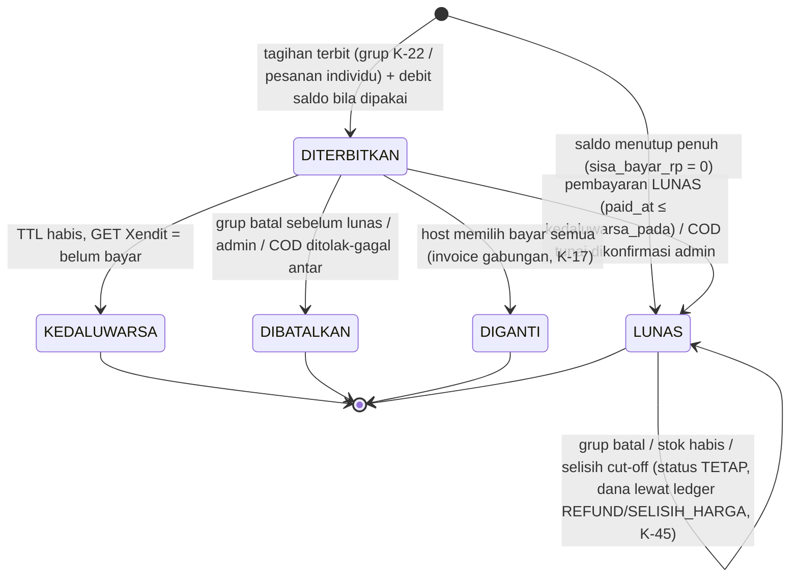
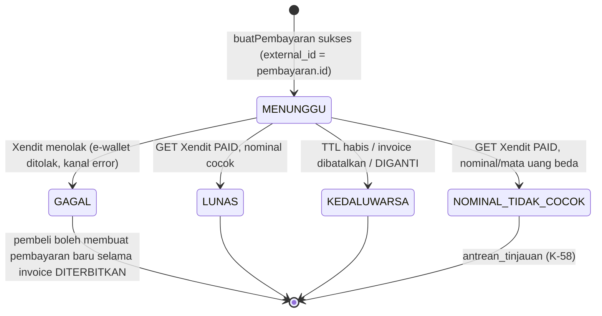
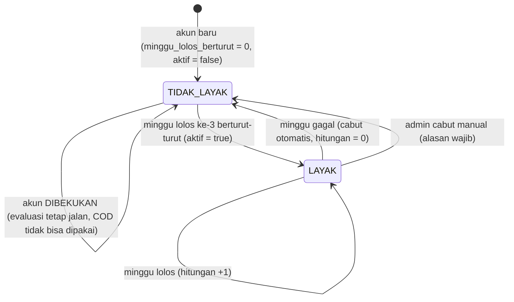

# Peta Flow Pembayaran & COD — NEKAT Fase 1

| Atribut | Nilai |
|---|---|
| Task | T-005 |
| Versi | 0.1 — Draf |
| Tanggal | 26 Nov 2026 |
| Penyusun | Workflow Architect (squad Produk & flow, pemilik: Randy) bersama Payments & Billing Engineer |
| Status | Draf, menunggu review + Reality Checker setelah T-021/T-029/T-030/T-034 dibangun |
| Sumber wajib | `project-specs/keputusan.md` §2, §9, §11–§14, dan §15 (di branch `keputusan/2026-11-26-gabungan`: K-39, K-40, K-45, P-18) |
| Diselaraskan dengan | `docs/flow/group-order.md` v0.6 (B-05, B-06, B-10, B-11, B-15, §7, §8), `docs/spec/T-004-model-data.md` §3.9–§3.11, §3.14, `docs/adr/0001-tech-stack.md` §3.2, §4.2, skema `packages/db/src/skema/{invoice,saldo,ongkir-promo-cod,grup}.ts` |
| Dipakai oleh | T-010, T-011, T-021, T-029, T-030, T-033, T-034, T-042, T-043, T-044 |

Dokumen ini menetapkan **perilaku wajib**, bukan cara implementasi. Tidak ada angka harga, margin, tarif, biaya admin, atau fee gateway.
Angka yang muncul hanya angka keputusan (60 menit F-26, Rp500.000 COD §2, 3 minggu §2, 5 menit K-39) dan semuanya dibaca dari konfigurasi.
Hal yang belum diputuskan diberi **DEFAULT SEMENTARA** dan ID di §16.

---

## 1. Ringkasan & cakupan

Semua uang pembeli masuk lewat **Xendit** (bayar di muka, §2/§9) atau **saldo** (= loyalty point, 1 poin = Rp1, K-13/G-06).
Semua refund & selisih **selalu** masuk saldo akun pembayar (F-03); tidak ada refund ke metode asal (ADR §4.2).
**COD** hanya untuk pesanan individu ("Beli sendiri", F-27) oleh akun yang lolos KPI 3 minggu berturut-turut, maksimal Rp500.000 per pesanan (§2, K-31).

**Dalam cakupan**: status invoice & pembayaran; alur QRIS / VA / e-wallet; webhook; kedaluwarsa; refund & selisih → saldo; pemakaian saldo di checkout; COD (kelayakan, batas, cabut otomatis/manual).

**Di luar cakupan** (dirujuk saja): engine harga & rumus kredit (`engine-harga.md`), mesin status grup (`group-order.md` §3–§4), pencairan saldo (G-06/K-34, dikunci `pencairan.aktif=false` sampai H5), alur pesanan individu end-to-end selain pembayaran (**spec belum ada — lihat §15 T-5**), template WA (T-010).

### 1.1 Istilah

| Istilah | Arti |
|---|---|
| Invoice / tagihan | Baris `invoice`. Satu per akun (`SENDIRI`), satu gabungan (`HOST`, K-17/K-37), atau satu per pesanan individu. Ongkir masuk tagihan yang sama (K-25) |
| Pembayaran | Baris `pembayaran`: satu upaya bayar ke Xendit untuk `invoice.sisa_bayar_rp`. `pembayaran.id` = `external_id` Xendit |
| Pembayar | `invoice.pembayar_akun_id`: akun sendiri, atau host bila `HOST` (G-06b). Penerima semua kredit atas invoice itu |
| TTL | `invoice.kedaluwarsa_pada` = `diterbitkan_pada` + `invoice.ttl_menit` (60, F-26, K-07); gabungan = kedaluwarsa tertua (K-37) |
| `paid_at` | Waktu bayar dari Xendit (`pembayaran.paid_at_gateway`) = **basis keterlambatan** (F-11); `webhook_diterima_pada` tetap disimpan |
| Pesanan individu | Pesanan "Beli sendiri" di luar grup (F-27), harga satuan. Satu-satunya jenis yang boleh COD (K-31) |

---

## 2. Aktor

| Aktor | Peran |
|---|---|
| Pembeli / host (USR) | Memilih metode, memakai saldo, membayar. Host memilih `SENDIRI`/`HOST` (G-07) |
| FE (PWA) | Menampilkan tagihan, instruksi bayar, hitung mundur. Halaman "kembali dari pembayaran" **bukan** bukti bayar (ADR §4.2.6) |
| GE (domain grup/pesanan) | Menerbitkan invoice, menerima event lunas/kedaluwarsa, menjalankan transisi grup/peserta |
| PAY (T-029/T-030) | Port `PaymentGateway` (`XenditGateway` / `FakeGateway`), endpoint webhook, rekonsiliasi |
| SAL (T-021) | Ledger saldo: satu-satunya jalan mengubah `akun_saldo` |
| COD (T-034) | Status kelayakan, cek batas, cabut manual; job mingguan T-042 |
| JOB | Job TTL `ttl:{invoice_id}`, rekonsiliasi, evaluasi KPI COD (T-010/T-042) |
| ADM | Admin login TOTP (H9): tinjauan, cabut COD, konfirmasi tunai COD, lepas dana ditahan |
| Xendit | Gateway QRIS / VA / e-wallet (mode test di non-production, live di production) |

---

## 3. Invarian uang (wajib, berlaku di semua cabang)

1. **Nominal selalu dari server**: rupiah integer, tanpa pembulatan (H6); klien tidak pernah mengirim harga/nominal/saldo (group-order §8.1). `akun_id` & saldo yang didebit selalu dari sesi (host pada `HOST`).
2. **Saldo tidak pernah negatif**: `akun_saldo.saldo_rp >= 0` dan `ledger_saldo.saldo_sesudah_rp >= 0` (CHECK DB). Tidak ada mekanisme "utang" ke pembeli.
3. **Ledger ditulis di transaksi yang sama** dengan perubahan status penyebabnya; **tidak pernah lewat outbox**. Gagal tulis ledger = rollback seluruh transaksi.
4. **Idempoten**: setiap entri ledger punya `kunci_idempotensi` unik (§8.2); entri ganda ditolak constraint dan dianggap **sukses**.
5. **Urutan kunci** (ADR §3.2): grup → stok SKU → peserta → invoice → pembayaran → `akun_saldo` (terakhir). Pesanan individu: invoice → pembayaran → `akun_saldo`.
6. **Status hanya maju** lewat update bersyarat (`WHERE status = <asal>`); event mundur diabaikan dan dicatat.
7. **Webhook bukan kebenaran**: status bayar dikonfirmasi lewat GET ke Xendit memakai ID yang tersimpan di DB (ADR §4.2.2, CWE-345).
8. **Rahasia** hanya dari environment variable: `XENDIT_SECRET_KEY`, `XENDIT_CALLBACK_TOKEN` (`.env.example`). Tidak pernah di kode, DB, log, atau dokumen.
9. **Tidak ada tagihan tambahan** setelah tagihan terbit (P-19); semua penyesuaian ke arah pembeli berupa kredit saldo.
10. **Tidak bisa batal setelah bayar** (K-40/F-07). Dana kembali ke saldo hanya bila grup batal / stok habis (dan jalur turunan yang sudah diputuskan: F-13 DITAHAN dibatalkan, F-21 slot batal).

---

## 4. Mesin status

### 4.1 Invoice (`invoice.status`)



| # | Asal | Pemicu | Guard | Aksi (satu transaksi kecuali disebut) | Tujuan |
|---|---|---|---|---|---|
| I1 | — | Terbit, `sisa_bayar_rp > 0` | Guard penerbit (group-order G2 / checkout individu) | Snapshot baris (K-15); `saldo_dipakai_rp` → ledger `PAKAI_CHECKOUT` `debit:{invoice_id}`; job `ttl:{invoice_id}`. Setelah commit: PAY `buatPembayaran` | DITERBITKAN |
| I2 | — | Terbit, `sisa_bayar_rp = 0` | Saldo ≥ total di dalam kunci `akun_saldo` | Ledger `PAKAI_CHECKOUT`; `lunas_pada` = waktu debit; tanpa Xendit; event `TagihanLunas` | LUNAS |
| I3 | DITERBITKAN | `PembayaranLunas` (§6) | Pembayaran cocok (nominal, mata uang, `external_id`); `paid_at ≤ kedaluwarsa_pada`; grup/peserta masih menerima pembayaran (group-order A4) | `lunas_pada = paid_at`; peserta → LUNAS; evaluasi syarat grup | LUNAS |
| I4 | DITERBITKAN | Job TTL (§7) | GET Xendit = belum bayar; invoice belum LUNAS di dalam kunci | Ledger `SALDO_BALIK` `saldo-balik:{invoice_id}` (bila `saldo_dipakai_rp > 0`); lepas reservasi; peserta → DIKELUARKAN (K-12); setelah commit: PAY `kedaluwarsakan` | KEDALUWARSA |
| I5 | DITERBITKAN | Grup batal / admin batal / COD gagal | Alasan tercatat | Seperti I4 (`SALDO_BALIK`); setelah commit: outbox `BATAL_PEMBAYARAN_XENDIT` | DIBATALKAN |
| I6 | DITERBITKAN | Host "Saya bayar semua" | Lihat K-48 | Invoice lama → DIGANTI, `SALDO_BALIK` saldo anggota, invoice gabungan terbit (I1/I2) atas host dengan kedaluwarsa tertua (K-37); setelah commit: batalkan pembayaran lama | DIGANTI |
| I7 | LUNAS | Grup batal / stok habis baris (K-29) / selisih cut-off / slot batal (F-21) | — | **Status tidak berubah** (K-45). Ledger kredit ke pembayar (§8) | LUNAS |

### 4.2 Pembayaran (`pembayaran.status`)



Aturan: maksimal **satu** pembayaran `MENUNGGU`/`LUNAS` per invoice (`UK (invoice_id) WHERE status IN ('MENUNGGU','LUNAS')`).
Ganti metode (mis. QRIS → VA) = pembayaran lama dibatalkan di Xendit **lebih dulu** (status KEDALUWARSA), lalu pembayaran baru; `kedaluwarsa_pada` invoice **tidak berubah**.
Pembayaran yang lunas di Xendit padahal baris NEKAT sudah KEDALUWARSA/invoice bukan DITERBITKAN = **bayar terlambat** (§6.3), bukan kebangkitan status.

### 4.3 Status COD akun (`status_cod`)


`LAYAK`/`TIDAK_LAYAK` adalah tampilan dari `status_cod.aktif`; tidak ada kolom status baru. CHECK DB: `NOT aktif OR minggu_lolos_berturut >= 3`.

---

## 5. Happy path per metode

Ketersediaan metode (server menentukan; FE hanya menampilkan daftar dari server):

| Jenis tagihan | QRIS | VA | E-wallet | Saldo | COD |
|---|---|---|---|---|---|
| Grup `SENDIRI` | ya | ya | **tidak** (K-36) | ya, saldo akun sendiri | **tidak** (K-31) |
| Grup `HOST` (gabungan) | ya | ya | tidak (K-36) | ya, **hanya saldo host** | tidak |
| Pesanan individu (F-27) | ya | ya | ya (§9; ADR §4.2) | ya | ya, bila layak & total ≤ batas (§10) |

### 5.1 Langkah bersama (semua metode Xendit)
1. Tagihan terbit (I1). Debit saldo (bila dipakai) di transaksi penerbitan. Invoice: `total_rp`, `saldo_dipakai_rp`, `sisa_bayar_rp`, `kedaluwarsa_pada`.
2. Pembeli memilih metode di FE → `POST invoice/{id}/bayar {metode, kanal?}`. Server cek: invoice milik akun sesi (pembayar), status DITERBITKAN, `sekarang < kedaluwarsa_pada`, metode diizinkan untuk jenis tagihan, nominal ≥ minimum kanal (K-50).
3. Insert `pembayaran` (MENUNGGU) → commit → PAY `buatPembayaran` (di luar transaksi) dengan `external_id = pembayaran.id`, nominal = `sisa_bayar_rp`, kedaluwarsa = **waktu absolut** `kedaluwarsa_pada` (bukan durasi baru).
4. Timeout/5xx Xendit → `cekStatus(external_id)` dulu; tidak ada → buat ulang dengan `external_id` sama (M-06). Tidak pernah membuat `external_id` baru untuk upaya yang sama.
5. FE menampilkan instruksi + hitung mundur ke `kedaluwarsa_pada`; status diperbarui dari server (polling/push), bukan dari redirect.
6. Xendit mengirim webhook → §6 → I3. WA "Pembayaran diterima" lewat outbox.

### 5.2 QRIS
- QR dinamis dengan nominal tetap = `sisa_bayar_rp`, kedaluwarsa = `kedaluwarsa_pada`.
- `HOST`: QR dikirim ke host saja (K-17); anggota non-host melihat "Host yang membayar".
- QR ditampilkan di aplikasi dan dikirim via WA (gambar/tautan tanpa PII anggota lain, CWE-359).

### 5.3 Virtual Account
- VA **closed amount** (nominal harus tepat) dan **sekali pakai** per pembayaran, kedaluwarsa = `kedaluwarsa_pada`. Tujuannya: bayar kurang/lebih ditolak bank, bukan diterima lalu direkonsiliasi manual.
- Pembeli memilih bank (`pembayaran.kanal`). Ganti bank = §4.2 "ganti metode".
- Bila kanal tetap menerima nominal berbeda (mis. konfigurasi Xendit salah) → NOMINAL_TIDAK_COCOK (§6.2).

### 5.4 E-wallet (pesanan individu saja)
- Charge e-wallet dengan `external_id` = `pembayaran.id`; alur redirect/deeplink atau push (tergantung kanal, dipilih T-029).
- Charge e-wallet bisa punya batas waktu sendiri yang lebih pendek dari TTL. Charge gagal/kedaluwarsa → pembayaran GAGAL/KEDALUWARSA; **invoice tetap DITERBITKAN** sampai `kedaluwarsa_pada`, pembeli boleh mencoba lagi (pembayaran baru).
- Redirect sukses dari e-wallet **tidak** menandai lunas; tunggu webhook + GET.

### 5.5 Saldo menutup penuh
- `sisa_bayar_rp = 0` → I2 langsung LUNAS di transaksi penerbitan, tanpa Xendit, tanpa job TTL. Untuk grup: peserta → LUNAS seketika.

### 5.6 Host bayar semua (K-17, K-37)
- Satu invoice gabungan atas host (`gabungan = true`), total semua anggota berbarang, satu ongkir (K-25), kedaluwarsa = tertua dari invoice yang digantikan.
- Lunas → semua peserta dalam invoice → LUNAS. Kedaluwarsa → semua peserta dalam invoice → DIKELUARKAN → grup batal bila akun lunas < 3 (group-order B-06).
- Semua kredit (selisih, refund) masuk saldo **host** (G-06b).

---

## 6. Webhook Xendit (T-030)

### 6.1 Langkah pemrosesan (urutan wajib)

| Langkah | Aksi | Gagal → respons |
|---|---|---|
| W1 | Endpoint `POST /webhook/xendit` (rate limit terpisah & longgar, ADR §4.2.5). Baca header `x-callback-token`; bandingkan **constant-time** dengan `XENDIT_CALLBACK_TOKEN` dari env | Tidak cocok/kosong → `401`, log keamanan tanpa isi payload, tanpa efek |
| W2 | Parse & normalisasi oleh adapter → `{event_id_gateway, external_id, status_normal (PAID / EXPIRED / FAILED / LAINNYA), jenis_produk (QR/VA/EWALLET)}` | Tidak bisa diparse → `400` (log, alert bila berulang) |
| W3 | Cari `pembayaran` dengan `id = external_id` | Tidak ada → insert `webhook_event` (pembayaran_id NULL) + `webhook_proses.hasil = YATIM` + `antrean_tinjauan PEMBAYARAN_YATIM` → `200` |
| W4 | **Di luar transaksi**: GET status ke Xendit memakai `pembayaran.xendit_ref` yang tersimpan (bukan ID dari payload). Dilakukan untuk **semua** event (PAID, EXPIRED, FAILED), sehingga event tak berurutan diselesaikan oleh status terkini | Timeout/5xx → `503` agar Xendit mengulang; tanpa efek |
| W5 | Bandingkan hasil GET: nominal = `pembayaran.jumlah_rp`, mata uang IDR, `external_id` sama | Beda → transaksi: pembayaran NOMINAL_TIDAK_COCOK, `hasil = NOMINAL_TIDAK_COCOK`, `antrean_tinjauan` + alert; invoice tetap DITERBITKAN → `200` |
| W6 | **Satu transaksi**: insert `webhook_event` (dedup `UK(gateway, event_id_gateway)` & `UK(gateway, external_id, status)`) + `webhook_payload` (PII di-redaksi) + pemrosesan menurut §6.2 dengan urutan kunci §3.5 + `webhook_proses` + outbox WA | Duplikat → `200` tanpa efek. Error lain → **rollback + `5xx`** (tidak ada event "tercatat tapi tidak diproses") |
| W7 | Simpan `webhook_diterima_pada` = waktu server, `paid_at_gateway` = `paid_at` hasil GET (F-11) | — |

### 6.2 Tabel keputusan (status hasil GET × kondisi NEKAT)

| Status GET | Kondisi di dalam kunci | Hasil | `webhook_proses.hasil` |
|---|---|---|---|
| PAID | pembayaran MENUNGGU, invoice DITERBITKAN, `paid_at ≤ kedaluwarsa_pada`, grup/peserta menerima pembayaran | pembayaran LUNAS → I3 | DIPROSES |
| PAID | pembayaran sudah LUNAS | no-op (termasuk event `SETTLED` setelah `PAID`) | DUPLIKAT |
| PAID | invoice KEDALUWARSA / DIBATALKAN / DIGANTI, **atau** `paid_at > kedaluwarsa_pada`, **atau** grup sudah BATAL / sudah lewat masa terima pembayaran | **Bayar terlambat** §6.3 | TERLAMBAT |
| PAID | invoice DITERBITKAN tetapi peserta sudah DIKELUARKAN oleh job TTL padahal `paid_at ≤ kedaluwarsa_pada` | **Menunggu K-47.** DEFAULT SEMENTARA: bayar terlambat §6.3 (tidak menghidupkan peserta) | TERLAMBAT |
| EXPIRED | pembayaran MENUNGGU | pembayaran KEDALUWARSA; invoice **tidak** langsung KEDALUWARSA kecuali `sekarang ≥ kedaluwarsa_pada` (ditangani job TTL §7) | DIPROSES |
| EXPIRED | pembayaran LUNAS | diabaikan (status hanya maju), log | DUPLIKAT |
| FAILED | pembayaran MENUNGGU | pembayaran GAGAL; invoice tetap DITERBITKAN; FE menawarkan coba lagi | DIPROSES |
| LAINNYA (PENDING dsb.) | — | catat saja | DIPROSES |

### 6.3 Bayar terlambat → saldo
Satu transaksi: pembayaran LUNAS (uang memang diterima), ledger **`BAYAR_TERLAMBAT`** sebesar **seluruh** `jumlah_rp` ke `pembayar_akun_id`, kunci `bayar_terlambat:{pembayaran_id}`.
Tidak mengubah status invoice/peserta/grup, tidak menghitung ulang syarat grup. Akun pembayar DIBEKUKAN → tanpa kredit, `antrean_tinjauan DANA_DITAHAN` (F-10).
Outbox WA: "Pembayaranmu masuk setelah batas waktu · Rp{n} masuk ke Poin NEKAT". Saldo yang sempat dipakai invoice itu sudah kembali lewat `SALDO_BALIK` (I4/I5) — tidak dihitung dua kali.

### 6.4 Urutan acak & duplikat (ringkas)
- Event apa pun hanya **pemicu** untuk GET; keputusan diambil dari status GET + kondisi DB di dalam kunci. EXPIRED yang datang sebelum PAID → GET mengembalikan PAID → diproses sebagai PAID.
- Event yang sama datang berulang/bersamaan → constraint unik `webhook_event` + update bersyarat menjamin satu efek.
- Webhook tidak datang → rekonsiliasi (§7 langkah 2, dan job rekonsiliasi harian: semua pembayaran MENUNGGU > `kedaluwarsa_pada` dan semua LUNAS hari itu dicocokkan dengan Xendit).

### 6.5 Retensi
`webhook_payload` (sudah diredaksi) dipangkas setelah rekonsiliasi — usulan teknis T-004 §6.3: 90 hari; `webhook_event` & `webhook_proses` disimpan selama masa simpan transaksi (kebijakan privasi, isian "[5] tahun" menunggu #5/hukum).

---

## 7. Kedaluwarsa (job `ttl:{invoice_id}`)

Pemicu: job dijadwalkan saat terbit pada `kedaluwarsa_pada` + tenggang `pembayaran.tenggang_detik` (konfigurasi; **menunggu K-47**, DEFAULT SEMENTARA: nilai teknis kecil diisi Joseph, bukan memperpanjang batas bayar). Cron cadangan tiap menit memakai indeks `(status, kedaluwarsa_pada) WHERE status='DITERBITKAN'` (M-01).

| Langkah | Aksi | Gagal → |
|---|---|---|
| 1 | Lewati bila invoice bukan DITERBITKAN | — |
| 2 | Pembayaran MENUNGGU ada → GET status Xendit (M-07) | GET gagal → ulangi dengan backoff; **jangan** kedaluwarsakan tanpa jawaban Xendit; alert setelah batas ulang |
| 3 | GET = PAID → proses seperti webhook PAID (§6.2) dengan `paid_at` dari GET | — |
| 4 | GET = belum bayar → PAY `kedaluwarsakan(external_id)` (QR/VA ditutup di Xendit) | Gagal → tetap lanjut langkah 5; PAID sesudahnya → §6.3 |
| 5 | Satu transaksi: invoice → KEDALUWARSA, pembayaran → KEDALUWARSA, `SALDO_BALIK`, lepas reservasi, peserta → DIKELUARKAN (K-12), evaluasi syarat grup (lunas < 3 → grup BATAL + refund anggota LUNAS, §8) | Rollback; ulang |
| 6 | Outbox WA "Waktu bayar habis" (dan WA grup bila grup batal) | Antre ulang (M-05) |

Peringatan sebelum TTL habis: WA pengingat (F-17, jadwal di T-010). **K-39** (peringatan 5 menit sebelum anggota yang belum "Siap" dikeluarkan) berlaku pada fase **sebelum** tagihan terbit — bukan job ini; dicatat agar T-010 tidak mencampurnya.

---

## 8. Refund & selisih → saldo

### 8.1 Aturan
1. Tujuan **selalu** saldo akun pembayar (F-03, K-13, G-06b). Tidak ada refund ke QRIS/VA/e-wallet asal.
2. Invoice LUNAS **tetap LUNAS** (bukti bayar, K-45); kembalinya dana hanya terlihat di ledger.
3. Nominal = nilai yang benar-benar dibayar untuk bagian yang batal, **termasuk bagian yang dibayar dengan saldo** (saldo yang dipakai invoice LUNAS ikut kembali sebagai bagian `REFUND`, bukan `SALDO_BALIK`).
4. Biaya admin akun ikut kembali bila grup batal (K-26). Ongkir yang sudah dibayar kembali bila pengiriman batal (`REFUND_ONGKIR`).
5. Kredit baru dari pembayaran (`REFUND`, `SELISIH_HARGA`, `BAYAR_TERLAMBAT`, `KOREKSI_ADMIN`) diberi `dapat_dicairkan_sejak` (masa tahan pencairan K-34, nilai konfigurasi kosong). Saldo tetap bisa langsung dipakai belanja.
6. Akun pembayar DIBEKUKAN → tidak ada kredit; peserta DANA_DITAHAN + tinjauan (F-10). Admin melepas → entri ditulis saat itu dengan kunci yang sama.

### 8.2 Tabel sumber kredit/debit

| Sumber | Jenis ledger | Kunci idempotensi | Akun | Ditulis oleh (transaksi) |
|---|---|---|---|---|
| Saldo dipakai saat tagihan terbit | `PAKAI_CHECKOUT` (−) | `debit:{invoice_id}` | pembayar | penerbitan invoice (I1/I2) |
| Invoice KEDALUWARSA / DIBATALKAN / DIGANTI sebelum lunas | `SALDO_BALIK` (+) | `saldo-balik:{invoice_id}` | pembayar | I4 / I5 / I6 |
| Grup batal setelah lunas (lunas < 3, admin, DITAHAN dibatalkan F-13, slot batal F-21 atas permintaan) | `REFUND` (+) | `refund:{peserta_id}:{alasan}:{seq}` | pembayar | transisi grup → BATAL |
| Stok habis setelah tagihan terbit, baris saja (K-29) | `REFUND` (+) | `refund:{peserta_id}:STOK_HABIS:{seq}` | pembayar | pembatalan baris (lihat K-49 untuk invoice belum lunas) |
| Alokasi parsial/0 saat cut-off (F-09) | `REFUND` (+) atau bagian kredit cut-off | `refund:{peserta_id}:ALOKASI:{seq}` | pembayar | job cut-off |
| Tier lebih murah tercapai saat cut-off | `SELISIH_HARGA` (+), dibatasi pagar modal (P-23) | `selisih:{grup_id}:{peserta_id}` | pembayar | job cut-off |
| Ongkir dibayar, pengiriman batal | `REFUND_ONGKIR` (+) | `refund_ongkir:{invoice_id}:{peserta_id}` | pembayar | pembatalan pengiriman |
| PAID terlambat | `BAYAR_TERLAMBAT` (+) | `bayar_terlambat:{pembayaran_id}` | pembayar | webhook / job TTL (§6.3) |
| Koreksi admin (four-eyes) | `KOREKSI_ADMIN` (±) | `koreksi:{pengajuan_id}` | akun target | keputusan koreksi DISETUJUI |
| Pencairan (dikunci H5) | `PENCAIRAN` (−) / `PENCAIRAN_BATAL` (+) | `cair:{pencairan_id}` / `cair-batal:{pencairan_id}` | pemilik | di luar dokumen ini |

`{seq}` urut per peserta agar refund parsial berulang tetap unik (T-004 §3.11). Rumus nominal kredit cut-off & refund baris: `engine-harga.md` §5.

---

## 9. Pemakaian saldo di checkout

1. FE mengirim `pakai_saldo: true|false` (bukan nominal). Server menghitung `saldo_dipakai_rp = min(saldo_rp, total_rp)` **di dalam kunci `akun_saldo`** di transaksi penerbitan (dikurangi bila perlu agar sisa ≥ minimum kanal — **menunggu K-50**).
2. Saldo menutup penuh → I2 (LUNAS seketika). Saldo menutup sebagian → `PAKAI_CHECKOUT`, `sisa_bayar_rp = total_rp − saldo_dipakai_rp` dibayar QRIS/VA/(e-wallet individu)/(COD individu).
3. Saldo tidak cukup karena dua checkout bersamaan → yang kedua membaca saldo terkini di dalam kunci; CHECK `saldo_rp ≥ 0` menjadi pagar terakhir (`SALDO_KURANG` → rollback, FE memuat ulang ringkasan).
4. Saldo yang dipakai **terkunci** pada invoice itu sampai invoice berstatus akhir: KEDALUWARSA/DIBATALKAN/DIGANTI → `SALDO_BALIK`; LUNAS → menjadi bagian dana yang bisa di-`REFUND` (§8.1.3).
5. `HOST`: hanya saldo host. `SENDIRI`: saldo akun sendiri. Saldo akun lain tidak pernah dipakai.
6. Akun DIBEKUKAN tidak bisa memakai saldo (cek di dalam kunci).
7. COD + saldo: saldo dipotong dulu, sisa dibayar tunai; **batas COD dibandingkan dengan total sebelum saldo** (P-18), lihat §10.2.
8. Tampilan: "Poin NEKAT dipakai Rp{a} · Sisa bayar Rp{b}". Ledger riwayat menampilkan jenis dalam bahasa pengguna.

---

## 10. COD (pesanan individu saja, K-31)

### 10.1 Kelayakan & evaluasi mingguan (job T-042, idempoten per `(akun, minggu)`)
1. Minggu = **menunggu K-52** (DEFAULT SEMENTARA: Senin 00:00 – Minggu 23:59 WIB; job berjalan Senin dini hari WIB, jadwal di T-010).
2. Untuk tiap akun AKTIF yang punya pesanan atau `status_cod` (akun tanpa pesanan di minggu itu tetap dievaluasi bila `minggu_lolos_berturut > 0`): hitung `kpi_cod_mingguan` memakai `ambang_kpi_cod` versi berlaku (nilai = usulan §2, final per §14 "2"; bisa diubah admin, **tidak di-hardcode**):
   - pesanan selesai ≥ minimal per minggu;
   - tingkat sukses ≥ ambang persen;
   - penolakan saat diantar ≤ maks (0);
   - batal setelah dikirim ≤ maks (0).
   Pesanan yang dihitung & penyebut tingkat sukses: **menunggu K-52** (DEFAULT SEMENTARA: semua pesanan grup + individu yang mencapai status akhir minggu itu; pembatalan karena NEKAT — grup batal, stok habis, slot dibatalkan — tidak dihitung).
3. Lolos → `minggu_lolos_berturut + 1`; mencapai 3 → `aktif = true` + WA "COD sekarang tersedia untukmu".
4. Gagal → `minggu_lolos_berturut = 0`; bila `aktif` → `aktif = false` (**cabut otomatis**) + WA berisi alasan KPI yang gagal (tanpa data orang lain).
5. Satu transaksi per akun: `kpi_cod_mingguan` (PK `(akun_id, minggu_mulai)`) + `status_cod`; rerun minggu yang sama = no-op. Minggu terlewat (job mati) dievaluasi berurutan dari yang tertua.
6. Akun DIBEKUKAN: evaluasi tetap dicatat, COD tidak bisa dipakai selama dibekukan.

### 10.2 Checkout COD
Guard server (di dalam transaksi penerbitan, bukan hanya di FE):
1. Pesanan individu (bukan grup) — grup → metode COD tidak ditawarkan, API menolak `422 COD_TIDAK_UNTUK_GRUP`.
2. `status_cod.aktif = true` dan akun AKTIF.
3. **`total_rp` (sebelum saldo) ≤ `cod.batas_per_pesanan_rp`** (konfigurasi = Rp500.000 sesuai §2; P-18). Dasar "total": **menunggu K-56** (DEFAULT SEMENTARA: `invoice.total_rp` = barang − diskon + biaya admin + ongkir − subsidi ongkir).
4. Cara kirim: **menunggu K-59** (DEFAULT SEMENTARA: COD hanya antar rumah).
5. Lolos → invoice DITERBITKAN metode COD, saldo (bila dipakai) didebit `PAKAI_CHECKOUT`, reservasi stok, **tanpa** pembayaran Xendit dan **tanpa** job TTL 60 menit (model data: K-57).
6. Gagal → metode COD disembunyikan; API: `403 COD_TIDAK_LAYAK` / `422 COD_MELEBIHI_BATAS` (+ batas) / `422 COD_TIDAK_UNTUK_GRUP`. Pesan UI: "Bayar di tempat belum tersedia untuk pesanan ini" + alasan singkat.

### 10.3 Penyelesaian pesanan COD
| Kejadian | Aksi | Invoice | Ledger | KPI |
|---|---|---|---|---|
| Diterima, tunai lunas | Admin/petugas konfirmasi "Tunai diterima Rp{sisa}" (TOTP, H9/H13) | → LUNAS (`lunas_pada` = waktu konfirmasi) | — | pesanan selesai |
| Ditolak saat diantar | Admin catat penolakan + alasan | → DIBATALKAN | `SALDO_BALIK` bila saldo dipakai | penolakan +1 |
| Gagal antar (pembeli tidak ada) | Admin catat; jadwal ulang atau batal (Operations) | tetap / → DIBATALKAN | `SALDO_BALIK` bila batal | ikut K-52 |
| Stok habis sebelum kirim | Baris/pesanan batal | → DIBATALKAN (semua baris) atau tetap (sebagian) | `SALDO_BALIK` / porsi saldo baris | tidak dihitung (DEFAULT K-52) |
| Selisih tunai (petugas terima kurang) | Bukan urusan saldo pembeli; tinjauan operasional | tetap DITERBITKAN sampai admin menutup | — | — |

Biaya kirim pesanan COD yang ditolak: **menunggu K-55** (DEFAULT SEMENTARA: tidak ditagih ke pembeli; saldo tidak pernah dipotong menjadi negatif; dampaknya hanya KPI).

### 10.4 Cabut otomatis
- Hanya lewat evaluasi mingguan (§10.1.4), sesuai §2. Pencabutan instan saat penolakan terjadi **tidak** dibuat (bukan keputusan); admin bisa mencabut manual bila perlu.
- Pesanan COD yang sudah terbit saat dicabut: **menunggu K-54** (DEFAULT SEMENTARA: tetap COD — kelayakan dinilai saat checkout).

### 10.5 Cabut manual (admin)
1. Admin (TOTP, peran yang berhak) membuka akun → "Cabut COD" → alasan wajib (teks tidak kosong).
2. Satu transaksi: `aktif = false`, `dicabut_manual_pada`, `dicabut_oleh`, `alasan_cabut` (CHECK lengkap), `minggu_lolos_berturut = 0` (**menunggu K-53**), `log_admin`.
3. WA ke pengguna: "Bayar di tempat dinonaktifkan · hubungi CS" (alasan internal tidak dikirim bila berisi dugaan kecurangan).
4. Setelah cabut manual, apakah evaluasi otomatis boleh mengaktifkan lagi & apakah admin boleh memberi COD manual: **menunggu K-53** (DEFAULT SEMENTARA: boleh lolos lagi lewat 3 minggu baru; admin **tidak** bisa memberi COD manual).

---

## 11. Cabang gagal & pemulihan

| # | Cabang | Deteksi | Pemulihan | Pengguna melihat | Admin melihat |
|---|---|---|---|---|---|
| FP-01 | Xendit timeout saat buat pembayaran | Timeout/5xx | `cekStatus(external_id)`; tidak ada → buat ulang dengan `external_id` sama; tetap gagal sampai TTL → I4 | "Menyiapkan pembayaran…" lalu tombol coba lagi | Log PAY, alert bila berulang |
| FP-02 | Kunci Xendit/env tidak ada | Start-up check | Aplikasi tidak menerima checkout berbayar (fail closed); alert DevOps | "Pembayaran sedang gangguan" | Alert |
| FP-03 | Token webhook salah | W1 | `401`, log keamanan | — | Alert bila berulang (indikasi serangan / rotasi token) |
| FP-04 | GET konfirmasi gagal | W4 | `503`, Xendit mengulang; rekonsiliasi harian | Status tetap "menunggu" | — |
| FP-05 | Nominal tidak cocok | W5 | NOMINAL_TIDAK_COCOK + tinjauan (**K-58**) | "Pembayaran sedang diperiksa" | `antrean_tinjauan NOMINAL_TIDAK_COCOK` |
| FP-06 | Pembayaran yatim | W3 | Tinjauan (**K-58**) | — | `PEMBAYARAN_YATIM` |
| FP-07 | Webhook duplikat / bersamaan | Constraint unik | `200` tanpa efek | — | `webhook_proses = DUPLIKAT` |
| FP-08 | Webhook tidak datang | Job TTL / rekonsiliasi | GET sebelum kedaluwarsa (§7.2) | — | Selisih rekonsiliasi |
| FP-09 | PAID setelah kedaluwarsa / grup batal / DIGANTI | §6.2 | `BAYAR_TERLAMBAT` ke saldo pembayar | WA "masuk ke Poin NEKAT" | `TERLAMBAT` |
| FP-10 | PAID dengan `paid_at ≤ TTL` tiba setelah job TTL | §6.2 | **K-47** (DEFAULT: ke saldo) | Seperti FP-09 | `TERLAMBAT` + tanda "dalam TTL" |
| FP-11 | Saldo tidak cukup (balapan) | CHECK / guard dalam kunci | Rollback, ringkasan dimuat ulang | "Saldo berubah, cek lagi ringkasan" | — |
| FP-12 | Ledger gagal ditulis | Error DB | Rollback seluruh transaksi; webhook `5xx` | Status tidak berubah | Error tracking |
| FP-13 | Akun pembayar dibekukan saat kredit | Status akun di dalam kunci | DANA_DITAHAN + tinjauan (F-10) | "Dana sedang ditinjau" | `DANA_DITAHAN` |
| FP-14 | Host ganti ke bayar semua saat anggota sedang bayar | Pembayaran lama LUNAS setelah DIGANTI | **K-48** (DEFAULT: bagian anggota ke saldo anggota) | WA bayar terlambat | `TERLAMBAT` |
| FP-15 | Stok habis baris sebelum lunas | INV | **K-49** (DEFAULT: tagihan tetap, nilai baris dikreditkan saat lunas) | "1 barang habis · nilainya masuk Poin NEKAT setelah bayar" | Notifikasi stok ulang (K-29) |
| FP-16 | Sisa bayar < minimum kanal | Cek §5.1.2 | **K-50** | Metode yang tidak bisa disembunyikan | — |
| FP-17 | E-wallet ditolak / dibatalkan pembeli | Webhook FAILED | Pembayaran GAGAL; invoice tetap; coba lagi | "Pembayaran gagal, coba lagi" | — |
| FP-18 | Job TTL / evaluasi COD tidak jalan | `job_run` / cron cadangan | Run berikutnya; evaluasi minggu terlewat berurutan | — | Alert DevOps |
| FP-19 | COD dicoba di luar kelayakan / di atas batas | Guard §10.2 | Tolak dengan kode | Metode COD tidak tampil | Log |
| FP-20 | COD ditolak saat antar | Admin catat | §10.3 | Pesanan "Dibatalkan" | KPI penolakan |
| FP-21 | Grup batal setelah sebagian lunas | Transisi grup | `REFUND` per peserta, invoice tetap LUNAS (K-45) | "Grup batal · Rp{n} masuk Poin NEKAT" | Riwayat grup "batal" |

---

## 12. Kontrak handoff

Semua event membawa `id_event`, `waktu` (ISO-8601 dengan offset), `versi_skema`, `kunci_idempotensi`. Nominal = rupiah integer.

### 12.1 T-021 — Ledger saldo (SAL, dipanggil **di dalam** transaksi pemanggil)
```
HANDOFF: GE/PAY/COD -> SAL.debitCheckout
  PAYLOAD: { akun_id: uuid (dari sesi/pembayar), invoice_id: uuid, maks_rp: bigint (= total_rp) }
  SUCCESS: { id_entri, dipakai_rp: bigint (= min(saldo, maks_rp)), saldo_sesudah_rp }
  FAILURE: { code: "AKUN_DIBEKUKAN" | "SALDO_KURANG", retryable: false } -> rollback
  KUNCI: debit:{invoice_id}; DUPLIKAT = sukses (kembalikan entri lama)
HANDOFF: GE/PAY/COD -> SAL.kredit
  PAYLOAD: { akun_id, jumlah_rp > 0, jenis: SALDO_BALIK|REFUND|REFUND_ONGKIR|SELISIH_HARGA|BAYAR_TERLAMBAT,
             referensi_jenis, referensi_id, kunci_idempotensi, dapat_dicairkan_sejak? }
  SUCCESS: { id_entri, saldo_sesudah_rp }
  FAILURE: { code: "AKUN_DIBEKUKAN" -> pemanggil menandai DANA_DITAHAN; lainnya -> rollback }
  DUPLIKAT kunci = sukses tanpa efek
HANDOFF: FE -> SAL.riwayat   GET saldo/riwayat?cursor  (akun sesi saja; lintas akun -> 404)
  SUCCESS: { saldo_rp, entri: [{ id, waktu, jenis_tampil, jumlah_rp, saldo_sesudah_rp, referensi_tampil }] }
INVARIAN: job harian saldo_rp = SUM(ledger); selisih -> alert, tanpa koreksi otomatis
```

### 12.2 T-029 — Port `PaymentGateway` (PAY, dipanggil **di luar** transaksi)
```
HANDOFF: GE -> PAY.buatPembayaran
  PAYLOAD: { pembayaran_id (= external_id), invoice_id, jumlah_rp, metode: QRIS|VA|EWALLET, kanal?,
             kedaluwarsa_pada: timestamptz absolut, keterangan_tanpa_PII }
  SUCCESS: { xendit_ref, instruksi: { qr_string? | nomor_va? + bank? | url_redirect? }, kedaluwarsa_pada }
  FAILURE: { code: "TIMEOUT"|"GATEWAY_5XX" retryable: true | "METODE_TIDAK_DIDUKUNG"|"NOMINAL_DI_BAWAH_MINIMUM" retryable: false }
  TIMEOUT: nilai teknis T-029 -> perlakukan FAILURE retryable; wajib cekStatus sebelum buat ulang
HANDOFF: PAY.cekStatus { pembayaran_id } -> { status_normal, jumlah_rp, mata_uang, paid_at?, xendit_ref }
HANDOFF: PAY.kedaluwarsakan / batalkan { pembayaran_id } -> { ok } | { code, retryable }
GUARD metode: grup -> QRIS|VA saja (K-36, CHECK DB); EWALLET hanya pesanan individu (perlu K-57)
MODE: test di non-production, live hanya production; kunci dari env XENDIT_SECRET_KEY
FakeGateway: bisa mensimulasikan PAID, EXPIRED, FAILED, duplikat, urutan acak, nominal beda, paid_at di tepi TTL
```

### 12.3 T-030 — Webhook (Xendit → PAY → GE)
```
HANDOFF: Xendit -> POST /webhook/xendit
  HEADER: x-callback-token (constant-time vs env XENDIT_CALLBACK_TOKEN)
  RESPON: 200 (diproses/duplikat/yatim/nominal beda/terlambat) | 400 (tak terbaca) | 401 (token) | 5xx (GET gagal / error -> Xendit mengulang)
HANDOFF: PAY -> GE (dalam transaksi W6)
  PembayaranLunas    { pembayaran_id, invoice_id, jumlah_rp, paid_at, webhook_diterima_pada }
  PembayaranGagal    { pembayaran_id, invoice_id, alasan }
  PembayaranKedaluwarsa { pembayaran_id, invoice_id }
  GE membalas hasil: DIPROSES | TERLAMBAT (GE menulis BAYAR_TERLAMBAT) ; error -> rollback
```

### 12.4 T-034 — COD (dan T-042 job mingguan)
```
HANDOFF: GE(checkout individu) -> COD.cekKelayakan
  PAYLOAD: { akun_id (sesi), jenis_pesanan: INDIVIDU|GRUP, total_rp_sebelum_saldo, cara_kirim }
  SUCCESS: { boleh: true }
  FAILURE: { boleh: false, code: "COD_TIDAK_LAYAK"|"COD_MELEBIHI_BATAS"|"COD_TIDAK_UNTUK_GRUP"|"AKUN_DIBEKUKAN", batas_rp? }
  Dipanggil ulang DI DALAM transaksi penerbitan (cek FE tidak cukup)
HANDOFF: ADM -> COD.cabutManual { akun_id, alasan: string non-kosong } (admin dari sesi TOTP)
  SUCCESS: { aktif: false, minggu_lolos_berturut } ; FAILURE: 422 ALASAN_WAJIB, 403 BUKAN_ADMIN
HANDOFF: ADM -> COD.konfirmasiTunai { invoice_id, jumlah_rp (= sisa_bayar_rp) } -> invoice LUNAS ; 409 bila bukan DITERBITKAN / jumlah beda
HANDOFF: ADM -> COD.catatPenolakan { invoice_id, alasan } -> invoice DIBATALKAN + SALDO_BALIK ; KPI dihitung T-042
HANDOFF: JOB(T-042) -> COD.evaluasiMinggu { minggu_mulai (WIB) } -> { dievaluasi, lolos, dicabut, diaktifkan } ; idempoten per (akun, minggu)
HANDOFF: ADM -> COD.ubahAmbang { nilai KPI } -> versi baru ambang_kpi_cod (append-only, log_admin)
```

---

## 13. Status terlihat (ringkas)

| Keadaan | Pengguna | Admin | DB | Log |
|---|---|---|---|---|
| Menunggu bayar | Instruksi + hitung mundur | Invoice DITERBITKAN | invoice DITERBITKAN, pembayaran MENUNGGU | `pay.buat external_id=…` |
| Lunas | "Pembayaran diterima" | LUNAS + `paid_at` & waktu webhook | invoice/pembayaran LUNAS | `webhook DIPROSES` |
| Kedaluwarsa | "Waktu bayar habis · kamu dikeluarkan dari grup" | KEDALUWARSA | + `SALDO_BALIK` | `ttl kedaluwarsa invoice=…` |
| Bayar terlambat | "Masuk ke Poin NEKAT" | `TERLAMBAT` | pembayaran LUNAS + `BAYAR_TERLAMBAT` | `webhook TERLAMBAT` |
| Diperiksa | "Pembayaran sedang diperiksa" | Antrean tinjauan | NOMINAL_TIDAK_COCOK / YATIM | alert |
| COD layak | Opsi "Bayar di tempat" tampil (bila batas terpenuhi) | `status_cod.aktif` + riwayat KPI | `status_cod` | `cod evaluasi akun=… lolos` |

Log tidak pernah memuat token, kunci, nomor VA lengkap, QR string, nama/HP pembayar (ADR §4.2.4, H8).

---

## 14. Kasus uji kunci

| ID | Skenario | Harapan |
|---|---|---|
| TC-PAY-01 | Grup `SENDIRI`, QRIS, PAID dalam TTL | Invoice & pembayaran LUNAS, `lunas_pada = paid_at`, peserta LUNAS |
| TC-PAY-02 | VA closed amount, PAID | Sama dengan 01; kanal tersimpan |
| TC-PAY-03 | E-wallet untuk tagihan grup | Ditolak (K-36), CHECK DB menolak insert |
| TC-PAY-04 | E-wallet pesanan individu gagal lalu coba QRIS | Pembayaran 1 GAGAL, pembayaran 2 MENUNGGU→LUNAS, kedaluwarsa invoice tidak berubah |
| TC-PAY-05 | Saldo ≥ total | LUNAS tanpa panggilan Xendit, satu `PAKAI_CHECKOUT` |
| TC-PAY-06 | Saldo < total, lalu kedaluwarsa | `PAKAI_CHECKOUT` lalu `SALDO_BALIK` sama nominal; saldo kembali ke awal |
| TC-PAY-07 | Dua checkout bersamaan memakai saldo yang sama | Total debit ≤ saldo awal; saldo tidak pernah negatif |
| TC-PAY-08 | Webhook token salah | `401`, tanpa baris `webhook_event` |
| TC-PAY-09 | Webhook PAID dua kali / bersamaan | Satu efek; kedua `200`; satu `DUPLIKAT` |
| TC-PAY-10 | EXPIRED datang sebelum PAID, GET = PAID | Diproses sebagai PAID |
| TC-PAY-11 | Payload PAID palsu (GET = belum bayar) | Tidak LUNAS |
| TC-PAY-12 | GET nominal beda | NOMINAL_TIDAK_COCOK, invoice DITERBITKAN, tinjauan |
| TC-PAY-13 | `external_id` tak dikenal | `YATIM`, `200`, tinjauan |
| TC-PAY-14 | GET Xendit timeout | `503`, tanpa efek; retry berikutnya diproses |
| TC-PAY-15 | PAID setelah invoice KEDALUWARSA | `BAYAR_TERLAMBAT` = seluruh nominal ke pembayar; peserta tetap DIKELUARKAN |
| TC-PAY-16 | PAID `paid_at` 1 detik sebelum TTL, webhook tiba setelah job TTL | Perilaku sesuai K-47 (DEFAULT: ke saldo) |
| TC-PAY-17 | Job TTL: GET = PAID | Diproses PAID, tidak dikeluarkan |
| TC-PAY-18 | Grup batal (lunas < 3) setelah 2 akun lunas | 2 `REFUND` (termasuk porsi saldo & biaya admin), invoice tetap LUNAS |
| TC-PAY-19 | Mode `HOST`: selisih cut-off | `SELISIH_HARGA` ke host saja |
| TC-PAY-20 | Host ganti ke bayar semua; anggota membayar QR lama setelah DIGANTI | Sesuai K-48 (DEFAULT: ke saldo anggota), host tidak ditagih ganda untuk anggota yang sudah lunas |
| TC-PAY-21 | Stok habis 1 baris setelah lunas (K-29) | `REFUND` nilai baris, baris lain tetap |
| TC-PAY-22 | Ulang job cut-off | Tidak ada `SELISIH_HARGA` ganda (kunci unik) |
| TC-PAY-23 | Kredit ke akun DIBEKUKAN | Tanpa ledger, DANA_DITAHAN + tinjauan |
| TC-PAY-24 | Akses invoice/saldo akun lain | `404` (CWE-639) |
| TC-COD-01 | 3 minggu lolos berturut | Minggu ke-3: `aktif = true` |
| TC-COD-02 | Lolos, lolos, gagal, lolos | Hitungan 1,2,0,1; tidak aktif |
| TC-COD-03 | Aktif, lalu minggu gagal | Cabut otomatis, hitungan 0, WA |
| TC-COD-04 | Rerun evaluasi minggu yang sama | Tanpa perubahan |
| TC-COD-05 | Total tepat Rp500.000 / Rp500.001 (sebelum saldo) | Boleh / ditolak `COD_MELEBIHI_BATAS` |
| TC-COD-06 | Total Rp600.000, saldo Rp200.000 | Ditolak (P-18: dibanding total sebelum saldo) |
| TC-COD-07 | COD pada tagihan grup lewat API langsung | `422 COD_TIDAK_UNTUK_GRUP` |
| TC-COD-08 | Cabut manual tanpa alasan | Ditolak; dengan alasan → tercatat + log admin |
| TC-COD-09 | COD ditolak saat antar, saldo dipakai | Invoice DIBATALKAN, `SALDO_BALIK`, penolakan masuk KPI |
| TC-COD-10 | Ubah ambang KPI | Versi baru; evaluasi minggu berikutnya memakai versi baru |

---

## 15. Temuan ketidaksesuaian dokumen (untuk diselaraskan, mis. T-047)

| # | Temuan | Dampak | Usulan |
|---|---|---|---|
| T-1 | `group-order.md` B-08 & T-004 §3.9 masih memakai **invoice ongkir terpisah** (`jenis FINAL`, K-10); K-25 sudah mengganti: ongkir masuk satu tagihan. Skema `invoice.ts` sudah menghapus `jenis` | Implementor T-030/T-033 bisa membangun dua tagihan | Perbarui group-order B-08, T-004 §3.9 & `antrean_tinjauan INVOICE_FINAL_BELUM_LUNAS` |
| T-2 | Nama status grup/peserta beda: dokumen flow `MENUNGGU_PELUNASAN`/`TERKONFIRMASI`/`BERGABUNG`; skema `TAGIHAN_TERBIT`/`AKTIF`/`CUT_OFF`/`AKTIF` (peserta) | Kebingungan pemetaan | Satu tabel padanan di group-order §3 |
| T-3 | `group-order.md` A13 (batal mandiri setelah bayar, menunggu K-30) bertentangan dengan **K-40** (tidak bisa batal setelah bayar) | Tombol batal bisa terbangun | Hapus A13 dan jalur batal LUNAS; dokumen ini mengikuti K-40 |
| T-4 | `group-order.md` A5/B-05 "seluruh invoice dibatalkan bila stok habis"; **K-29** sudah memutuskan hanya baris | Refund salah lingkup | Ikuti K-29 (§8.2); sisa pertanyaan di K-49 |
| T-5 | Tidak ada spec alur **pesanan individu** (F-27 "Beli sendiri"), padahal COD & e-wallet hanya ada di sana; `invoice.grup_id` NN dan `pembayaran.metode` CHECK `QRIS|VA` | COD & e-wallet tidak bisa dibangun | Registry: workflow "Pesanan individu" = **Missing**; model data → K-57 |
| T-6 | T-004 §3.14 menyebut "#2 belum final"; keputusan §14 "2" sudah menetapkan nilai KPI = usulan | Teks usang | Perbarui T-004 |
| T-7 | `group-order.md` §5 B-11 hanya GET untuk PAID; dokumen ini mewajibkan GET untuk semua event (urutan acak) | Perilaku EXPIRED-sebelum-PAID | Selaraskan B-11 |

---

## 16. Keputusan terbuka baru

ID sementara; dipindah ke `project-specs/keputusan-terbuka.md` oleh sesi berikutnya. Sampai diputuskan, berlaku **DEFAULT SEMENTARA** (= rekomendasi).

| ID | Pertanyaan | Pemilik | Rekomendasi / DEFAULT SEMENTARA |
|---|---|---|---|
| K-47 | Pembayaran dengan `paid_at` sebelum batas 60 menit tetapi konfirmasinya baru tiba setelah anggota dikeluarkan otomatis: anggota dihidupkan kembali (bila grup masih menunggu pelunasan) atau dana masuk saldo? | Randy | Job TTL selalu menanyakan status ke Xendit dulu dan menunggu masa tenggang teknis singkat (konfigurasi, diisi Joseph) sebelum mengeluarkan. Setelah dikeluarkan **tidak** dihidupkan kembali; seluruh nominal masuk saldo pembayar (`BAYAR_TERLAMBAT`) |
| K-48 | Host memilih "Saya bayar semua" setelah sebagian anggota sudah membayar/sedang membayar tagihan sendiri: siapa yang masuk tagihan gabungan, dan bagaimana bila QR lama tetap dibayar? | Randy | Tagihan gabungan hanya mencakup anggota yang **belum lunas**; QR/VA lama dibatalkan dulu; bila QR lama tetap terbayar setelah diganti → nominal penuh ke saldo anggota itu (`BAYAR_TERLAMBAT`). Host tidak pernah membayar bagian anggota yang sudah lunas |
| K-49 | Stok satu baris habis (K-29) **sebelum** tagihan dilunasi: tagihan diterbitkan ulang dengan nominal baru, atau tagihan tetap dan nilai baris dikembalikan ke saldo setelah lunas? | Randy | Tagihan & QR/VA tetap (hindari balapan pembayaran); setelah lunas nilai baris yang batal langsung dikreditkan `REFUND`; pembeli diberi tahu sebelum membayar |
| K-50 | Sisa bayar setelah dipotong saldo bisa lebih kecil dari nominal minimum kanal Xendit (mis. VA). Apa yang dilakukan? | Joseph | Sistem otomatis mengurangi pemakaian saldo agar sisa = minimum kanal yang dipilih (tagihan tidak bertambah); kanal yang tetap tidak memenuhi disembunyikan. Angka minimum dari dokumentasi/kontrak Xendit di T-029 |
| K-51 | Biaya transaksi Xendit (fee per metode QRIS/VA/e-wallet/pencairan) ditanggung siapa dan apakah ditampilkan ke pembeli? | Efan | Fase 1 ditanggung NEKAT, tidak ditambahkan ke tagihan (sejalan P-19 & biaya admin flat K-26); dicatat sebagai biaya per order (Finance Tracker). Angka dari kontrak Xendit, tidak diisi agen |
| K-52 | KPI COD: (a) pesanan mana yang dihitung (grup + individu?), (b) penyebut "tingkat sukses" (pembatalan karena NEKAT ikut atau tidak), (c) definisi minggu & dasar tanggal pesanan | Randy | (a) semua pesanan grup + individu; (b) pembatalan karena NEKAT (grup batal, stok habis, slot dibatalkan) tidak dihitung; penolakan, tidak diambil, batal setelah kirim dihitung gagal; (c) Senin 00:00–Minggu 23:59 WIB, menurut waktu pesanan mencapai status akhir |
| K-53 | Setelah COD dicabut **manual**: hitungan minggu di-reset? Boleh lolos lagi otomatis? Boleh admin memberi COD manual tanpa 3 minggu? | Randy | Reset ke 0; boleh lolos lagi lewat 3 minggu baru kecuali admin menandai "blokir COD" (kolom baru); admin **tidak** bisa memberi COD manual (hanya lewat KPI, §2) |
| K-54 | Pesanan COD yang sudah dibuat ketika status COD dicabut (otomatis/manual): tetap diantar COD atau harus dibayar di muka? | Randy | Tetap COD (kelayakan dinilai saat checkout); admin boleh membatalkan manual dengan alasan |
| K-55 | Pesanan COD ditolak saat diantar / gagal antar: biaya kirim dibebankan ke pembeli? | Efan | Fase 1 tidak ditagih (saldo tidak boleh negatif, tidak ada mekanisme tagih); sanksi hanya lewat KPI → cabut otomatis; ditinjau ulang setelah data pilot |
| K-56 | "Total" untuk batas COD Rp500.000 (P-18, sebelum saldo) termasuk ongkir dan biaya admin? | Randy | Ya: total tagihan = barang − diskon + biaya admin + ongkir − subsidi ongkir, sebelum potongan saldo |
| K-57 | Model data pesanan individu & COD: `invoice.grup_id` wajib, `pembayaran.metode` hanya QRIS/VA, invoice wajib TTL. Bagaimana diperluas? | Joseph | Migrasi expand: `invoice.grup_id` nullable + `jenis_pesanan` (GRUP/INDIVIDU) dengan CHECK konsisten; `metode` tambah `EWALLET` (hanya INDIVIDU) & `COD` (hanya INDIVIDU, tanpa baris `pembayaran` Xendit); invoice COD tanpa job TTL 60 menit, `kedaluwarsa_pada` = akhir slot kirim. Task skema baru sebelum T-034 |
| K-58 | Uang yang masuk tetapi tidak bisa dipasangkan (pembayaran yatim) atau nominalnya tidak cocok: diapakan? | Joseph | Tidak pernah otomatis LUNAS. Admin meninjau dengan bukti Xendit; bila pemilik jelas → kredit saldo lewat `KOREKSI_ADMIN` four-eyes; bila tidak jelas → refund via Xendit/CS di luar aplikasi, tercatat di log admin |
| K-59 | COD boleh untuk ambil di drop point, atau hanya antar rumah? | Efan | Fase 1 hanya antar rumah (drop point belum punya kasir/penerimaan tunai tercatat) |

---

## 17. Asumsi

| # | Asumsi | Diverifikasi | Risiko bila salah |
|---|---|---|---|
| A-1 | Xendit mendukung kedaluwarsa absolut untuk QR & VA dan dapat menutup QR/VA lebih awal | Belum (T-029) | Pembayaran diterima setelah TTL lebih sering → lebih banyak `BAYAR_TERLAMBAT` |
| A-2 | VA closed amount tersedia untuk bank yang dipakai | Belum (T-029) | Bayar kurang/lebih → lebih banyak NOMINAL_TIDAK_COCOK |
| A-3 | Status Xendit bisa ditanya dengan ID yang tersimpan untuk QR, VA, dan e-wallet | ADR §4.2 (rencana) | Konfirmasi GET tidak bisa → tidak boleh LUNAS |
| A-4 | `pakai_saldo` boolean (pakai maksimum) cukup; pembeli tidak memilih nominal saldo | Tafsiran G-03 | Bila perlu nominal parsial, kontrak §12.1 berubah |
| A-5 | Pesanan individu memakai TTL 60 menit yang sama (F-26 dibaca berlaku umum) | Tafsiran | Bila beda, konfigurasi `ttl_menit` per jenis pesanan |
| A-6 | Konfirmasi tunai COD dilakukan admin (tanpa akun kurir, H13) | H13 | Bila kurir pihak ketiga, perlu kontrak baru |
| A-7 | Nilai KPI COD = usulan §2 (keputusan §14 "2"), disimpan di `ambang_kpi_cod` | keputusan.md | — |
