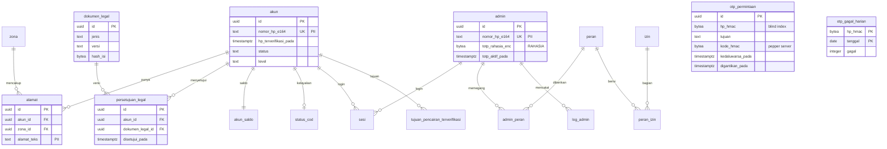
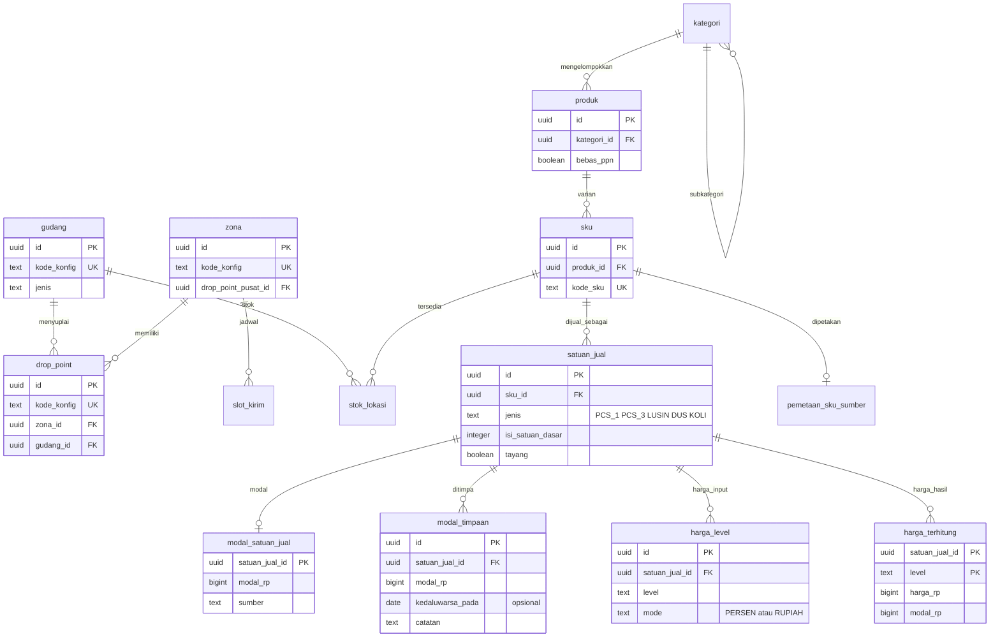
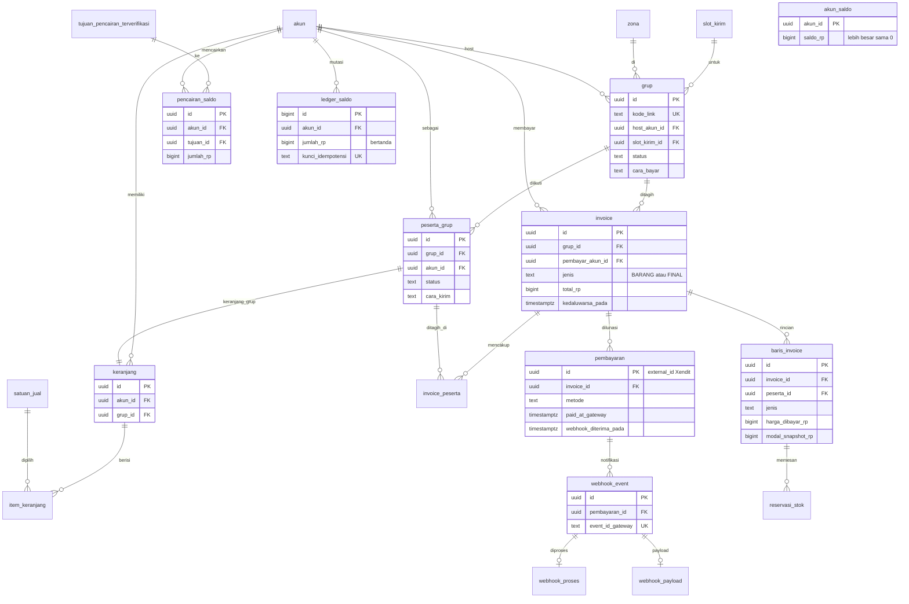
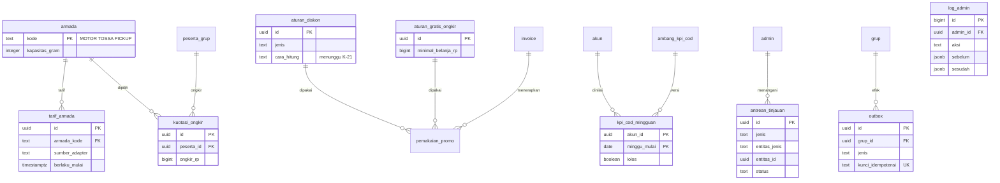

# T-004 — Model data & ERD (NEKAT Fase 1)

| Atribut | Nilai |
|---|---|
| Task | T-004 (`task/T-004-model-data`) · non-kode |
| Versi | 0.2 — Draf, 15 Nov 2026 (putaran perbaikan 1: append-only + pengecualian, keamanan OTP / pencairan / four-eyes, level `SATUAN`, ID keputusan resmi) |
| Penyusun | Backend Architect (squad Build & QA, pemilik: Joseph) |
| Sumber kebenaran | `project-specs/keputusan.md` (§1–§13). Bila bertentangan dengan dokumen lain, keputusan.md yang berlaku |
| Dibaca | `CLAUDE.md`, ADR-0001, `docs/flow/group-order.md` (T-002), `docs/spec/engine-harga.md` (T-003), `docs/spec/T-009-kontrak-inventory-source.md` |
| Dipakai oleh | T-013 (skema & migrasi), T-020, T-021, T-022, T-023, T-030, T-031, T-032, T-034, T-036–T-038, T-042 |

Dokumen ini hanya model. Tidak ada migrasi, angka harga, margin, tarif, nilai biaya admin, atau tarif PPN. Semua nilai bisnis
berasal dari panel admin / CSV / konfigurasi dan **kosong** secara bawaan. Hal yang belum diputuskan diberi kolom/enum fleksibel
dan ditandai `menunggu K-xx / P-xx`.

---

## 1. Prinsip

| # | Prinsip | Alasan |
|---|---|---|
| M1 | **Uang = `bigint` rupiah penuh** (integer, tanpa pecahan). Tipe TS `Rupiah` bermerek. Tidak ada `float`/`real`/`numeric` untuk nominal uang | Xendit IDR hanya menerima integer; H6 melarang pembulatan, jadi nilai pecahan **tidak boleh tercipta**, bukan dibulatkan. Dengan `bigint`, nilai pecahan tidak bisa tersimpan sama sekali: modal pecahan (K-01) dan hasil hitung pecahan ditolak di domain → SKU tidak tayang + `antrean_tinjauan`. `numeric` justru akan menyimpan pecahan diam-diam |
| M2 | **Persen = `numeric(9,4)`** (desimal eksak, bukan float), hanya untuk *rasio* (margin %, diskon %, tarif PPN). Hasil terapannya wajib integer rupiah; bila tidak → tidak tayang / tidak diterapkan + antrean (menunggu K-28) | **Keputusan teknis T-004** (bukan keputusan bisnis): DB menyimpan `numeric(9,4)` karena presisi persen P-01 belum ditetapkan dan input CSV harus tersimpan apa adanya; engine T-020 memetakan ke representasi internalnya (mis. basis poin) dan menolak presisi di luar batas dengan `MARGIN_FORMAT` |
| M3 | Waktu `timestamptz` (UTC), tanggal bisnis `date` dalam WIB. ID `uuid` (v7, urut waktu) kecuali disebut lain | ADR §3.2 |
| M4 | Status = `text` + `CHECK (status IN (...))`, bukan `ENUM` PostgreSQL | Menambah nilai (keputusan terbuka) cukup ganti constraint, tanpa `ALTER TYPE` |
| M5 | Tabel **append-only**: `ledger_saldo`, `log_admin`, `log_audit`, `webhook_event`, `persetujuan_legal`, `konfigurasi_ppn`, `pengajuan_koreksi_saldo`, `keputusan_koreksi_saldo` (status four-eyes dicatat sebagai baris keputusan baru, bukan UPDATE). Hak `UPDATE/DELETE` dicabut dari peran DB aplikasi `app_rw` + trigger penolak. **Pengecualian (hanya ini)**: (1) status proses webhook tidak disimpan di `webhook_event`, tetapi di tabel terpisah `webhook_proses`; (2) payload webhook ada di tabel terpisah `webhook_payload` yang boleh dihapus **hanya** oleh fungsi `SECURITY DEFINER` `pangkas_webhook_payload(batas timestamptz)` (dijalankan job retensi, peran `retensi`); (3) anonimisasi `persetujuan_legal` hanya lewat fungsi `SECURITY DEFINER` `anonimkan_akun(akun_id)` yang boleh meng-`NULL`-kan `ip_hmac` & `user_agent_ringkas` (kolom lain tetap); trigger penolak mengizinkan perubahan itu hanya bila `current_user` = pemilik fungsi. Setiap pemanggilan dicatat di `log_audit` | ADR §5.2, §7 |
| M6 | Snapshot saat **invoice diterbitkan** (harga, modal, PPN, versi aturan) disimpan di baris invoice; riwayat tidak ikut berubah | K-15, P-08 |
| M7 | Koordinat gudang / drop point / radius zona **hanya** di `config/lokasi.json`. DB menyimpan `kode_konfig` yang merujuk entri config | keputusan §5, §11 #3 |
| M8 | Kolom data pribadi ditandai **[PII]**; rahasia ditandai **[RAHASIA]** (hanya terenkripsi aplikasi, kunci di env). Detail akses & retensi di §6 | UU PDP, ADR §7 |
| M10 | ID `uuid` v7 **mudah ditebak** (urut waktu) → bukan pengaman. Setiap query resource pengguna wajib difilter `akun_id` dari sesi, dan **wajib ada tes** akses lintas akun per endpoint (T-044) | ADR §7 (CWE-639) |
| M11 | Kolom terenkripsi/HMAC membawa `kunci_versi smallint NN` agar kunci bisa dirotasi tanpa kehilangan data (baca dengan versi lama, tulis dengan versi baru) | rotasi kunci |
| M9 | Uang & status dijaga dua lapis: fungsi domain **dan** constraint DB. Pagar lintas baris (`SATUAN ≥ MITRA_GROSIR ≥ FRANCHISE`) hanya di domain; tabel hasil hanya boleh ditulis use case harga | ADR §3.2, engine-harga §4.2 |

Nama tabel/kolom: bahasa Indonesia, `snake_case`. Kolom audit standar (`dibuat_pada`, `diubah_pada`) tidak diulang di tabel bawah.

---

## 2. ERD

Diagram dipecah per domain agar terbaca. Atribut yang tampil hanya kunci & kolom penting; daftar lengkap di §3.

### 2.1 Akun, legal, admin

### 2.2 Lokasi, katalog, modal & harga

### 2.3 Keranjang, grup, invoice, pembayaran, saldo

### 2.4 Ongkir, promo, COD, operasional

---

## 3. Tabel entitas

Kunci: `PK` primary key, `FK` foreign key, `UK` unique. "NN" = `NOT NULL`. Semua FK `ON DELETE RESTRICT` kecuali disebut lain
(data transaksi tidak pernah dihapus berantai).

### 3.1 Akun & autentikasi

**`akun`** — pembeli. Unik per nomor HP terverifikasi OTP (keputusan §3).

| Kolom | Tipe | Catatan |
|---|---|---|
| id | uuid | PK |
| nomor_hp_e164 | text | **[PII]** NULL hanya setelah dianonimkan. `UK` parsial `WHERE nomor_hp_e164 IS NOT NULL`. `CHECK (nomor_hp_e164 ~ '^\+62[0-9]{8,13}$')` |
| hp_hmac | bytea | HMAC-SHA256(nomor HP, kunci env) + `kunci_versi` — blind index untuk deteksi daftar ulang setelah akun dihapus (anti banyak akun, F-10). NN. `UK` **penuh** (termasuk akun dihapus) — **menunggu K-35** (bila K-35 mengizinkan daftar ulang: ganti `UK` parsial `WHERE status <> 'DIHAPUS'`) |
| hp_terverifikasi_pada | timestamptz | NN. Akun hanya dibuat setelah OTP lolos |
| hp_diganti_pada | timestamptz | waktu ganti nomor HP terakhir; memicu jeda pencairan (§3.11) |
| nama_panggilan | text | **[PII]** opsional, 1–40 karakter; tampil tersamar di halaman grup |
| jenis_pelanggan | text | `CHECK IN ('PERORANGAN','MITRA_GROSIR','FRANCHISE')`, bawaan `PERORANGAN`. Mitra/Franchise sebagai akun = Fase 2+. Bukan level harga (§3.7) |
| status | text | `AKTIF`, `DIBEKUKAN`, `DIHAPUS`. Dibekukan = dana ditahan (F-10) |
| dibekukan_alasan | text | wajib bila `DIBEKUKAN` (`CHECK`) |
| dianonimkan_pada | timestamptz | diisi saat hapus akun; PII di-NULL-kan / diganti, transaksi tetap |

**`otp_permintaan`** — OTP WhatsApp (H2). Tidak pernah menyimpan kode asli.

| Kolom | Tipe | Catatan |
|---|---|---|
| id | uuid | PK |
| hp_hmac | bytea | NN. Bukan nomor asli |
| tujuan | text | `LOGIN_PEMBELI`, `LOGIN_ADMIN` (faktor pertama admin, H9) |
| kode_hmac | bytea | NN, HMAC-SHA256(kode, **pepper server** dari env) + `kunci_versi`; **[RAHASIA]**. Kode 6 digit terlalu kecil untuk hash biasa |
| percobaan | smallint | NN, `CHECK (percobaan >= 0)`; batas per kode di konfigurasi |
| kedaluwarsa_pada, terpakai_pada | timestamptz | `CHECK (terpakai_pada IS NULL OR terpakai_pada <= kedaluwarsa_pada)` |
| digantikan_pada | timestamptz | diisi saat OTP baru terbit untuk `(hp_hmac, tujuan)` yang sama — OTP lama langsung nonaktif |
| ip_hmac | bytea | untuk rate limit |

`UK (hp_hmac, tujuan) WHERE terpakai_pada IS NULL AND digantikan_pada IS NULL` (paling banyak satu OTP hidup). Indeks `(hp_hmac, dibuat_pada DESC)`.

**`otp_gagal_harian`** (anti tebak, CWE-307): PK `(hp_hmac, tanggal date WIB)`; `gagal` integer NN `CHECK (>= 0)`; `kirim` integer NN `CHECK (>= 0)`.
Penghitung **tidak di-reset** oleh kirim ulang OTP; melewati batas harian (konfigurasi) → verifikasi ditolak sampai hari berikutnya + `log_audit`.
Berlaku sama untuk `LOGIN_ADMIN`.

**`sesi`** — sesi pembeli & admin.

| Kolom | Tipe | Catatan |
|---|---|---|
| id_hash | bytea | PK (hash ID sesi; cookie memegang ID asli) |
| akun_id / admin_id | uuid | FK, `CHECK (num_nonnulls(akun_id, admin_id) = 1)` |
| faktor_kedua_pada | timestamptz | wajib terisi untuk sesi admin sebelum akses panel (H9) |
| reauth_pada | timestamptz | step-up OTP terakhir; aksi sensitif (pencairan, tambah tujuan pencairan, ganti HP) wajib `reauth_pada` dalam jendela konfigurasi |
| kedaluwarsa_pada, dicabut_pada | timestamptz | sesi admin lebih pendek (konfigurasi) |

**`alamat`** — alamat antar rumah.

| Kolom | Tipe | Catatan |
|---|---|---|
| id | uuid | PK |
| akun_id | uuid | FK `akun` NN |
| zona_id | uuid | FK `zona`, NULL = di luar zona (F-18) |
| label | text | "Rumah" dsb. |
| alamat_teks, patokan, catatan_kurir | text | **[PII]** |
| lat, lng | numeric(9,6) | **[PII]** titik lokasi rumah (untuk jarak ongkir) |
| dihapus_pada | timestamptz | soft delete; PII dihapus fisik saat anonimisasi |

### 3.2 Persetujuan legal berversi

**`dokumen_legal`**: `id` PK; `jenis` (`SYARAT_KETENTUAN`, `KEBIJAKAN_PRIVASI`); `versi` text; `hash_isi` bytea (SHA-256 isi `docs/legal/*` yang tayang);
`berlaku_mulai` timestamptz; `wajib_setuju_ulang` boolean NN bawaan `true` (menunggu F-23). `UK (jenis, versi)`.

**`persetujuan_legal`** (append-only): `id` PK; `akun_id` FK; `dokumen_legal_id` FK; `disetujui_pada` NN; `kanal` (`PWA`, `APP`);
`ip_hmac`, `user_agent_ringkas` **[PII]**. `UK (akun_id, dokumen_legal_id)`.

Guard (domain + query): ikut/membuat grup ditolak bila akun belum menyetujui versi **berlaku** S&K **dan** Kebijakan Privasi (keputusan §3).

### 3.3 Admin, peran, TOTP (H7, H9)

**`admin`**

| Kolom | Tipe | Catatan |
|---|---|---|
| id | uuid | PK |
| nama | text | **[PII]** |
| nomor_hp_e164 | text | **[PII]** `UK`. Faktor pertama (OTP WA) |
| totp_rahasia_enc | bytea | **[RAHASIA]** terenkripsi AES-GCM di aplikasi dengan **AAD = `admin_id`** (ciphertext tidak bisa dipindah ke admin lain), kunci dari env (bukan di DB), + `kunci_versi`. NN setelah aktivasi |
| totp_aktif_pada | timestamptz | NULL = belum aktivasi → tidak bisa masuk panel |
| totp_langkah_terakhir | bigint | cegah pemakaian ulang kode TOTP yang sama |
| gagal_beruntun, dikunci_sampai | smallint, timestamptz | penguncian setelah gagal berulang |
| status | text | `AKTIF`, `NONAKTIF` |

**`kode_pemulihan_totp`**: `admin_id` FK, `kode_hash` bytea **[RAHASIA]**, `dipakai_pada`. Sekali pakai.

**`peran`** (`kode` PK: `owner`, `admin`), **`izin`** (`kode` PK, pola `<domain>.<aksi>`), **`peran_izin`** (`UK (peran_kode, izin_kode)`),
**`admin_peran`** (`UK (admin_id, peran_kode)`). Fase 1 (ADR §7):

| Izin | owner | admin |
|---|---|---|
| `harga.ubah` (modal, timpaan modal, margin/harga, aturan promo) | ✓ | ✓ |
| `produk.ubah`, `stok.ubah`, `grup.kelola` (tahan/lepas/batal), `pesanan.kelola`, `ongkir.ubah`, `cod.kelola`, `tinjauan.tangani` | ✓ | ✓ |
| `saldo.koreksi`, `pencairan.proses` | ✓ | ✓ (dengan alasan wajib) |
| `pii.lihat` (nomor HP & alamat tanpa samaran) | ✓ | ✓ (hanya per pesanan yang dibuka, tercatat di `log_admin`) |
| `admin.kelola`, `admin.reset_totp`, `laporan.keuangan`, `konfigurasi.ubah` (PPN, TTL, biaya admin, ambang), `saldo.setujui` (four-eyes) | ✓ | — |

H7: minimal 2 admin aktif ber-TOTP — dicek job harian, bukan constraint.

**Reset TOTP**: hanya owner lain (`admin.reset_totp`, tidak bisa untuk diri sendiri: `CHECK` di domain + `log_admin`), alasan wajib; reset menghapus `totp_rahasia_enc` & kode pemulihan, mencabut semua sesi admin itu, dan admin wajib aktivasi ulang sebelum masuk panel. Semua langkah tercatat di `log_admin`.

**Four-eyes**: koreksi saldo kredit di atas ambang `saldo.ambang_four_eyes_rp` (konfigurasi, kosong = semua koreksi kredit butuh persetujuan) lewat `pengajuan_koreksi_saldo` + `keputusan_koreksi_saldo` (§3.11): pengaju ≠ penyetuju.

### 3.4 Lokasi: gudang, zona, drop point, slot kirim

**`gudang`**: `id` PK; `kode_konfig` text `UK` (entri `config/lokasi.json`); `nama`; `jenis` (`PUSAT`, `CABANG`; F-20 cabang penerima); `aktif`.
Tidak ada kolom koordinat (M7).

**`zona`**: `id` PK; `kode_konfig` `UK`; `nama_kelurahan`; `drop_point_pusat_id` FK **nullable, `DEFERRABLE INITIALLY DEFERRED`** (FK melingkar dengan `drop_point.zona_id`: zona & drop point pertama dibuat dalam satu transaksi; zona `aktif = true` wajib punya drop point, `CHECK (NOT aktif OR drop_point_pusat_id IS NOT NULL)`) (radius dihitung dari titik drop point, keputusan §5;
nilai radius di config); `gudang_id` FK (cabang penerima pesanan default); `aktif`.

**`drop_point`**: `id` PK; `kode_konfig` `UK`; `zona_id` FK; `gudang_id` FK; `nama`, `alamat_publik` (bukan PII, tempat usaha); `jam_ambil` text; `aktif`.
Data akses kurir/pengelola drop point menunggu H13 (Fase 1: daftar dari admin, tanpa akun kurir).

**`slot_kirim`**

| Kolom | Tipe | Catatan |
|---|---|---|
| id | uuid | PK |
| zona_id | uuid | FK NN |
| tanggal | date | WIB |
| mulai, selesai | time | WIB, `CHECK (selesai > mulai)` |
| cut_off_pada | timestamptz | NN, `CHECK` cut-off sebelum awal slot (dicek domain karena beda zona waktu) |
| kapasitas_gram | bigint | NULL = tanpa batas (T-006) |
| status | text | `DIBUKA`, `DITUTUP`, `DIBATALKAN` (F-21) |

`UK (zona_id, tanggal, mulai)`. Indeks `(cut_off_pada) WHERE status = 'DIBUKA'` untuk cron cut-off.

### 3.5 Katalog: kategori, produk, SKU, satuan jual

**`kategori`**: `id` PK; `induk_id` FK `kategori` (NULL = kategori, terisi = subkategori; maks. 2 tingkat, dicek domain); `kode` `UK`; `nama`; `urutan`; `aktif`.
Tidak ada kategori rokok/bir di seed Fase 1 (keputusan §7). Daftar kode terlarang ada di konfigurasi `kategori_terlarang`; produk/kategori yang cocok
→ ditolak / `antrean_tinjauan` jenis `KATEGORI` (P-24 terbuka).

**`produk`**

| Kolom | Tipe | Catatan |
|---|---|---|
| id | uuid | PK |
| kategori_id | uuid | FK ke **subkategori** NN |
| nama | text | 1–200 karakter |
| deskripsi, gambar_url | text | |
| bebas_ppn | boolean | NN bawaan `false` (G-04). Diubah lewat izin `harga.ubah`, tercatat |
| tinjauan_kategori | text | `TIDAK_PERLU`, `MENUNGGU`, `DISETUJUI` (engine-harga §8.3) |
| aktif | boolean | penanda admin; tayang ditentukan per satuan jual |

**`sku`**: `id` PK; `produk_id` FK; `kode_sku` `UK`; `barcode` (indeks); `nama_varian`; `satuan_dasar` (`pcs`, `gram`, `ml`) — kg/liter dari sumber dikonversi ke gram/ml saat sinkron agar stok & isi tetap integer; `aktif_di_sumber` boolean.
**`pemetaan_sku_sumber`**: `sku_id` PK/FK, `sku_sumber_id` text `UK` (Gudang). SKU sumber tanpa pemetaan → antrean `SKU_BELUM_DIPETAKAN`.

**`satuan_jual`** — unit yang dibeli pengguna (P-03).

| Kolom | Tipe | Catatan |
|---|---|---|
| id | uuid | PK |
| sku_id | uuid | FK NN |
| jenis | text | `CHECK IN ('PCS_1','PCS_3','LUSIN','DUS','KOLI')`. `UK (sku_id, jenis)` |
| isi_satuan_dasar | integer | NN `CHECK (> 0)`; `CHECK ((jenis='PCS_1' AND isi=1) OR (jenis='PCS_3' AND isi=3) OR (jenis='LUSIN' AND isi=12) OR jenis IN ('DUS','KOLI'))` |
| berat_gram | integer | NN `CHECK (>= 0)` (ongkir) |
| moq_mitra_grosir | integer | NULL = belum diatur; `CHECK (moq_mitra_grosir IS NULL OR > 0)` (F-04, P-05: per barang) |
| boleh_grup | boolean | NN bawaan `true` — kolom fleksibel, **menunggu P-21** |
| tayang | boolean | NN bawaan `false`; **hanya** ditulis use case harga/stok |
| alasan_tidak_tayang | text[] | kode `AlasanTidakTayang` (engine-harga §4.3), mis. `MODAL_KOSONG`, `MODAL_PECAHAN`, `MARGIN_KOSONG` |
| versi_harga | text | hash input harga terakhir (PG-6) |

Indeks katalog: `(tayang) WHERE tayang` + join `produk(kategori_id)`; perilaku produk stok habis (tampil berlabel atau disembunyikan) dikendalikan
konfigurasi `katalog.mode_stok_habis` — **menunggu K-20**.

### 3.6 Stok & reservasi

**`stok_lokasi`**: `UK (sku_id, gudang_id)`; `tersedia` bigint `CHECK (>= 0)` (satuan dasar: pcs / gram / ml); `data_pada`, `disinkron_pada` timestamptz (P-10 umur data; H14 tahan checkout).

**`reservasi_stok`** — dibuat saat **invoice diterbitkan** (barang di keranjang tidak memotong stok, P-08).

| Kolom | Tipe | Catatan |
|---|---|---|
| id | uuid | PK |
| baris_invoice_id | uuid | FK NN, `UK` (satu reservasi per baris) |
| sku_id, gudang_id | uuid | FK NN |
| qty_satuan_dasar | integer | `CHECK (> 0)` |
| status | text | `AKTIF`, `TERPAKAI` (cut-off/alokasi), `DILEPAS` (kedaluwarsa, batal, dikeluarkan) |

Indeks `(sku_id, gudang_id) WHERE status = 'AKTIF'` — stok bebas = `tersedia − Σ reservasi AKTIF`. Stok tidak cukup saat invoice → invoice dibatalkan (P-08).

### 3.7 Modal & harga per level

**`modal_satuan_jual`** — modal berlaku per satuan jual (K-01: input manual per satuan jual).

| Kolom | Tipe | Catatan |
|---|---|---|
| satuan_jual_id | uuid | PK/FK |
| modal_rp | bigint | NULL = kosong → tidak tayang. `CHECK (modal_rp IS NULL OR modal_rp > 0)` |
| sumber | text | `MANUAL` (panel/CSV, `LocalInventory`), `GUDANG` (`GudangApiInventory`) |
| modal_gudang_rp | bigint | nilai terakhir dari Gudang, disimpan untuk perbandingan saat ada timpaan (P-25) |
| data_pada, disinkron_pada | timestamptz | umur data modal (P-10) |

Modal pecahan dari CSV/Gudang **tidak** disimpan di `modal_rp` (M1): nilai mentah masuk `antrean_tinjauan.data` jenis `MODAL_PECAHAN`, satuan jual
`tayang = false` + alasan `MODAL_PECAHAN` (K-01). Penurunan modal dari Gudang → hanya `log_audit` (K-02).

**`modal_timpaan`** — timpaan modal admin (P-25, K-03).

| Kolom | Tipe | Catatan |
|---|---|---|
| id | uuid | PK |
| satuan_jual_id | uuid | FK NN |
| modal_rp | bigint | NN `CHECK (> 0)` |
| catatan | text | NN (alasan wajib) |
| kedaluwarsa_pada | date | **opsional**. Bukan pencabutan otomatis: saat tercapai, job harian membuat `antrean_tinjauan` jenis `TIMPAAN_KEDALUWARSA` + notifikasi admin berisi barang & catatan (K-03: hanya pengingat, timpaan tetap berlaku sampai dicabut admin) |
| notifikasi_dikirim_pada | timestamptz | idempotensi notifikasi kedaluwarsa |
| dibuat_oleh, dicabut_oleh | uuid | FK `admin` |
| dicabut_pada | timestamptz | NULL = aktif |

`UK (satuan_jual_id) WHERE dicabut_pada IS NULL` (satu timpaan aktif). Indeks `(kedaluwarsa_pada) WHERE dicabut_pada IS NULL AND notifikasi_dikirim_pada IS NULL`.
Modal efektif = timpaan aktif, bila tidak ada = `modal_satuan_jual.modal_rp`.

**`harga_level`** — input harga per level per satuan jual (P-01). Field kosong = level itu tidak tayang.

| Kolom | Tipe | Catatan |
|---|---|---|
| id | uuid | PK |
| satuan_jual_id | uuid | FK NN |
| level | text | `CHECK IN ('SATUAN','MITRA_GROSIR','FRANCHISE')`. `UK (satuan_jual_id, level)` |
| mode | text | `PERSEN` atau `RUPIAH` (P-01) |
| margin_persen | numeric(9,4) | NULL = kosong. `CHECK (margin_persen IS NULL OR margin_persen > 0)` (P-16: margin 0 dilarang) |
| harga_jual_rp | bigint | NULL = kosong. `CHECK (harga_jual_rp IS NULL OR harga_jual_rp > 0)` |
| — | | `CHECK ((mode='PERSEN' AND harga_jual_rp IS NULL) OR (mode='RUPIAH' AND margin_persen IS NULL))` |

Arti level (keputusan §11–§12). Nama `SATUAN` dipakai (bukan "individu") agar tidak tertukar dengan "harga grup individu":
- `SATUAN` = harga satuan (grup < minimum belanja grup K-18, grup gagal). Wajib terisi agar tayang.
- `MITRA_GROSIR` = **harga grup individu** (K-14) **dan** harga Mitra drop point bila syarat `moq_mitra_grosir` terpenuhi (P-05, K-08).
  Kosong tidak menahan tayang (P-06); satuan jual itu **tidak punya harga grup** dan selalu memakai `SATUAN` — **menunggu K-27**.
- `FRANCHISE` = disiapkan, tidak dipakai checkout Fase 1.

**`harga_terhitung`** — hasil engine (ditulis hanya use case harga, M9).

| Kolom | Tipe | Catatan |
|---|---|---|
| satuan_jual_id, level | uuid, text | PK gabungan |
| modal_rp | bigint | modal efektif saat dihitung |
| harga_rp | bigint | `CHECK (modal_rp > 0 AND harga_rp > modal_rp)` (PG-1 + P-16) |
| versi_harga | text | NN |
| dihitung_pada | timestamptz | |

Pagar `SATUAN ≥ MITRA_GROSIR ≥ FRANCHISE` (CLAUDE.md "grup individu ≥ Mitra Grosir ≥ Franchise", K-08, K-14) ditegakkan domain sebelum tulis; tidak bisa `CHECK` lintas baris.
Bila hasil persen tidak integer → baris tidak ditulis, alasan `HARGA_PECAHAN` (menunggu K-28).

### 3.8 Keranjang & grup (G-01: grup per keranjang, campur produk)

**`keranjang`**: `id` PK; `akun_id` FK NN; `grup_id` FK NULL (NULL = keranjang pribadi sebelum masuk grup); `status` (`AKTIF`, `DIPAKAI_GRUP`, `DITINGGALKAN`).
`UK (akun_id) WHERE grup_id IS NULL AND status='AKTIF'` (satu keranjang pribadi aktif); `UK (akun_id, grup_id) WHERE grup_id IS NOT NULL AND status <> 'DITINGGALKAN'`;
`UK (id, akun_id, grup_id)` (target FK komposit dari `peserta_grup`).
Ikut lagi setelah `DIKELUARKAN`/`BATAL`: keranjang lama → `DITINGGALKAN`, dibuat **peserta & keranjang baru** (riwayat utuh). Boleh/tidaknya ikut lagi
dan syaratnya **menunggu K-22** (ikut/menambah barang setelah tagihan terbit) dan **K-30** (batal sendiri setelah tagihan terbit) (bawaan sementara: boleh ikut lagi selama grup `DIBUKA`/`AKTIF`).

**`item_keranjang`**: `id` PK; `keranjang_id` FK (`ON DELETE CASCADE` — satu-satunya cascade, data belum transaksi); `satuan_jual_id` FK;
`qty` integer `CHECK (> 0)`; `UK (keranjang_id, satuan_jual_id)`. Tanpa harga (harga dihitung server, ADR §5.3); tidak memotong stok.

**`grup`**

| Kolom | Tipe | Catatan |
|---|---|---|
| id | uuid | PK |
| kode_link | text | `UK`, 6 karakter acak kriptografis tanpa karakter ambigu (`nekat.id/g/{kode}`, domain dari config #6). `CHECK (kode_link ~ '^[A-HJ-NP-Z2-9]{6}$')` |
| host_akun_id | uuid | FK `akun` NN (pembuat grup) |
| zona_id, slot_kirim_id | uuid | FK NN |
| gudang_id | uuid | FK — cabang penerima pesanan, cek stok sebelum diproses (F-20) |
| status | text | §4.1 |
| alasan_status | text | mis. `AKUN_LUNAS_KURANG_DARI_3` (K-12), `DI_BAWAH_MODAL` (P-09/P-26), `STOK_TIDAK_TERKONFIRMASI` |
| cara_bayar | text | `SENDIRI` (bawaan, G-07) atau `HOST` (dipilih host saat invoice tersedia; K-17 → invoice gabungan) |
| min_akun | smallint | NN snapshot konfigurasi `grup.min_akun`; `CHECK (min_akun >= 3)` (keputusan §3 tidak bisa dilonggarkan lewat konfigurasi) |
| akun_menambah_barang | integer | cache hitungan akun berbeda yang punya item (K-17), dihitung ulang di transaksi |
| akun_lunas | integer | cache hitungan akun lunas (K-12) |
| total_belanja_rp | bigint | cache total grup untuk syarat minimum belanja grup (F-30, K-09, K-18; nilai minimum di konfigurasi) |
| harga_grup_berlaku | boolean | true bila ≥ 3 akun dan total ≥ minimum (K-09, K-14, K-18) |
| evaluasi_dimulai_pada | timestamptz | pagar balapan webhook vs cut-off (flow B-11.5) |
| ditahan_pada | timestamptz | P-09/P-26; alasan di `alasan_status`, penyelesaian admin di `log_admin` |
| dibatalkan_pada | timestamptz | riwayat "batal" (F-29) |

Indeks: `(slot_kirim_id, status)`, `(host_akun_id)`, `(status) WHERE status = 'DITAHAN'` (antrean admin).
Tidak ada `UK (produk, zona, slot)` lagi (ADR §3.2 M-10 usang karena G-01).

**`peserta_grup`**

| Kolom | Tipe | Catatan |
|---|---|---|
| id | uuid | PK |
| grup_id, akun_id | uuid | FK NN. `UK (grup_id, akun_id) WHERE status NOT IN ('DIKELUARKAN','BATAL','DIREFUND')` |
| keranjang_id | uuid | NN `UK`; **FK komposit** `(keranjang_id, akun_id, grup_id) → keranjang(id, akun_id, grup_id)` agar keranjang pasti milik akun & grup yang sama |
| peran | text | `HOST`, `ANGGOTA` |
| status | text | §4.2 |
| cara_kirim | text | `ANTAR_RUMAH`, `DROP_POINT` (F-12: campur dalam satu grup) |
| alamat_id / drop_point_id | uuid | FK; `CHECK ((cara_kirim='ANTAR_RUMAH' AND alamat_id IS NOT NULL) OR (cara_kirim='DROP_POINT' AND drop_point_id IS NOT NULL))` |
| alamat_snapshot | jsonb | **[PII]** salinan alamat saat invoice (untuk daftar antar) |
| level_harga | text | `SATUAN` / `MITRA_GROSIR` hasil evaluasi |
| pilihan_saat_gagal | text | `BELUM_MEMILIH`, `LANJUT_SATUAN`, `BATAL_KE_SALDO` — **menunggu K-11** |
| dana_ditahan | boolean | NN bawaan `false` (F-10) |
| kredit_tertahan_rp | bigint | kredit cut-off yang tidak ditulis karena dana ditahan |
| bergabung_pada, dikeluarkan_pada | timestamptz | K-12 |
| ref_pengundang_akun_id | uuid | FK `akun` NULL — atribusi "ajak tetangga", **menunggu F-22** |

### 3.9 Invoice (TTL, snapshot, ongkir final, biaya admin, PPN, host bayar)

**`invoice`** — Fase 1 **hanya lewat grup**: `grup_id` NN. Konsisten dengan K-18 (grup di bawah minimum belanja tetap lewat grup, memakai harga `SATUAN`). Jalur beli biasa di luar grup (F-27, terbuka) cukup migrasi expand `grup_id` → nullable.

| Kolom | Tipe | Catatan |
|---|---|---|
| id | uuid | PK |
| nomor | text | `UK`, nomor nota tampil |
| grup_id | uuid | FK NN |
| pembayar_akun_id | uuid | FK NN. `SENDIRI` = akun peserta; `HOST` = host (G-06b: kredit selisih/refund ke akun pembayar) |
| jenis | text | `BARANG` (invoice awal, wajib lunas dalam TTL) atau `FINAL` (ongkir & penyesuaian setelah harga terkunci, K-10) |
| gabungan | boolean | true bila mencakup >1 peserta (K-17) |
| status | text | `DITERBITKAN`, `LUNAS`, `KEDALUWARSA`, `DIBATALKAN` (stok habis, P-08), `DIGANTI` (diganti invoice gabungan) |
| diterbitkan_pada | timestamptz | NN — awal hitung TTL (K-07) |
| ttl_menit | smallint | NN, snapshot konfigurasi (F-26) |
| kedaluwarsa_pada | timestamptz | NN, diisi domain = `diterbitkan_pada` + `ttl_menit`; `CHECK (kedaluwarsa_pada > diterbitkan_pada)`. Invoice gabungan host: = `kedaluwarsa_pada` **tertua** dari invoice yang digantikan (tidak memperpanjang TTL; **default, menunggu K-37**) |
| menggantikan_invoice_ids | uuid[] | untuk invoice gabungan; invoice lama → `DIGANTI` di transaksi yang sama |
| subtotal_barang_rp, potongan_rp, biaya_admin_rp, ongkir_rp, subsidi_ongkir_rp | bigint | NN `CHECK (>= 0)`, jumlah dari `baris_invoice` |
| ppn_rp, dpp_rp | bigint | rincian PPN (G-04; harga tampil sudah termasuk PPN). Cara hitung **menunggu K-28** |
| konfigurasi_ppn_id | uuid | FK `konfigurasi_ppn` (snapshot versi) |
| total_rp | bigint | NN `CHECK (total_rp = subtotal_barang_rp - potongan_rp + biaya_admin_rp + ongkir_rp - subsidi_ongkir_rp AND total_rp >= 0)` |
| saldo_dipakai_rp | bigint | NN `CHECK (>= 0 AND <= total_rp)` (G-03: poin = saldo, digabung metode lain) |
| sisa_bayar_rp | bigint | NN `CHECK (sisa_bayar_rp = total_rp - saldo_dipakai_rp)`; 0 = lunas penuh dengan saldo |
| lunas_pada | timestamptz | dari `paid_at` Xendit atau waktu debit saldo (F-11) |

Indeks: `(status, kedaluwarsa_pada) WHERE status='DITERBITKAN'` (job kedaluwarsa K-12), `(grup_id, jenis)`, `(pembayar_akun_id, diterbitkan_pada DESC)`.

**`invoice_peserta`**: `invoice_id` FK, `peserta_id` FK, `jenis` (salinan), `aktif` boolean. `UK (peserta_id, jenis) WHERE aktif` — satu invoice aktif
per peserta per jenis. Peralihan ke invoice gabungan (K-17), **satu transaksi**: invoice lama → `DIGANTI`, `invoice_peserta` lama `aktif=false`,
semua `baris_invoice` lama (termasuk `BIAYA_ADMIN`) `dibatalkan=true`, baris disalin ke invoice gabungan, pembayaran Xendit lama dibatalkan
(di luar transaksi, lewat outbox), reservasi stok dipindah ke baris baru.

**`baris_invoice`** — snapshot per baris saat invoice (K-15).

| Kolom | Tipe | Catatan |
|---|---|---|
| id | uuid | PK |
| invoice_id, peserta_id | uuid | FK NN |
| jenis | text | `BARANG`, `BIAYA_ADMIN` (G-05/K-06; di invoice `BARANG` atau `FINAL` dan perlakuan saat host bayar **menunggu K-26**), `BIAYA_ADMIN_PAGAR` (kekurangan pagar modal sebagai biaya admin, P-16/P-23), `ONGKIR`, `SUBSIDI_ONGKIR`, `DISKON` |
| satuan_jual_id | uuid | FK, wajib untuk `BARANG` |
| nama_snapshot | text | nama produk + satuan saat invoice |
| qty | integer | `CHECK (qty > 0)` |
| level_harga | text | `SATUAN` / `MITRA_GROSIR` |
| harga_dibayar_rp | bigint | harga per satuan jual saat invoice |
| modal_snapshot_rp | bigint | modal efektif saat invoice; `CHECK (jenis <> 'BARANG' OR (modal_snapshot_rp > 0 AND harga_dibayar_rp > modal_snapshot_rp))` |
| versi_harga | text | |
| potongan_baris_rp, subsidi_ongkir_baris_rp | bigint | `CHECK (>= 0)`; **nilai bersih** saat invoice, lantai keras DB: `harga_dibayar_rp*qty - potongan_baris_rp - subsidi_ongkir_baris_rp >= modal_snapshot_rp*qty`; batas promo yang lebih ketat `≥ modal × (1+β)` di domain (P-07, K-16) (alokasi subsidi **menunggu P-20**) |
| bebas_ppn | boolean | snapshot `produk.bebas_ppn` |
| ppn_baris_rp, dpp_baris_rp | bigint | NULL bila bebas PPN |
| nilai_rp | bigint | NN; nilai baris (negatif hanya untuk `DISKON`/`SUBSIDI_ONGKIR`) |
| modal_cutoff_rp, harga_final_rp | bigint | diisi saat cut-off; `harga_final_rp` NULL bila alokasi 0. `CHECK (harga_final_rp IS NULL OR harga_final_rp >= modal_cutoff_rp)` — harga final adalah hasil `min(harga dibayar, harga live cut-off)`, bukan harga sel baru, jadi pagarnya **≥** (P-09); grup DITAHAN bila tidak lolos |
| nilai_bersih_final_rp | bigint | diisi saat cut-off = kewajiban barang bersih setelah kredit selisih dibatasi (P-23). `CHECK (nilai_bersih_final_rp IS NULL OR nilai_bersih_final_rp >= modal_cutoff_rp*qty_teralokasi + CASE WHEN qty_teralokasi > 0 THEN subsidi_ongkir_baris_rp ELSE 0 END)` (P-23, P-26); kekurangan dicatat sebagai `BIAYA_ADMIN_PAGAR` |
| qty_teralokasi | integer | `CHECK (qty_teralokasi BETWEEN 0 AND qty)` (F-09) |
| penanggung_selisih_naik | text | NULL; kolom fleksibel bila harga final > harga dibayar tetapi ≥ modal — **menunggu P-19** (sementara domain: harga final ≤ harga dibayar, PG-7) |
| dibatalkan | boolean | NN bawaan `false` |

`UK (peserta_id) WHERE jenis='BIAYA_ADMIN' AND NOT dibatalkan` — biaya admin flat satu kali per akun per grup (K-06; nilai dari `konfigurasi.biaya_admin_rp`, kosong bawaan).
Invoice final yang tidak dilunasi (ongkir, K-10): status & tindak lanjut **menunggu K-25** (bawaan sementara: invoice `KEDALUWARSA` + `antrean_tinjauan` jenis `INVOICE_FINAL_BELUM_LUNAS`, barang tidak dikirim otomatis).
Indeks `(invoice_id)`, `(peserta_id)`, `(satuan_jual_id)`.

**`konfigurasi_ppn`** (versi, append-only): `id`, `tarif_persen` numeric(9,4) NULL, `dpp_pembilang`/`dpp_penyebut` integer NULL, `berlaku_mulai`, `dibuat_oleh`.
Semua NULL bawaan; diisi owner (G-04). Tidak ada nilai di dokumen/kode.

### 3.10 Pembayaran Xendit

**`pembayaran`**

| Kolom | Tipe | Catatan |
|---|---|---|
| id | uuid | PK = `external_id` ke Xendit (M-06: retry tidak membuat invoice ganda) |
| invoice_id | uuid | FK NN |
| metode | text | `CHECK IN ('QRIS','VA')` untuk invoice grup (F-01: grup dilunasi via VA/QRIS). Nilai `EWALLET` (keputusan §9) disiapkan di kode tetapi **tidak** diizinkan constraint untuk grup — **menunggu K-36** |
| kanal | text | kode bank VA / e-wallet |
| jumlah_rp | bigint | NN `CHECK (> 0)`, harus = `invoice.sisa_bayar_rp` saat dibuat |
| xendit_ref | text | `UK` (id invoice/QR/VA di Xendit) |
| status | text | `MENUNGGU`, `LUNAS`, `KEDALUWARSA`, `GAGAL`, `NOMINAL_TIDAK_COCOK` |
| paid_at_gateway | timestamptz | **basis keterlambatan** (F-11) |
| webhook_diterima_pada | timestamptz | tetap disimpan (F-11) |
| kunci_idempotensi | text | `UK` |

`UK (invoice_id) WHERE status IN ('MENUNGGU','LUNAS')` — satu pembayaran hidup per invoice. Indeks `(status, dibuat_pada)` untuk rekonsiliasi.

**`webhook_event`** (append-only): `id` PK; `gateway` text NN; `event_id_gateway` text **NN**; `external_id` NN; `status` NN; `pembayaran_id` FK `pembayaran` (NULL = event yatim → `antrean_tinjauan`);
`diterima_pada` NN. Dedup: `UK (gateway, event_id_gateway)` **dan** `UK (gateway, external_id, status)`.
**`webhook_proses`**: `webhook_event_id` PK/FK; `diproses_pada`; `hasil` (`DIPROSES`, `DUPLIKAT`, `YATIM`, `NOMINAL_TIDAK_COCOK`, `TERLAMBAT`). Ditulis di transaksi pemrosesan (M5).
**`webhook_payload`**: `webhook_event_id` PK/FK; `payload_redaksi` jsonb (nama/HP/email pembayar dihapus sebelum simpan). Dipangkas oleh `pangkas_webhook_payload` (M5, §6.3).

### 3.11 Saldo = loyalty point (K-13, G-06)

**`akun_saldo`**: `akun_id` PK/FK; `saldo_rp` bigint NN `CHECK (saldo_rp >= 0)` (tidak boleh negatif); dikunci `FOR UPDATE` terakhir dalam urutan kunci (ADR §3.2).
1 poin = Rp1, jadi tidak ada kolom poin terpisah; tidak ada kolom kedaluwarsa (G-06c).

**`ledger_saldo`** (append-only)

| Kolom | Tipe | Catatan |
|---|---|---|
| id | bigint identity | PK |
| akun_id | uuid | FK NN (akun pembayar/host saat host bayar, G-06b) |
| jumlah_rp | bigint | NN `CHECK (jumlah_rp <> 0)`; + kredit, − debit |
| jenis | text | `SELISIH_HARGA`, `REFUND`, `REFUND_ONGKIR`, `BAYAR_TERLAMBAT`, `PAKAI_CHECKOUT`, `SALDO_BALIK`, `KOREKSI_ADMIN`, `PENCAIRAN`, `PENCAIRAN_BATAL` |
| referensi_jenis, referensi_id | text, uuid | grup/peserta/invoice/pembayaran/pencairan |
| kunci_idempotensi | text | NN `UK` (mis. `selisih:{grup_id}:{peserta_id}`, `refund:{peserta_id}:{alasan}:{seq}` — `seq` urut per peserta agar refund parsial berulang tetap unik, `debit:{invoice_id}`, `cair:{pencairan_id}`, `koreksi:{pengajuan_id}`) |
| alasan | text | wajib untuk `KOREKSI_ADMIN` (`CHECK`) |
| dibuat_oleh_admin_id | uuid | FK, pengaju koreksi |
| disetujui_oleh_admin_id | uuid | FK; wajib untuk `KOREKSI_ADMIN` kredit di atas ambang four-eyes; `CHECK (disetujui_oleh_admin_id IS NULL OR disetujui_oleh_admin_id <> dibuat_oleh_admin_id)` |
| dapat_dicairkan_sejak | timestamptz | masa tahan sebelum kredit boleh dicairkan: untuk kredit dari pembayaran baru (`REFUND`, `SELISIH_HARGA`, `BAYAR_TERLAMBAT`) & `KOREKSI_ADMIN`; lama tahan dari konfigurasi (kosong) — **menunggu K-34** |
| saldo_sesudah_rp | bigint | **NN** `CHECK (>= 0)`; memudahkan riwayat & rekonsiliasi |

Indeks `(akun_id, id DESC)` (riwayat saldo). Invarian dites + job harian: `akun_saldo.saldo_rp = SUM(ledger_saldo.jumlah_rp)`.

**`pengajuan_koreksi_saldo`** (four-eyes, append-only): `id`; `akun_id` FK; `jumlah_rp` bigint `CHECK (<> 0)`; `alasan` NN; `diajukan_oleh` FK `admin` NN; `diajukan_pada`.
**`keputusan_koreksi_saldo`** (append-only): `pengajuan_id` PK/FK (satu keputusan per pengajuan); `hasil` (`DISETUJUI`, `DITOLAK`); `diputuskan_oleh` FK `admin` NN;
`catatan`; `diputuskan_pada`. Trigger/domain: `diputuskan_oleh <> pengajuan.diajukan_oleh`. Status pengajuan = ada/tidaknya baris keputusan (tanpa UPDATE).
Ledger `KOREKSI_ADMIN` (kunci `koreksi:{pengajuan_id}`) ditulis di transaksi yang sama dengan keputusan `DISETUJUI`.

**`tujuan_pencairan_terverifikasi`** — tujuan pencairan yang lolos validasi.

| Kolom | Tipe | Catatan |
|---|---|---|
| id | uuid | PK |
| akun_id | uuid | FK NN |
| tujuan_jenis, tujuan_kode | text | `BANK`, `VA`, `EWALLET` + kode bank/e-wallet |
| nomor_tujuan_enc | bytea | **[PII][RAHASIA]** AES-GCM, AAD = `akun_id`, + `kunci_versi` |
| nomor_tujuan_akhir | text | 4 digit terakhir untuk tampilan |
| nama_hasil_validasi | text | **[PII]** nama pemilik dari validasi akun Xendit |
| nama_cocok | boolean | NN; hasil *name-match* dengan pemilik akun NEKAT; `false` → tidak bisa dipakai |
| xendit_validasi_ref | text | |
| divalidasi_pada | timestamptz | NN |
| boleh_dipakai_sejak | timestamptz | NN = `divalidasi_pada` + jeda tujuan baru (konfigurasi, kosong) |
| dinonaktifkan_pada | timestamptz | |

**`pencairan_saldo`** — G-06d (fitur dikunci `pencairan.aktif=false` sampai tinjauan hukum H5).

| Kolom | Tipe | Catatan |
|---|---|---|
| id | uuid | PK |
| akun_id | uuid | FK NN |
| jumlah_rp | bigint | `CHECK (> 0)`; debit ledger `PENCAIRAN` saat diajukan, `PENCAIRAN_BATAL` bila gagal |
| tujuan_id | uuid | FK `tujuan_pencairan_terverifikasi` NN (`nama_cocok = true`, `sekarang ≥ boleh_dipakai_sejak`) |
| reauth_sesi_pada | timestamptz | NN, salinan `sesi.reauth_pada` (step-up OTP) saat pengajuan |
| status | text | `DIAJUKAN`, `DISETUJUI`, `DIPROSES`, `BERHASIL`, `GAGAL`, `DITOLAK` |
| xendit_disbursement_ref | text | `UK` |
| kunci_idempotensi | text | `UK` |
| disetujui_oleh, diproses_oleh | uuid | FK `admin`; di atas ambang four-eyes `CHECK (disetujui_oleh <> diproses_oleh)` |

Guard pengajuan (domain, dalam transaksi berkunci `akun_saldo`) — **semua wajib sebelum `pencairan.aktif = true`**; nilai & aturan bisnisnya **menunggu K-34** (konfigurasi kosong):
akun `AKTIF` (bukan `DIBEKUKAN`) dan tidak ada peserta `dana_ditahan`; step-up OTP baru; jeda setelah tujuan baru **dan** setelah `akun.hp_diganti_pada`;
limit harian `pencairan.limit_harian_rp` (indeks `(akun_id, dibuat_pada)`); jumlah ≤ saldo yang `dapat_dicairkan_sejak ≤ sekarang`.

### 3.12 Armada, tarif, ongkir (K-05, P-12)

**`armada`**: `kode` PK (`MOTOR`, `TOSSA`, `PICKUP`); `kapasitas_gram` bigint NULL; `aktif`. Pemilihan armada terkecil yang cukup di domain (keputusan §4).

**`tarif_armada`** (versi): `id`; `armada_kode` FK; `tarif_dasar_rp`, `tarif_per_kg_rp`, `tarif_per_km_rp` bigint **NULL semua** (`CHECK (IS NULL OR >= 0)`);
`sumber_adapter` text (aplikasi eksternal, #4); `ref_eksternal`; `berlaku_mulai`; `diambil_pada`. NULL = antar rumah tidak tersedia (ADR §5.3).

**`kuotasi_ongkir`**: `id`; `peserta_id` FK; `armada_kode` FK; `berat_gram`, `jarak_meter` integer; `ongkir_rp` bigint NN `CHECK (>= 0)` (angka jadi dari adapter, pembulatan
ikut adapter, P-12); `sumber_adapter`, `ref_eksternal`; `berlaku_sampai`; `dipakai_di_invoice_id` FK. Ongkir masuk invoice `FINAL` (K-10); drop point = 0.

### 3.13 Diskon & gratis ongkir

**`aturan_diskon`**

| Kolom | Tipe | Catatan |
|---|---|---|
| id | uuid | PK |
| nama | text | |
| jenis | text | `PERSEN`, `NOMINAL` |
| nilai_persen / nilai_rp | numeric(9,4) / bigint | sesuai jenis, `CHECK (> 0)`; kosong bawaan |
| cakupan_jenis | text | `SEMUA`, `PRODUK`, `KATEGORI`, `LEVEL`, `ZONA` |
| cakupan_ids | uuid[] | daftar id sesuai cakupan |
| level | text | NULL = semua level |
| cara_hitung | text | `TOTAL_PROPORSIONAL`, `PER_BARANG` — **menunggu K-21** (tidak menumpuk, P-15) |
| berlaku_mulai, berlaku_sampai | timestamptz | `CHECK (berlaku_sampai > berlaku_mulai)` |
| kuota, terpakai | integer | `CHECK (terpakai >= 0 AND (kuota IS NULL OR terpakai <= kuota))` |
| maks_per_akun | integer | NULL = tanpa batas; `CHECK (IS NULL OR > 0)`; dicek di transaksi checkout (cegah penimbunan, CWE-770) |
| aktif | boolean | |

**`aturan_gratis_ongkir`**: `id`; `minimal_belanja_rp` bigint NULL (dihitung **sesudah** diskon, P-13); `zona_id`, `level`, periode; `subsidi_jenis` (`PENUH`, `MAKS`);
`subsidi_maks_rp` bigint NULL; `kuota`, `terpakai`, `maks_per_akun`; `aktif`.

**`pemakaian_promo`**: `id`; `aturan_diskon_id` / `aturan_gratis_ongkir_id` (tepat satu, `CHECK num_nonnulls = 1`); `invoice_id` FK; `akun_id` FK; `status`
(`DIRESERVASI`, `TERPAKAI`, `DILEPAS`); `alasan_tidak_memenuhi` text (P-27: tampilkan "tidak memenuhi syarat" + alasan + saran). `UK (aturan_*, invoice_id)`. Indeks `(aturan_*, akun_id) WHERE status <> 'DILEPAS'` untuk `maks_per_akun`.

Batas bawah promo & gratis ongkir (P-07, K-16): nilai bersih per baris `≥ modal × (1+β)`, β = konfigurasi `promo.batas_bawah_margin` (nilai tidak ditulis di sini); dicek domain per baris.

### 3.14 COD: KPI mingguan (keputusan §2)

**`ambang_kpi_cod`** (versi): `id`; `min_pesanan_selesai` integer NULL; `min_sukses_persen` numeric(5,2) NULL; `maks_penolakan`, `maks_batal_setelah_kirim` integer NULL;
`berlaku_mulai`; `dibuat_oleh`. Default usulan keputusan §2 diisi admin (#2 belum final).

**`kpi_cod_mingguan`**: PK `(akun_id, minggu_mulai date WIB)`; `pesanan_selesai`, `pesanan_total`, `penolakan`, `batal_setelah_kirim` integer `CHECK (>= 0)`;
`sukses_persen` numeric(5,2); `lolos` boolean; `ambang_id` FK; `dihitung_pada`. Job idempoten per `(akun, minggu)`.

**`status_cod`**: `akun_id` PK; `minggu_lolos_berturut` smallint `CHECK (>= 0)`; `aktif` boolean (= lolos 3 minggu berturut-turut); `dicabut_manual_pada`,
`dicabut_oleh`, `alasan_cabut` (`CHECK`: wajib bila dicabut manual). Batas nominal COD per pesanan = konstanta keputusan §2 di domain. Perbandingan batas
sebelum/sesudah saldo menunggu P-18.

### 3.15 Log, audit, antrean "perlu ditinjau", outbox, job

**`log_admin`** (append-only): `id` bigint; `admin_id` FK NN; `izin_kode`; `entitas_jenis`, `entitas_id`; `sebelum`, `sesudah` jsonb (**tanpa PII** — PII diganti `[REDAKSI]`);
`alasan` text; `ip_hmac`; `waktu`. Indeks `(entitas_jenis, entitas_id, waktu DESC)`, `(admin_id, waktu DESC)`. Termasuk akses `pii.lihat`.

**`log_audit`** (append-only): kejadian sistem — sinkron Gudang, penurunan modal (K-02), cut-off, job, login gagal. Kolom: `id`, `jenis`, `aktor` (`SISTEM`, `PENGGUNA`, `ADMIN`),
`ref_jenis`, `ref_id`, `data` jsonb (tanpa PII), `waktu`.

**`antrean_tinjauan`**

| Kolom | Tipe | Catatan |
|---|---|---|
| id | uuid | PK |
| jenis | text | `MODAL_PECAHAN` (K-01), `HARGA_PECAHAN` (K-28), `INVOICE_FINAL_BELUM_LUNAS` (K-25), `KATEGORI`, `SKU_BELUM_DIPETAKAN`, `TIMPAAN_KEDALUWARSA` (K-03), `GRUP_DITAHAN` (P-09/P-26), `DANA_DITAHAN` (F-10), `PEMBAYARAN_YATIM`, `NOMINAL_TIDAK_COCOK`, `PICKING_GAGAL`, `KONFLIK_IDEMPOTENSI` |
| entitas_jenis, entitas_id | text, uuid | NN |
| data | jsonb | nilai mentah (mis. modal pecahan apa adanya sebagai teks), tanpa PII |
| status | text | `TERBUKA`, `SELESAI`, `DIABAIKAN` |
| ditangani_oleh, catatan, selesai_pada | uuid, text, timestamptz | catatan wajib saat ditutup |

`UK (jenis, entitas_jenis, entitas_id) WHERE status='TERBUKA'` (tidak dobel). Indeks `(status, jenis, dibuat_pada)`.

**`outbox`**: `id`; `grup_id` FK NULL (picking & notifikasi grup); `jenis` (`WA`, `PICKING`, `BATAL_PEMBAYARAN_XENDIT`); `kunci_idempotensi` `UK`; `payload` jsonb (hanya id; PICKING tanpa nama/HP/alamat, T-009 §2); `status`, `percobaan`,
`kirim_setelah`, `kedaluwarsa_pesan`. **Ledger tidak pernah lewat outbox.** **`job_run`**: `kunci` PK (mis. `cutoff:{slot_id}`), `status`, `lease_sampai`.

**`konfigurasi`**: `kunci` PK, `nilai` jsonb, `diubah_oleh`, `diubah_pada` (riwayat via `log_admin`). Kunci contoh: `invoice.ttl_menit`, `biaya_admin_rp` (NULL),
`grup.minimum_belanja_rp`, `grup.min_akun` (≥ 3), `promo.batas_bawah_margin`, `saldo.ambang_four_eyes_rp`, `pencairan.limit_harian_rp`, `otp.batas_gagal_harian`, `katalog.mode_stok_habis` (K-20), `pencairan.aktif` (H5). Tidak ada rahasia.

---

## 4. Status

### 4.1 `grup.status`

| Status | Arti | Ke |
|---|---|---|
| `DIBUKA` | dibuat host, < 3 akun berbeda menambah barang | `AKTIF`, `BATAL` |
| `AKTIF` | ≥ 3 akun menambah barang (K-17; istilah "terbuka" keputusan §3, F-15) | `DIBUKA`, `CUT_OFF`, `BATAL` |
| `CUT_OFF` | evaluasi berjalan | `HARGA_TERKUNCI`, `DITAHAN`, `GAGAL`, `LANJUT_SATUAN`, `BATAL` |
| `DITAHAN` | modal cut-off > harga dibayar / nilai bersih < modal / stok tidak terkonfirmasi → keputusan admin (P-09, P-26, H14) | `HARGA_TERKUNCI`, `LANJUT_SATUAN`, `BATAL` |
| `HARGA_TERKUNCI` | harga final dikunci, selisih → saldo | `DIPROSES` |
| `LANJUT_SATUAN` | grup gagal, peserta lanjut harga satuan — **menunggu K-11** | `DIPROSES` |
| `GAGAL` | grup gagal tanpa barang diproses (F-02) — **menunggu K-11** | akhir |
| `BATAL` | akun lunas < 3 setelah TTL (K-12, F-29), admin membatalkan, atau slot dibatalkan; tercatat di riwayat sebagai "batal" | akhir |
| `DIPROSES` | picking diterima | `SELESAI` |
| `SELESAI` | semua peserta di status akhir | akhir |

`CHECK (status IN (...))`; transisi hanya lewat update bersyarat `WHERE status = <asal>` (ADR §3.2).

### 4.2 `peserta_grup.status`

`AKTIF` (menambah barang) → `MENUNGGU_BAYAR` (invoice terbit) → `LUNAS` / `COD_TERKONFIRMASI` → `TERKUNCI` → `DIPROSES` → `DIKIRIM` / `SIAP_DIAMBIL` → `DITERIMA` / `DITOLAK`.
Cabang: `DIKELUARKAN` (tidak lunas dalam TTL, K-12), `BATAL`, `DIREFUND`, `DANA_DITAHAN`, `TIDAK_DIAMBIL` (**menunggu F-28**).

---

## 5. Constraint & indeks lintas tabel

| Aturan | Penegakan |
|---|---|
| **Harga sel / harga jual** > modal (CLAUDE.md + P-16: margin 0 dilarang) | `CHECK (harga_rp > modal_rp)` di `harga_terhitung`; `CHECK (harga_dibayar_rp > modal_snapshot_rp)` di `baris_invoice` (BARANG); `CHECK (> 0)` di `harga_level` |
| **Nilai bersih saat invoice** (setelah promo & subsidi ongkir) ≥ modal × (1+β) (P-07, K-16) | domain per baris (β dari konfigurasi); DB menjaga lantai keras nilai bersih **≥** modal × qty |
| **Nilai bersih saat cut-off** ≥ modal cut-off (P-09, P-23, P-26) | `CHECK` `harga_final_rp >= modal_cutoff_rp` & `nilai_bersih_final_rp >= modal_cutoff_rp*qty_teralokasi + subsidi`; gagal di domain → grup `DITAHAN`; kredit selisih dibatasi, kekurangan = `BIAYA_ADMIN_PAGAR` |
| Pagar `SATUAN ≥ MITRA_GROSIR ≥ FRANCHISE` (harga grup individu = `MITRA_GROSIR`, K-14) | domain (lintas baris); hanya use case harga boleh tulis `harga_terhitung` |
| Kode satuan kanonik | `PCS_1`, `PCS_3`, `LUSIN`, `DUS`, `KOLI` (`CHECK` di `satuan_jual.jenis`); CSV/Gudang dipetakan ke kode ini |
| Harga kartu = detail | satu sumber `harga_terhitung` + `versi_harga`; promo dari `aturan_diskon`, tidak menimpa harga |
| Grup ≥ 3 akun berbeda | `CHECK (grup.min_akun >= 3)` + `UK` parsial peserta aktif per `(grup_id, akun_id)` + `akun` unik per HP + hitung ulang di transaksi berkunci |
| TTL invoice | `invoice.kedaluwarsa_pada` + indeks job; webhook memakai `paid_at_gateway` (F-11) |
| Idempotensi uang | `UK` `ledger_saldo.kunci_idempotensi`, `pembayaran.kunci_idempotensi`, `webhook_event (gateway, event_id_gateway)` & `(gateway, external_id, status)`, `pencairan_saldo.kunci_idempotensi`, `outbox.kunci_idempotensi` |
| Saldo tidak negatif | `CHECK` `akun_saldo.saldo_rp >= 0` + `ledger_saldo.saldo_sesudah_rp >= 0` |
| Urutan kunci | `grup` (urut id) → `stok_lokasi` (urut sku) → `peserta_grup` → `invoice` → `akun_saldo` (ADR §3.2; `pesanan` diganti `invoice`) |

---

## 6. Data pribadi: kolom, akses, retensi

### 6.1 Kolom PII & rahasia

| Tabel | Kolom | Minimisasi |
|---|---|---|
| `akun` | nomor_hp_e164, nama_panggilan | nama opsional; tanpa email, tanggal lahir, KTP (Fase 1) |
| `alamat` | alamat_teks, patokan, catatan_kurir, lat, lng | hanya untuk antar rumah; drop point tidak perlu alamat |
| `peserta_grup` | alamat_snapshot | hanya peserta `ANTAR_RUMAH` |
| `admin` | nama, nomor_hp_e164 | |
| `tujuan_pencairan_terverifikasi` | nomor_tujuan_enc, nama_hasil_validasi | terenkripsi aplikasi, tampil 4 digit terakhir |
| `persetujuan_legal`, `otp_permintaan`, `log_admin` | ip_hmac, user_agent_ringkas | IP tidak pernah disimpan mentah; dianonimkan lewat `anonimkan_akun` (M5) |
| Rahasia | `admin.totp_rahasia_enc`, `kode_pemulihan_totp.kode_hash`, `otp_permintaan.kode_hmac`, `sesi.id_hash` | kunci enkripsi/HMAC hanya di env/secret store (CLAUDE.md #6) |

### 6.2 Siapa boleh membaca

| Pembaca | Boleh | Tidak boleh |
|---|---|---|
| Pembeli | baris miliknya sendiri (filter `akun_id` dari sesi, ADR §7 IDOR) | data peserta lain kecuali nama samaran + jumlah |
| Admin (`admin`) | data operasional; PII tersamar bawaan; PII penuh per pesanan lewat `pii.lihat` (tercatat) | `totp_rahasia_enc`, nomor rekening penuh (hanya saat `pencairan.proses`) |
| Owner | semua yang admin boleh + laporan keuangan + kelola admin | rahasia terenkripsi (hanya aplikasi yang mendekripsi) |
| Kurir / drop point | daftar antar per slot: nama, nomor HP, alamat, isi pesanan (H13 menunggu; Fase 1 lewat admin) | riwayat, saldo |
| n8n / laporan | *view* read-only tanpa PII (H4) | semua kolom [PII]/[RAHASIA] |
| Gudang | barang, qty, slot, drop point (T-009) | PII apa pun |
| Error tracking / log | data teredaksi (H8, pino `redact`) | PII, OTP, token |

Peran DB: `app_rw` (tanpa DDL; tanpa UPDATE/DELETE pada tabel append-only), `migrasi` (DDL), `laporan_ro` (hanya view tanpa PII), `retensi` (hanya `EXECUTE` fungsi `SECURITY DEFINER` M5).

### 6.3 Retensi (usulan, mengikuti draf `docs/legal/kebijakan-privasi.md`)

| Data | Retensi |
|---|---|
| `otp_permintaan` | hapus fisik setelah kedaluwarsa + jendela rate limit (usulan teknis: ≤ 24 jam) |
| `sesi` | hapus saat logout / kedaluwarsa |
| `webhook_payload` | dihapus oleh `pangkas_webhook_payload` setelah rekonsiliasi (usulan teknis: 90 hari); `webhook_event` (dedup) tetap |
| `alamat`, `peserta_grup.alamat_snapshot` | selama akun aktif; snapshot dianonimkan setelah pesanan selesai + masa komplain (F-24 terbuka) |
| Transaksi (`invoice`, `baris_invoice`, `pembayaran`, `ledger_saldo`, `pencairan_saldo`) | akun aktif + "[5] tahun" (isian kurung siku kebijakan privasi, menunggu #5/hukum), lalu dianonimkan |
| Hapus akun | PII di-NULL-kan / dihapus, `akun.status = DIHAPUS`, `hp_hmac` disimpan untuk cegah banyak akun; transaksi tetap. Saldo > 0 saat hapus & daftar ulang nomor yang sama **menunggu K-35** |
| Lokasi penyimpanan | menunggu H12 |

---

## 7. Kolom fleksibel untuk keputusan terbuka

| Keputusan | Kolom / enum | Bawaan sementara |
|---|---|---|
| K-11 grup gagal | `peserta_grup.pilihan_saat_gagal`, status grup `GAGAL` / `LANJUT_SATUAN` | `BELUM_MEMILIH` |
| K-20 stok habis di katalog | `konfigurasi.katalog.mode_stok_habis` (`TAMPIL_LABEL` / `SEMBUNYI`) | sembunyi (backlog T-025) |
| K-21 cara hitung diskon | `aturan_diskon.cara_hitung` | `TOTAL_PROPORSIONAL` (rekomendasi) |
| P-19 harga final > dibayar | `baris_invoice.penanggung_selisih_naik` | NULL; domain: final ≤ dibayar |
| P-20 alokasi subsidi ongkir | `baris_invoice.subsidi_ongkir_baris_rp` + `konfigurasi.alokasi_subsidi_ongkir` | `PROPORSIONAL_NILAI` |
| P-21 tier/grup opsional per produk | `satuan_jual.boleh_grup` | `true` |
| F-22 atribusi pengundang | `peserta_grup.ref_pengundang_akun_id` | NULL |
| F-23 persetujuan ulang | `dokumen_legal.wajib_setuju_ulang` | `true` |
| F-28 barang tidak diambil | status peserta `TIDAK_DIAMBIL` | belum dipakai |
| H5 pencairan | `konfigurasi.pencairan.aktif` | `false` |
| K-25 invoice final tidak lunas | status invoice `KEDALUWARSA` + antrean `INVOICE_FINAL_BELUM_LUNAS` | barang tidak dikirim otomatis |
| K-26 biaya admin: invoice awal/final & host bayar | `baris_invoice.jenis = BIAYA_ADMIN` di invoice mana pun; `UK` per peserta | invoice `BARANG`, per akun peserta |
| K-27 `MITRA_GROSIR` kosong | `harga_level` level `MITRA_GROSIR` NULL | tidak ada harga grup, pakai `SATUAN` |
| K-28 rupiah pecahan (margin %, diskon %, PPN) | alasan `HARGA_PECAHAN`, `invoice.ppn_rp/dpp_rp` | tidak tayang / tidak diterapkan + antrean |
| K-22, K-30 ikut lagi / batal setelah tagihan terbit | peserta & keranjang baru, keranjang lama `DITINGGALKAN` | boleh ikut lagi selama `DIBUKA`/`AKTIF` |
| K-34 aturan pencairan | `tujuan_pencairan_terverifikasi`, `ledger_saldo.dapat_dicairkan_sejak`, konfigurasi limit/jeda | nilai kosong; `pencairan.aktif=false` |
| K-35 hapus akun & daftar ulang | `akun.hp_hmac` `UK` penuh | daftar ulang ditolak |
| K-36 e-wallet di grup | `pembayaran.metode` `CHECK IN ('QRIS','VA')` | e-wallet tidak tersedia untuk grup |
| K-37 TTL invoice gabungan | `invoice.kedaluwarsa_pada` | = kedaluwarsa tertua yang digantikan |

---

## 8. Keputusan terbuka yang berasal dari T-004

Keempat butir ini tercatat di `project-specs/keputusan-terbuka.md` (K-25, K-26, K-28, K-35; bagian K-22–K-38). Butir terkait lain yang dirujuk model ini: K-22, K-27, K-30, K-34, K-36, K-37. Sampai diputuskan, model memakai bawaan sementara di §7.

| # | Pertanyaan | Rekomendasi | Pemilik |
|---|---|---|---|
| K-28 | H6 tanpa pembulatan, tetapi margin %, diskon %, dan rincian PPN bisa menghasilkan rupiah pecahan | Margin/diskon: hasil pecahan → tidak tayang / diskon tidak diterapkan + antrean (seperti K-01); PPN: total = harga tampil, pembagian rincian PPN/DPP oleh konsultan pajak | Efan (+ konsultan pajak) |
| K-26 | Biaya admin: ditagih di invoice awal atau final, dan saat host bayar (gabungan) dihitung per akun peserta atau sekali? | Invoice awal; per akun peserta (K-06) | Efan |
| K-25 | Invoice final (ongkir, K-10) tidak dilunasi | Potong dari kredit/saldo dulu; sisa ditagih dengan TTL sama; tidak lunas → barang ditahan di drop point + antrean admin | Randy + Efan |
| K-35 | Hapus akun dengan saldo > 0, dan nomor HP yang sama mendaftar lagi | Saldo wajib diselesaikan sebelum hapus; `hp_hmac` disimpan, daftar ulang ditinjau | Randy (+ hukum) |

Persen `numeric(9,4)` vs basis poin bukan keputusan bisnis: diputuskan teknis di M2.

---

## 9. Selisih dengan dokumen lain (untuk diselaraskan di T-047)

- Flow T-002 & ADR §3.2 masih memakai grup **per produk × zona × slot** dan `UNIQUE(produk_id, zona_id, slot_id)`; model ini mengikuti G-01 (grup per keranjang).
- Engine-harga memakai tier `SATUAN/G0/G1/G2` dan level `INDIVIDU/MITRA`; model ini memakai satuan jual P-03 + level harga `SATUAN / MITRA_GROSIR / FRANCHISE` (K-08, K-14), tanpa tabel `definisi_tier`. Catatan: `SATUAN` di sini = level harga, bukan tier engine.
- Status grup beda dengan T-002 §3: `BELUM_AKTIF` dihapus (cukup `DIBUKA` < 3 akun menambah barang, K-17), `GAGAL_LANJUT_SATUAN` → `LANJUT_SATUAN`, `DIBATALKAN` → `BATAL` (F-29, K-12, termasuk batal karena akun lunas < 3). Status peserta tambah `DIKELUARKAN` (K-12), `AKTIF` (menambah barang sebelum invoice).
- T-009 `satuanDasar` memakai `kg`/`liter`; model ini menyimpan `gram`/`ml` (integer) dan mengonversi saat sinkron.
- F-26/K-07 TTL dihitung sejak invoice diterbitkan; flow B-11 masih `min(TTL, cut-off)`.
- Engine-harga & T-009 menyebut modal dibagi dari karton (`bagiAtas`) dan snapshot saat grup dibuka (F-08); model ini: modal per satuan jual (K-01) dan snapshot saat invoice (K-15).
- Engine-harga `margin_nol` bawaan mengizinkan sebagian sel; P-16 melarang margin 0 → `CHECK (harga > modal)`.
- `pesanan` di ADR diganti `invoice` + `peserta_grup` (satu peserta = satu akun per grup).
